# 1단원 문장이 Transformer를 통과하는 과정

CME 295 Lecture 1 정리. 토큰화부터 다음 토큰 확률이 나오는 데까지.

먼저 연결해둘 흐름은 이것.

`문장 → 토큰 → ID → 벡터 → 문맥을 반영한 벡터 → 다음 토큰 확률`

이름이 많지만 결국 중간에 무엇이 바뀌는지 따라가면 됨.
예시는 주로 `민수는 사과를 먹었다` 사용. 본문의 작은 벡터와 확률은 설명용 값.

## 1 문장을 토큰으로 나누기

모델에 문장을 넣으려면 먼저 처리할 조각으로 나눠야 함. 그 조각이 **토큰**.
토큰이 꼭 한 단어인 건 아님.

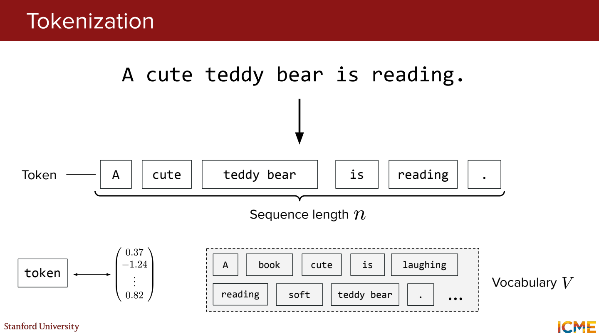

`reading`을 예로 보면,

- 단어 단위 → `reading` 하나. 읽기는 편한데 모르는 단어가 나오면?
- 문자 단위 → `r / e / a / d / i / n / g`. 조각은 적은 종류로 만들 수 있지만 문장 길이가 길어짐.
- 서브워드 단위 → 예를 들어 `read / ##ing`. 자주 나오는 조각을 묶어 쓰는 방식.

위 분할은 개념 예시. 실제 분할과 `##` 같은 표시는 사용하는 토크나이저에 따라 다름.

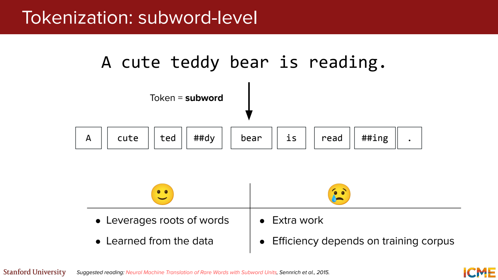

**그럼 왜 그냥 띄어쓰기로 나누면 안 될까?**

`먹다 / 먹었다 / 먹었지만`을 전부 다른 단어로 넣으면 사전이 계속 커짐.
자주 쓰이는 부분을 공유하면 이런 변형을 더 작은 조각으로 표현 가능.
한국어에서는 띄어쓰기 단위와 의미를 이루는 조각도 잘 맞지 않음.

그다음 각 토큰을 사전의 정수 ID로 바꿈.

```text
민수는 / 사과를 / 먹었다  →  1 / 2 / 3
```

여기서는 세 단위를 각각 한 토큰으로 가정. ID도 임의로 붙인 것.
`3`이 `1`보다 의미가 크다는 뜻은 아님. 그냥 사전에서 구별할 번호.

특수 토큰도 같이 기억.

| 토큰 | 쓰는 이유 | 예시 |
| --- | --- | --- |
| BOS | 시작 표시 | `[BOS] 민수는 ...` |
| EOS | 끝 표시 | `... 먹었다 [EOS]` |
| PAD | 길이를 맞추는 빈자리 | 짧은 문장 뒤에 채움 |
| UNK | 사전에 없는 입력 표시 | 해당 토크나이저가 표현하지 못하는 조각 |

실제 이름과 사용 여부는 모델마다 다름.

## 2 ID에서 임베딩 벡터로

ID만으로는 단어 사이 관계를 표현하기 어려움.
ID에 해당하는 행을 임베딩 테이블에서 꺼내 숫자 벡터로 사용.

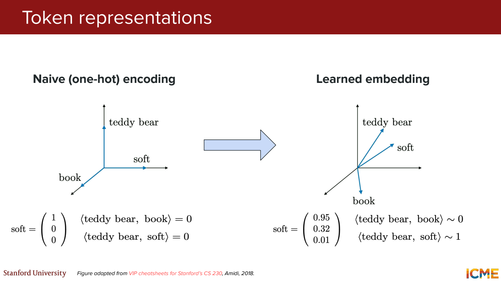

이걸 작은 조회 예제로 옮기면,

```text
사과를의 ID = 2
임베딩 테이블 E의 2번 행 = [0.2, -0.1, 0.7, 0.4]
→ 이 행을 사과를의 입력 벡터로 사용
```

그럼 같은 토큰이 두 번 나오면?

두 위치 모두 같은 행을 꺼냄. `사과를`의 ID가 둘 다 2라면 둘 다 E의 2번 행.
이 행을 바꾸고 다시 조회하면 두 위치의 벡터가 같이 바뀜.
그 뒤에 위치 정보와 문맥이 반영되면서 각 위치의 표현은 달라질 수 있음.

- 어휘 크기 `V_vocab` → 사전에 있는 토큰 종류 수
- 임베딩 차원 `d_model` → 토큰 하나를 표현하는 벡터 길이
- 테이블 모양 → `V_vocab × d_model`

여기서 어휘 크기와 뒤에 나오는 attention의 Value를 혼동하지 않으려고 `V_vocab`으로 적음.

One-hot으로도 ID를 나타낼 수 있음.
어휘가 4개라면 ID 2는 `[0, 0, 1, 0]`.
이 벡터에 임베딩 테이블을 곱해도 같은 2번 행이 나옴.
실제로는 굳이 큰 one-hot 벡터를 만들지 않고 행을 바로 조회할 수 있음.

**그럼 벡터의 첫 번째 숫자는 ‘사람’, 두 번째는 ‘음식’ 같은 뜻일까?**

보통 그렇게 정해두지 않음. 학습하면서 여러 차원에 특징이 나뉘어 담기는 것.
숫자 하나에 뜻을 붙이기보다 벡터 전체로 생각하기.

## 3 Word2vec과 RNN을 거쳐 Attention으로

Word2vec은 주변 단어를 맞히는 등의 과제를 통해 단어 벡터를 학습.

- CBOW → 주변 단어로 가운데 단어 예측
  - `민수는 [ ? ] 먹었다`에서 빈자리를 맞히는 식
- Skip-gram → 가운데 단어로 주변 단어 예측
  - `사과를`로 주변의 `민수는`, `먹었다` 등을 맞히는 식

여기서 예측은 정답을 확정한다는 뜻이 아니라 후보의 확률을 계산한다는 뜻.

일반적인 Word2vec은 같은 단어에 같은 벡터를 줌.
`먹는 배`와 `타는 배`의 ‘배’를 같은 어휘 항목으로 두었다면 기본 벡터는 같음.
문맥에 따라 달라지는 표현이 필요해지는 지점.

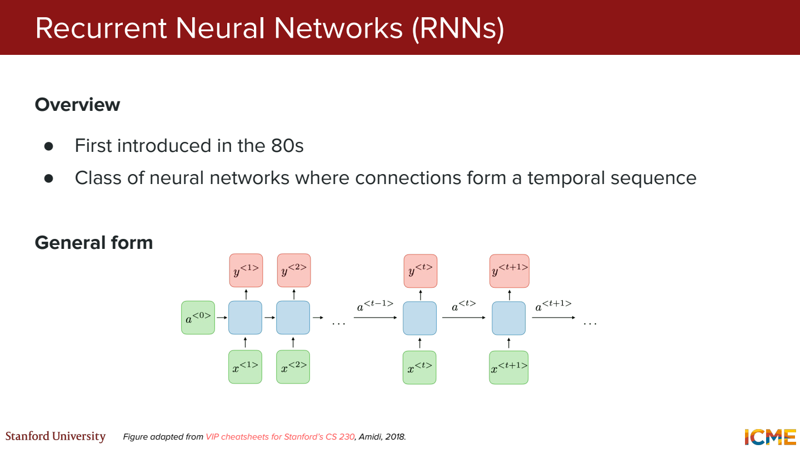

RNN은 앞에서 계산한 상태를 다음 위치로 넘김.

`민수는의 상태 → 사과를의 상태 → 먹었다의 상태`

순서는 반영되지만 뒤의 상태를 계산하려면 앞의 계산이 필요.
먼 정보를 전달하는 경로도 길어짐.
LSTM은 무엇을 기억하고 지울지 조절하는 gate와 별도의 cell state를 둬서 이 문제를 완화.
그래도 순차적으로 상태를 전달하는 구조는 남음.

Attention은 현재 위치가 필요한 다른 위치의 정보를 가중합으로 가져오는 방식.
번역에서 긴 입력을 하나의 상태에만 담기 어려웠던 문제와 연결됨.
원래 Transformer는 RNN 없이 attention과 FFN 등을 사용하도록 구성됨.

**그럼 Attention이면 긴 문장의 문제가 전부 해결될까?**

정보를 직접 참고하는 경로는 짧아짐. 대신 기본 self-attention은 토큰 쌍의 점수를 계산.
길이 100이면 10,000개, 길이 1,000이면 1,000,000개의 점수.
문장이 10배 길어지면 이 부분은 100배가 됨.

## 4 Q K V로 참고할 정보 계산하기

`민수는 사과를 먹었다`에서 지금은 `먹었다` 위치만 보기.
“무엇을 먹었지?”라고 찾는 상황으로 비유.

| 구분 | 하는 일 | 예시로 생각하면 |
| --- | --- | --- |
| Query | 현재 위치에서 찾는 정보 | `먹었다` 쪽의 “무엇을 먹었지?” |
| Key | Query와 비교할 특징 | `사과를` 쪽에서 비교에 쓰는 특징 |
| Value | 가중합에 들어갈 정보 | `사과를` 쪽에서 가져올 내용 |

실제 Q는 문장으로 된 질문이 아니라 숫자 벡터.
각 토큰에 Q, K, V가 생기고, `먹었다`만 Q를 가지는 건 아님.

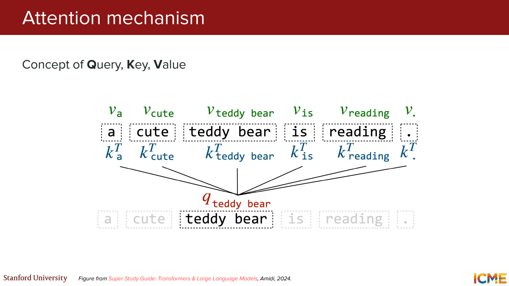

같은 입력 X에 서로 다른 학습 행렬을 곱함.

```text
Q = XW_Q
K = XW_K
V = XW_V
```

`W_Q`, `W_K`, `W_V`가 다르니 출발점이 같아도 결과는 달라짐.
X는 현재 층으로 들어오는 토큰 벡터들을 모은 것.
첫 입력 이후의 층에서는 앞선 층이 계산한 표현이 들어옴.

### 작은 숫자로 계산

`q_먹었다 = [1, 0]`으로 놓기.

| 토큰 | K | V | q와 K의 내적 |
| --- | --- | --- | --- |
| 민수는 | [0, 1] | [1, 0] | 0 |
| 사과를 | [2, 0] | [0, 2] | 2 |
| 먹었다 | [1, 1] | [1, 1] | 1 |

`사과를`의 내적은 `1×2 + 0×0 = 2`.
그다음 키 차원 `d_k = 2`의 제곱근으로 나누고 softmax.

```text
내적             [0, 2, 1]
sqrt(2)로 나누기 [0, 1.4142, 0.7071]
softmax          [0.1400, 0.5760, 0.2840]
```

Softmax는 `exp(각 점수) / [모든 exp(점수)의 합]`.
큰 점수에 더 큰 비율을 주고, 비율 전체의 합을 1로 만듦.

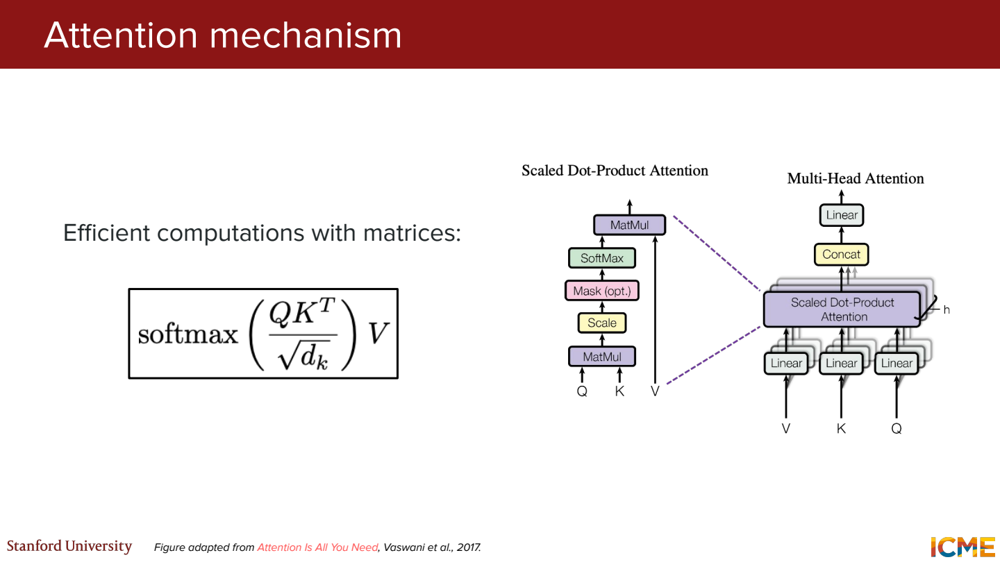

마지막에는 그 비율로 V들을 섞음.

```text
출력 ≈ 0.140 × [1, 0] + 0.576 × [0, 2] + 0.284 × [1, 1]
     = [0.424, 1.436]
```

`사과를` 하나를 뽑는 연산이 아니라 세 V의 가중합.
이 출력은 `먹었다` 위치에서 계산한 벡터. 다음 토큰 확률과는 구분.

그럼 같은 단어가 다른 문맥에서 달라지는 건 어디서일까?

`먹는 배`와 `타는 배`에서 ‘배’가 같은 토큰 ID라면 임베딩 조회값은 같음.
Attention에서는 참고하는 주변 토큰이 달라져 가중치와 가져오는 V가 달라질 수 있음.
그래서 출발 벡터는 같아도 attention을 거친 표현은 달라질 수 있는 것.

이 과정을 모든 Q에 대해 한꺼번에 쓰면,

$$
\operatorname{Attention}(Q,K,V)
= \operatorname{softmax}\left(\frac{QK^\top}{\sqrt{d_k}}\right)V
$$

토큰 3개, Q와 K 차원 2, V 차원 2라면,

```text
Q       (3, 2)
Kᵀ      (2, 3)
QKᵀ     (3, 3)  ← 각 위치가 세 위치를 얼마나 참고할지
출력    (3, 2)  ← (3, 3) 가중치와 (3, 2) V의 행렬곱
```

Softmax는 각 행 안에서 적용. 한 Q가 참고할 K들에 대한 비율을 만드는 것.

**그럼 K와 V는 왜 나눌까?**

검색할 책을 고르는 특징과 실제로 읽을 내용을 다르게 만들 수 있게 한 것.
그럼 Q, K는 두고 V만 바꾸면?

위 예시에서 `사과를`의 V만 `[0, 2]`에서 `[0, 4]`로 바꿔보기.
가중치는 그대로인데 출력은 약 `[0.424, 1.436]`에서 `[0.424, 2.588]`로 바뀜.
어디를 얼마나 참고할지는 Q와 K가, 실제 섞이는 내용은 V가 정한다는 뜻.
더 긴 계산은 [Q K V 보충 노트](01-attention-qkv.md)에 적어둠.

**왜 차원의 제곱근으로 나눌까?**

Q와 K의 성분이 각각 평균 0, 분산 1이고 서로 독립이라는 단순한 가정을 두면,
내적의 분산은 `d_k`, 표준편차는 `sqrt(d_k)`.
이 크기를 나눠 점수 규모를 조절. Softmax가 너무 한쪽에 몰리는 것을 줄이려는 것.
실제 학습된 Q, K가 항상 이 가정을 정확히 만족한다는 뜻은 아님.

## 5 위치 정보와 여러 개의 Head

### 단어만 알아서는 순서가 빠짐

`민수가 영희를 도왔다`와 `영희가 민수를 도왔다`는 누가 누구를 도왔는지가 다름.
각 토큰의 벡터에 문장 속 위치 정보도 필요.

위치 정보와 마스크가 없는 self-attention에서 입력 순서를 바꾸면 출력도 같은 순서로 재배열됨.
연산 자체만으로 어느 토큰이 첫 번째인지 따로 알려주지는 못함.

원래 Transformer에서는 토큰 임베딩에 위치 벡터를 더함.

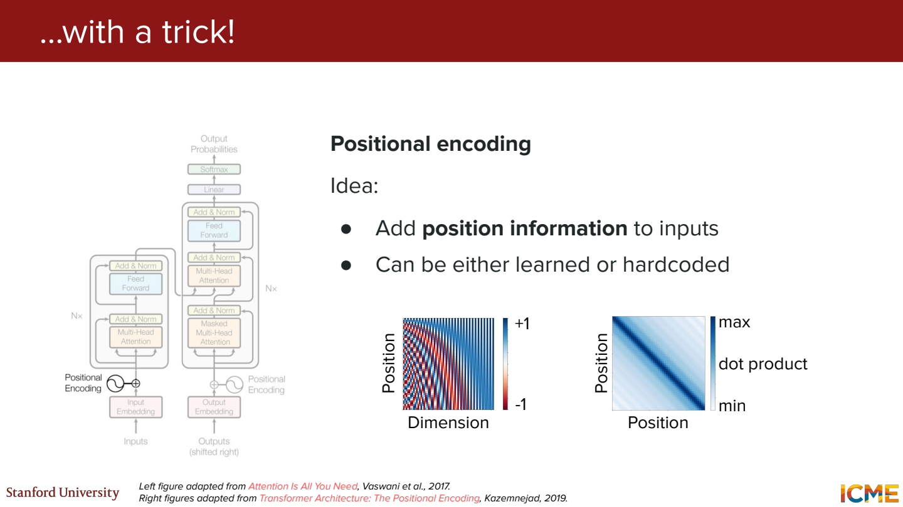

벡터를 이어 붙여 길이를 늘리는 게 아니라 같은 차원끼리 더함.
작은 예시로 `[0.2, -0.1, 0.7, 0.4] + [0, 1, 0, 1] = [0.2, 0.9, 0.7, 1.4]`.
길이 4가 그대로 유지됨.
원래 논문의 sin/cos 방식 외에 학습하는 위치 표현도 있음.

**그럼 더하면 단어 정보가 사라지는 건 아닐까?**

별도 칸에 보관하는 방식은 아님. 합쳐진 표현을 입력으로 모델이 학습.
단어와 위치를 어떻게 구별해 활용하는지는 다음에 작은 예제로 더 확인할 부분.

### 여러 Head로 나눠 보기

한 가지 변환으로만 Q, K, V를 만들지 않고, head마다 다른 변환을 사용.
각 head가 계산한 출력을 연결한 다음 `W_O`로 변환.

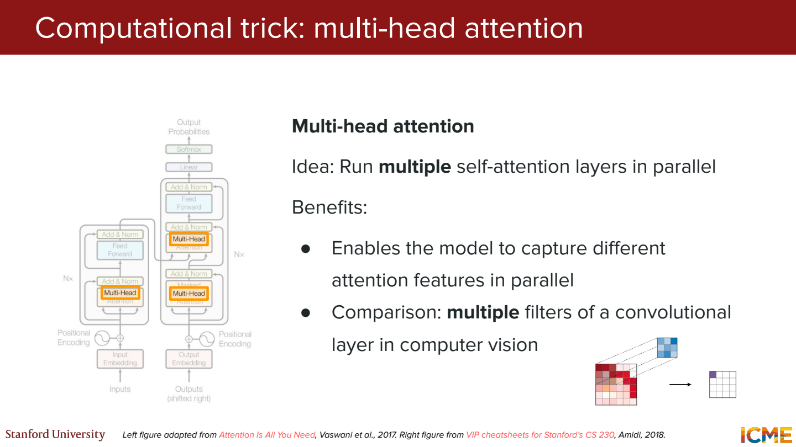

예를 들어 `d_model = 8`, head가 2개이고 각 head의 출력 차원이 4라면,

`4차원 출력 + 4차원 출력 → 연결해서 8차원 → W_O`

여기서 `+`는 성분끼리 더하기가 아니라 연결한다는 뜻.
‘첫 번째 head는 주어, 두 번째는 목적어’처럼 역할을 미리 정하는 것은 아님.

## 6 Encoder와 Decoder를 연결하면

1강에서 다루는 기본 구조는 번역용 Encoder–Decoder Transformer.

- Encoder → 입력 문장을 읽고 각 위치의 문맥 벡터 계산
- Decoder → Encoder 출력과 지금까지 만든 번역을 참고해 다음 토큰 예측

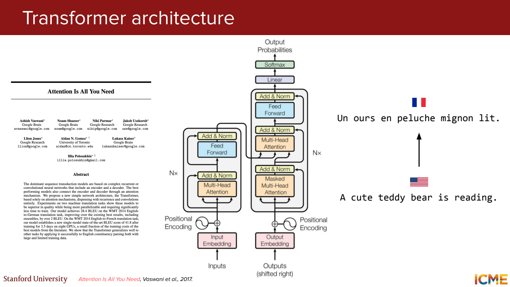

번역 예시로 보면 입력 문장 `A bear is reading.`을 Encoder에 넣음.
Decoder는 `[BOS]`부터 시작해서 `곰이`, `읽고`, `있다` 같은 번역 토큰을 차례로 생성한다고 생각.
번역 토큰 분할은 설명용 가정.

Decoder 안에는 attention이 두 종류.

| 구분 | Q는 어디서 | K와 V는 어디서 |
| --- | --- | --- |
| Masked self-attention | Decoder 쪽 입력 표현 | 같은 Decoder 쪽 입력 표현 |
| Cross-attention | Decoder의 앞선 sublayer 출력 | Encoder의 최종 출력 |

**그럼 Self와 Cross를 나누는 기준은?**

같은 시퀀스의 표현끼리 참고하면 Self.
Decoder가 다른 시퀀스인 원문의 표현을 참고하면 Cross.

GPT 계열의 decoder-only 모델은 이 전체 번역 구조와 다름.
보통 별도의 Encoder와 그 출력을 받는 cross-attention 없이, 앞의 토큰들을 참고해서 생성.

## 7 Decoder에서 미래를 가리는 이유

학습할 때는 정답 문장이 이미 있으니 모든 위치의 입력을 한 번에 넣을 수 있음.
그렇다고 뒤의 정답까지 참고하면 다음 토큰을 예측하는 연습이 안 됨.

```text
입력:  [BOS]  민수는  사과를  먹었다
정답:   민수는  사과를  먹었다  [EOS]
```

그럼 mask를 없애면 어느 위치에서 정답이 보일까?

`[BOS]` 위치에서는 뒤의 `민수는`, `민수는` 위치에서는 뒤의 `사과를`이 보임.
`사과를` 위치도 맞혀야 할 `먹었다`를 입력에서 바로 참고할 수 있음.
이러면 앞의 내용으로 예측하는 대신 뒤의 정답을 가져오는 식으로 학습할 수 있음.

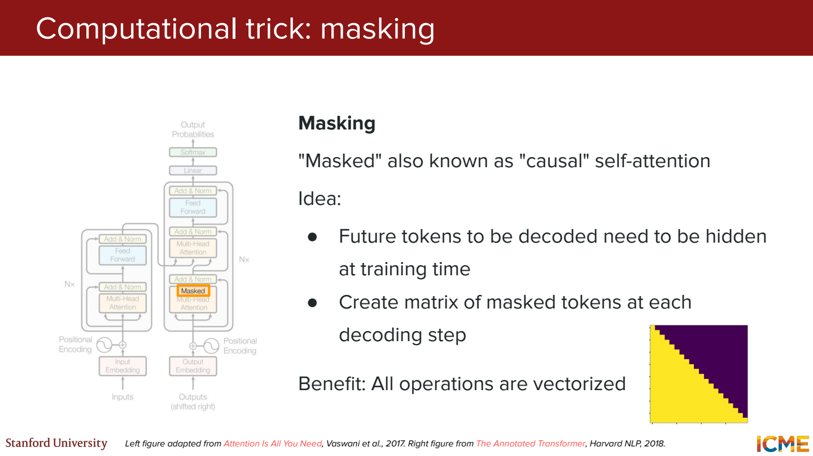

그래서 뒤쪽 위치의 attention 점수에 `-∞`를 넣고 softmax.
그 위치의 가중치는 0이 됨. 자기 위치와 앞쪽 위치는 참고 가능.

PAD를 가리는 padding mask는 목적이 다름.
미래를 가리는 게 아니라 길이 맞추기용 빈자리를 참고하지 않게 하는 것.

**그럼 학습은 한꺼번에 하는데 생성은 왜 순서대로 할까?**

학습에서는 정답 문장의 앞 토큰들이 이미 주어짐.
생성에서는 다음 토큰이 아직 없으니 하나를 정한 뒤 뒤에 붙여서 다시 계산해야 함.

## 8 Attention 옆에 붙어 있는 것들

Attention 뒤에는 FFN, residual connection, layer normalization도 붙음.

### FFN

토큰 위치마다 적용하는 작은 신경망.
Attention이 여러 위치의 정보를 섞었다면, FFN은 각 위치의 특징을 비선형으로 변환.
같은 층에서는 위치마다 같은 가중치를 사용.

원래 Transformer의 형태는 `Linear → ReLU → Linear`.
예를 들어 토큰당 4차원에서 16차원으로 넓혔다가 다시 4차원으로 줄일 수 있음.

### Residual connection

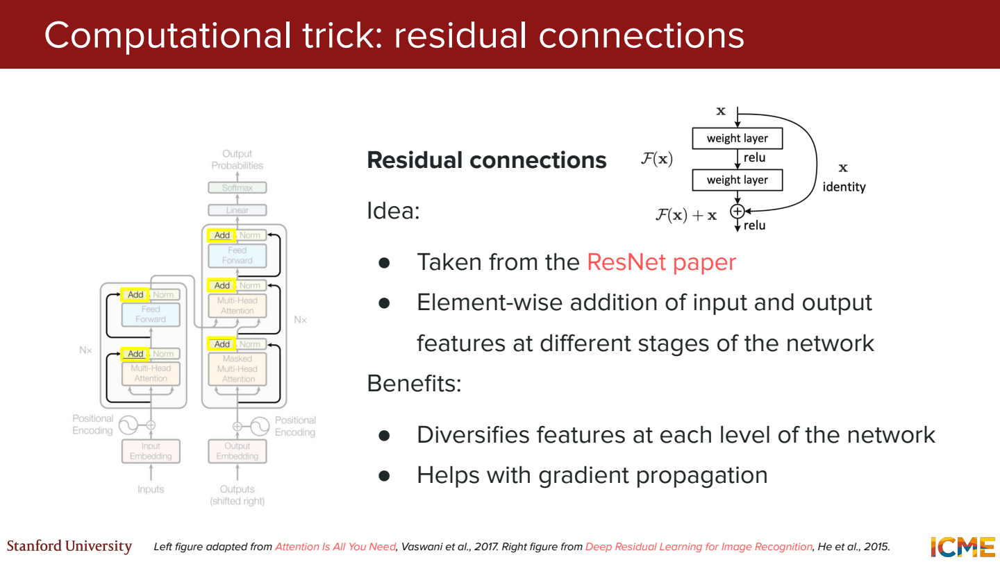

입력 x에 층이 계산한 결과 F(x)를 더함.

```text
x       = [1, 2]
F(x)    = [0.3, -0.5]
x+F(x)  = [1.3, 1.5]
```

앞의 표현을 다음으로 전달하는 경로를 두고, 깊은 모델에서 기울기가 흐르는 데도 도움.

### Layer normalization

토큰 하나의 특징 차원들을 기준으로 평균과 분산을 계산해 정규화.
예를 들어 `[1, 3]`이면 평균 2, 분산 1.
작은 epsilon과 학습되는 크기·이동 파라미터를 잠깐 빼고 보면 `[-1, 1]`이 됨.

여러 토큰의 값을 한데 평균 내는 계산으로 이해하면 안 됨.
원래 논문에서는 `LayerNorm(x + F(x))` 순서.
모든 Transformer가 이 순서를 그대로 쓰는 것은 아님.

### Dropout과 Label smoothing

- Dropout → 학습 중 일부 활성값을 확률적으로 0으로 만드는 방식. 보통 추론 시에는 끔.
- Label smoothing → 정답 분포가 한 곳에만 1로 몰리지 않게 조금 완화.

클래스 4개, smoothing 0.1을 균등분포와 섞는 정의라면,

`[1, 0, 0, 0] → [0.925, 0.025, 0.025, 0.025]`

항상 이 숫자 규칙으로 구현되는 건 아님. 정답 외 클래스에만 나누는 정의도 있으니 구현에서 확인.

## 9 마지막 벡터가 어떻게 단어가 되는지

Decoder를 통과한 마지막 위치의 벡터는 여전히 길이 `d_model`짜리 숫자 묶음.
출력 Linear가 이것을 어휘 개수만큼의 점수, 즉 logits로 바꿈.
Softmax를 거치면 어휘 전체의 확률 분포가 됨.

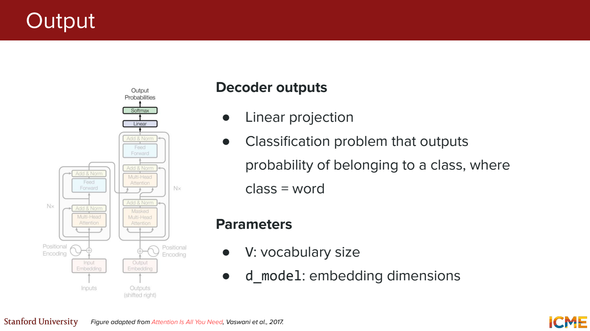

`[BOS] 민수는 사과를`까지 들어왔다고 가정.
예를 들어 다음 토큰 확률이 `먹었다 65%, 샀다 25%, 나머지 합계 10%`일 수 있음.
이 확률은 모델에서 측정한 값이 아니라 설명용.

가장 높은 토큰을 고르는 방식이라면 `먹었다`를 붙임.
그다음에는 `[BOS] 민수는 사과를 먹었다`를 바탕으로 다시 다음 토큰 예측.
확률에서 샘플링하는 방법도 있고, EOS나 길이 제한 등의 종료 조건에서 멈춤.

**Attention에서 쓴 softmax와 여기의 softmax는 뭐가 다를까?**

- Attention softmax → 문장 안에서 참고할 **위치들**에 대한 비율
- 출력 softmax → 다음에 나올 **어휘들**에 대한 확률

둘 다 합이 1이지만, 무엇에 대해 합을 내는지가 다름.

## 10 한 문장으로 다시 연결

`[BOS] 민수는 사과를`에서 다음 토큰을 예측하는 decoder-only 예시.

1. 토큰을 ID로 바꿈. 여기서는 세 토큰이라고 가정.
2. 각 ID로 임베딩 벡터를 꺼냄. `d_model=4`라면 모양은 `(3, 4)`.
3. 위치 정보를 반영.
4. 각 층에서 Q, K, V를 만들고 causal mask를 적용해 attention 계산.
5. 여러 head의 출력을 합치고, residual·정규화·FFN 등을 통과.
6. 마지막 위치의 벡터를 어휘 크기만큼의 logits로 바꿈.
7. Softmax 뒤에 토큰 하나를 선택하고 입력 뒤에 붙임.

여기서 토큰이 계속 새 단어로 바뀌는 게 아니라, 층을 거치며 **각 위치의 벡터 표현**이 바뀌는 것.
마지막 출력층에서 어휘 후보에 대한 점수가 나옴.

## 참고자료

- [Stanford CME 295 — Lecture 1](https://cme295.stanford.edu/)
- [Attention Is All You Need](https://arxiv.org/html/1706.03762v7)
