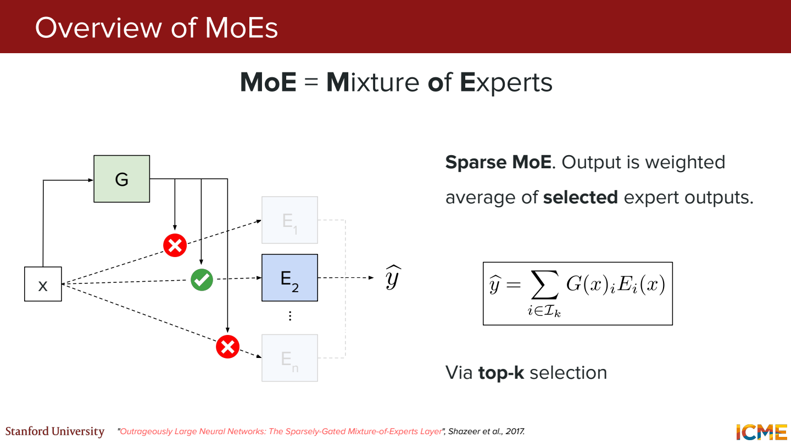
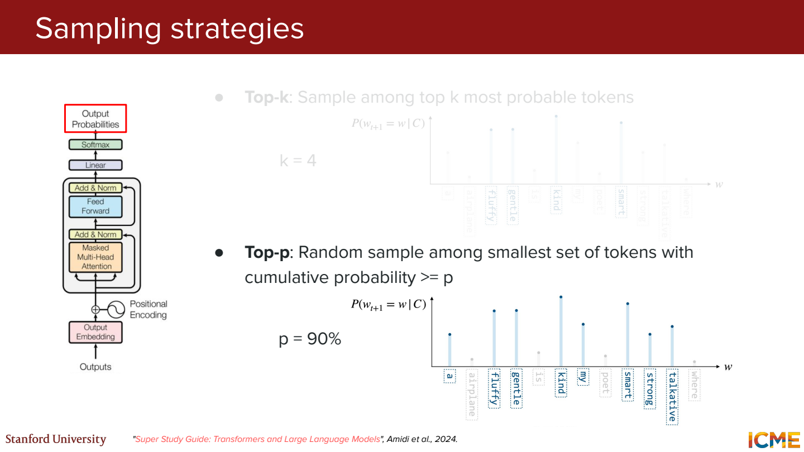
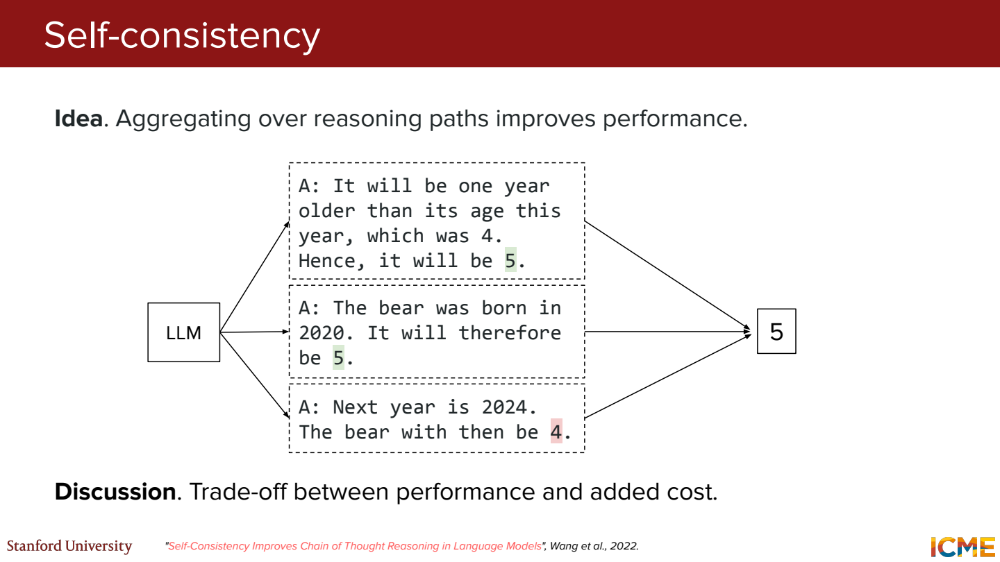
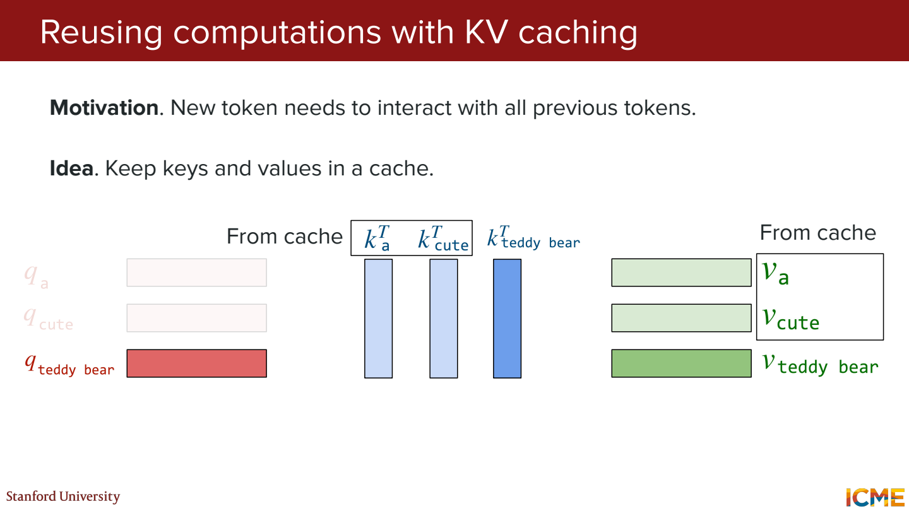
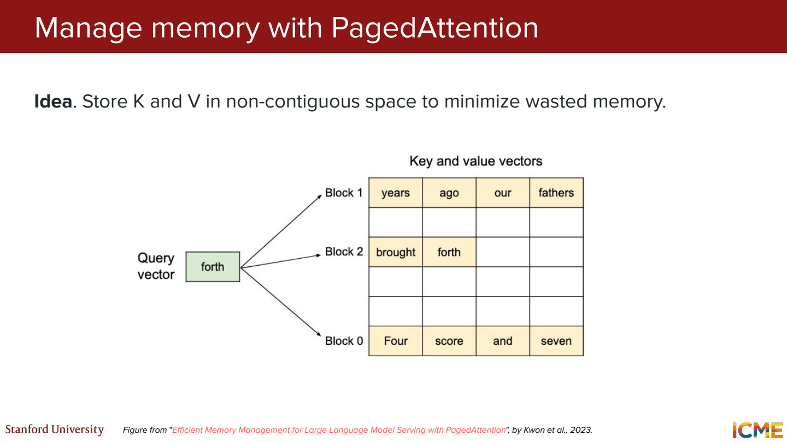
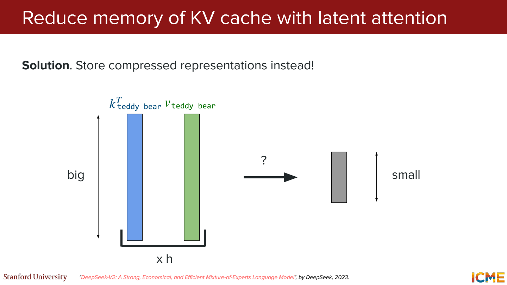
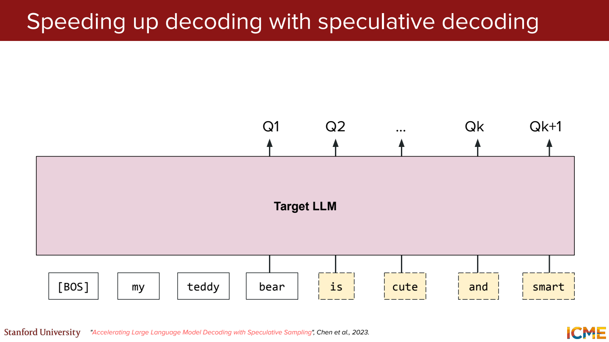
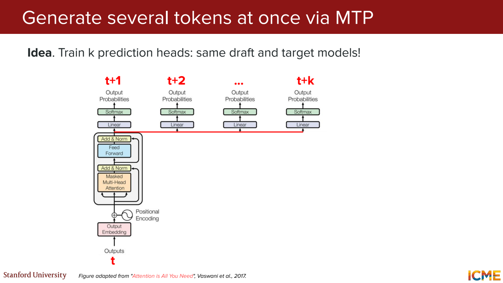

# 3단원 토큰을 고르고 생성 비용을 줄이기

확률을 계산하는 것과 실제 토큰을 선택하는 것은 별도 단계.
선택한 토큰을 붙인 뒤에는 다음 토큰 계산을 다시 해야 함.

## LLM에서 모든 파라미터가 매번 쓰이는지



Dense 모델은 해당 층의 파라미터를 모두 사용해 계산.
Sparse MoE는 router가 선택한 expert들을 사용.
전체 파라미터와 토큰 하나가 거치는 활성 파라미터를 나눠서 봐야 함.

예를 들어 expert가 8개이고 토큰마다 2개를 선택한다고 가정.
Expert 부분의 계산은 일부만 하지만 나머지 expert도 메모리나 다른 장치에 있어야 함.
Router가 한두 expert만 고르면 부하와 학습이 몰리는 문제가 생김.

그럼 expert를 분야별 담당자로 생각하면 될까?

편한 비유지만 실제 역할은 학습 결과.
같은 단어도 층과 문맥에 따라 다른 expert로 갈 수 있음.

## Greedy와 Beam search

Greedy는 현재 확률이 가장 높은 토큰 하나를 선택.
그 순간의 1등이 문장 전체 확률까지 가장 높게 만드는 것은 아님.

```text
첫 토큰 A의 확률 0.6, 그다음 최고 확률 후보 x가 0.4 → Ax 확률 0.24
첫 토큰 B의 확률 0.4, 그다음 y의 조건부 확률 0.9 → By 확률 0.36
```

이 예제에서 A 다음의 나머지 두 후보 확률은 각각 0.3이라고 가정.
Greedy는 A로 시작하므로 By를 놓침.
Beam search는 이런 후보 경로를 여러 개 유지하며 진행.
각 경로의 토큰 확률을 곱하거나 log 확률을 합쳐 비교.

그럼 beam을 늘리면 무조건 더 좋은 답인가?

모델이 높은 확률을 주는 경로를 더 탐색하는 것이지, 사실성과 유용성을 직접 보장하지는 않음.
긴 문장은 확률을 여러 번 곱해서 작아지기 쉬워 길이 처리도 중요.

## Sampling에서 후보를 잘라내기



다음 후보가 `[먹었다 0.50, 샀다 0.30, 버렸다 0.15, 기타 0.05]`라고 가정.

Top-k=2는 두 후보만 남김.
남은 확률 합이 0.8이므로 `[0.625, 0.375]`로 나눠 샘플링.
Top-p=0.9는 누적 확률 0.95에 도달하는 세 번째 후보까지 포함.

0.9를 넘어가게 만든 세 번째 후보도 포함한다는 점.
항상 확률을 정확히 0.9만 남기는 방식이 아님.

Temperature를 T라고 하면 `softmax(logits / T)`.
예를 들어 logits `[2, 1, 0]`은 T=1에서 약 `[0.665, 0.245, 0.090]`.
T=0.5에서는 약 `[0.867, 0.117, 0.016]`. 가장 큰 후보로 더 몰림.

형식이 중요한 출력은 grammar에 맞지 않는 후보를 가리는 guided decoding도 가능.
형식 제한과 답의 의미가 맞는지는 별도로 보기.

## 여러 답을 만들면 추론이 좋아질까



ICL은 프롬프트의 예시를 이용. CoT는 중간 추론을 생성하는 방식.
Self-consistency는 여러 경로에서 나온 최종 답을 모음.

`12, 12, 10, 12, 10`이면 다수결 답은 12.
한 번의 생성이 실수해도 보완할 가능성이 있지만 토큰과 지연시간이 늘어남.
틀린 공식을 공유하면 여러 번 해도 같은 오답이 나올 수 있음.

## 이전 토큰의 K와 V는 재사용



`민수는 사과를` 다음에 `먹었다`를 붙였다고 생각.
Causal 구조에서는 이전 위치가 새로 붙은 미래 토큰을 보지 않음.
따라서 이전 위치의 K, V를 저장해뒀다가 새 토큰 계산에서 재사용 가능.

그럼 Q도 전부 저장해야 할까?

다음 출력에서는 새 위치의 Q가 앞의 K들과 비교하면 됨.
이전 위치의 attention 출력을 다시 만들 필요가 없어 보통 KV cache라고 부름.

KV 저장량을 거칠게 쓰면,

```text
2 × 층 수 × 토큰 수 × KV head 수 × head 차원 × 값당 byte
```

2는 K와 V 두 종류. Batch 1, 4층, 100토큰, KV head 2개, 차원 8, 값당 2byte라면 25,600byte.
배치와 문맥 길이가 커지면 cache도 같이 커짐.
GQA는 여기서 KV head 수를 줄이는 방법과 연결.

## 저장 공간을 쓰는 방법도 바꿀 수 있음



요청마다 최대 길이만큼 큰 연속 공간을 예약하면 실제 사용하지 않는 부분이 많아질 수 있음.
PagedAttention은 작은 block들로 KV를 나눠 저장하고 논리적 순서와 물리적 위치를 연결.

예를 들어 한 요청에 10토큰이 필요하고 block 크기가 4라면 3개 block을 사용.
토큰 100개분을 처음부터 잡아두는 것보다 낭비를 줄일 수 있음.
마지막 block에는 남는 칸이 생길 수 있으니 낭비가 완전히 0은 아님.



Latent attention은 저장할 표현 자체를 더 작은 잠재 벡터로 만드는 접근.
메모리 배치를 바꾸는 PagedAttention과는 다른 축의 최적화.
압축에 맞춘 모델 구조와 학습이 필요하므로 기존 모델의 KV를 임의로 줄이면 되는 건 아님.

## 작은 모델이 초안을 쓰고 큰 모델이 확인



Draft 모델이 `민수는 / 사과를 / 먹었다`처럼 여러 토큰을 먼저 제안.
Target 모델이 이 후보들을 한 번의 병렬 계산으로 검증할 수 있음.
일부가 받아들여지면 큰 모델을 토큰마다 호출하는 횟수를 줄일 수 있음.

그럼 작은 모델의 답을 그냥 가져오는 건가?

아님. 정확한 speculative sampling은 수락·거절과 보정 분포를 사용해 target의 분포를 유지하도록 구성.
단순히 문장이 괜찮아 보인다고 통째로 통과시키는 방식과 구분.
Draft가 너무 자주 틀리면 검증 비용만 늘어 속도 이득이 줄어듦.



MTP는 여러 미래 위치를 예측하도록 학습하는 방식.
한 단계 뒤뿐 아니라 두세 단계 뒤의 학습 신호도 사용.
이 예측 head들을 draft로 활용할 수도 있지만, 여러 토큰의 예측이 곧 최종 채택을 뜻하지는 않음.

## 참고자료

- [Stanford CME 295](https://cme295.stanford.edu/)
