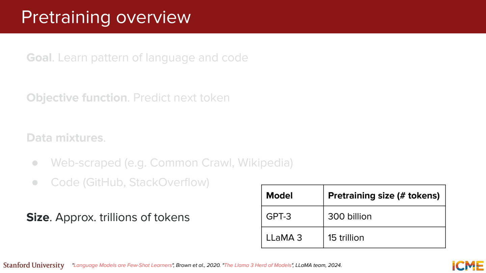
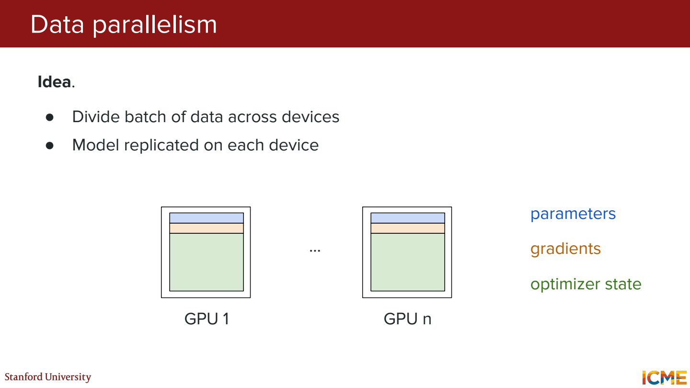
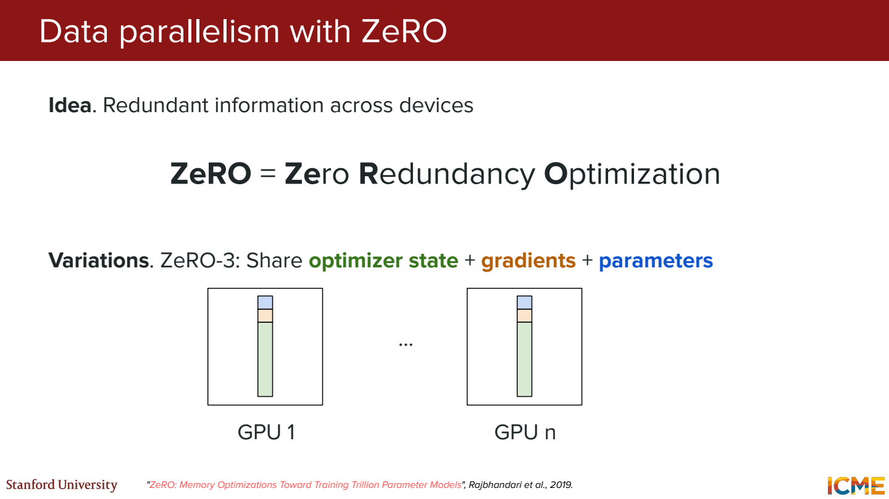
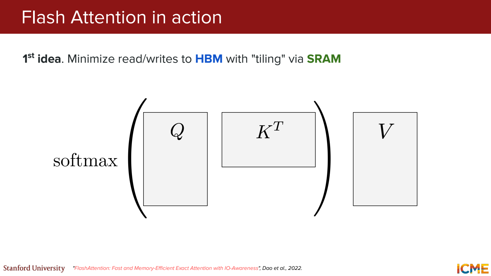
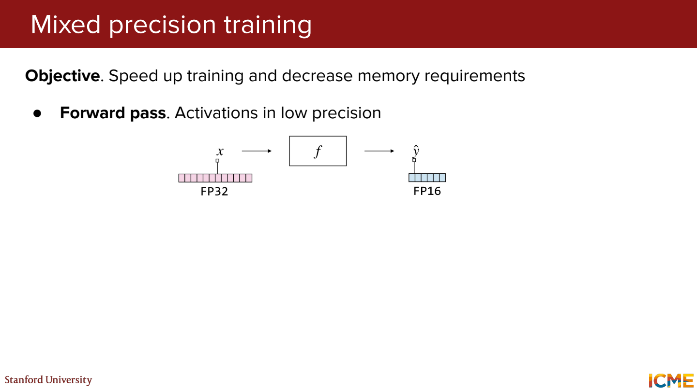
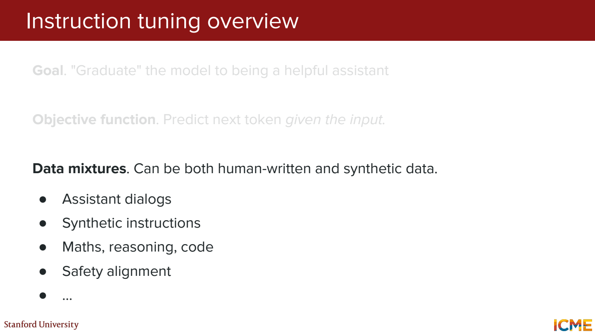
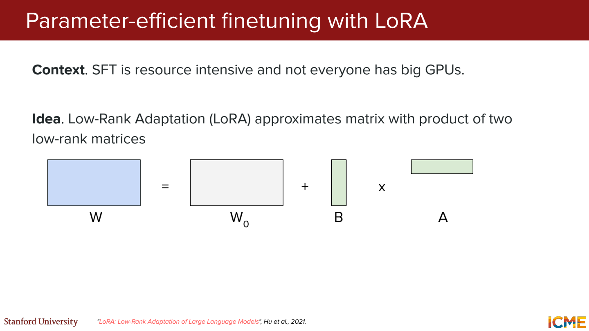
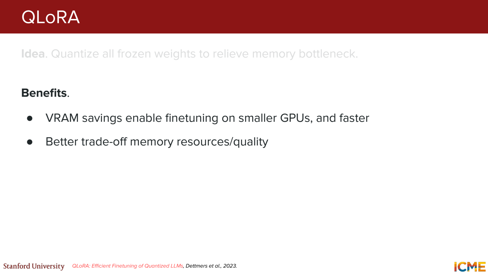

# 4단원 사전학습과 튜닝 그리고 LoRA

언어의 패턴을 배우는 단계와, 원하는 답변 방식을 배우는 단계를 나눠 보기.
학습 방법만큼 메모리에 무엇을 저장하는지도 중요.

## Pretraining에서 맞히는 것



문서나 코드에서 다음 토큰을 맞히면서 파라미터를 학습.
`민수는 사과를` 다음의 정답이 `먹었다`라면 그 토큰의 확률을 높이는 방향.

정답 토큰 확률이 0.2일 때 loss는 `-log(0.2) ≈ 1.609`.
0.8이면 `-log(0.8) ≈ 0.223`. 정답에 높은 확률을 줄수록 작아짐.

그럼 정답 토큰을 한 번 뽑았으면 학습이 잘된 건가?

샘플링에서 우연히 정답이 나온 것과 정답에 높은 확률을 준 것은 다름.
학습에서는 선택 결과 하나보다 예측 분포에 대한 loss를 사용.
여러 위치의 loss를 평균내고 역전파로 가중치를 업데이트.

데이터도 단순히 많기만 하면 되는 것은 아님.
중복 문서가 너무 많거나 품질이 낮으면 같은 패턴을 반복해서 배우게 됨.
검증·평가 데이터가 학습 자료에 섞이면 성능도 과대평가될 수 있음.

## 모델이 들어간다고 학습도 되는 건 아님

가중치 외에 gradient, optimizer state, 중간 activation을 저장해야 함.
Adam 계열은 파라미터마다 과거 gradient의 통계도 유지.

파라미터 10억 개를 2byte씩 저장하면 가중치만 약 2GB.
여기에 학습용 상태가 추가되므로 ‘2GB 모델이면 2GB GPU에서 학습’처럼 계산하면 부족.
Activation은 배치 크기와 시퀀스 길이의 영향도 받음.

## 여러 GPU로 나눠 학습



Data parallelism은 GPU마다 모델을 두고 데이터를 나눔.
배치 64개를 GPU 4개가 16개씩 처리한 뒤 gradient를 모아 업데이트하는 식.
각 GPU에 모델이 복제되므로 모델 자체가 너무 크면 이것만으로는 해결되지 않음.



ZeRO는 중복 저장된 학습 상태를 나눠 보관.
단계에 따라 optimizer state, gradient, parameter까지 분산.
메모리는 줄지만 필요한 데이터를 모으는 통신도 생김.

Tensor parallelism은 큰 행렬 연산을 여러 GPU에 나누는 것.
Pipeline parallelism은 층들을 나눠 앞 GPU의 결과를 뒤 GPU로 전달.
‘데이터를 나눈다’와 ‘모델 계산을 나눈다’를 구분하기.

## FlashAttention은 계산 결과보다 메모리 이동을 바꿈



기본 attention은 QK 점수와 softmax 결과가 토큰 수의 제곱 크기.
이 큰 중간 행렬을 느린 메모리에 쓰고 다시 읽는 비용이 큼.

FlashAttention은 Q, K, V를 block 단위로 가져와 계산하고 softmax 통계를 누적.
전체 attention 행렬을 그대로 메모리에 저장하지 않아도 출력을 계산할 수 있음.

그럼 일부 토큰을 생략하는 근사인가?

기본 FlashAttention은 dense attention과 같은 수학적 연산을 계산하는 방법.
연산 순서에 따른 부동소수점 차이는 있을 수 있지만, window 밖 토큰을 버리는 sparse attention과 다름.
주로 메모리 왕복과 중간 저장을 줄인다는 점을 기억.



Mixed precision은 모든 값을 한 가지 정밀도로 처리하지 않는 방식.
많은 행렬 연산은 낮은 정밀도로 하고, 민감한 누적이나 상태는 더 높은 정밀도를 사용하는 식.
메모리와 속도를 아낄 수 있지만 overflow·underflow와 수치 안정성을 고려해야 함.

## SFT는 답변 방식까지 학습



Pretraining만 된 모델은 질문에 답하기보다 질문이 있는 문서를 이어 쓸 수도 있음.
SFT에서는 지시와 적절한 답변의 쌍을 보여줌.

```text
입력: 다음 문장을 한 줄로 요약해줘. {문서}
목표 답변: {좋은 한 줄 요약}
```

그럼 loss가 완전히 다른 종류인가?

여전히 목표 답변의 다음 토큰을 맞히는 cross-entropy를 사용할 수 있음.
차이는 데이터 형식과 어떤 토큰에 loss를 주는지.
프롬프트 토큰은 loss에서 제외하고 답변 토큰만 학습하는 설정도 흔함.

평가에서는 학습에 쓰지 않은 지시로 일반화되는지 확인.
예제 답변을 외운 것과 새로운 입력에서 같은 작업을 하는 것을 구분해야 함.

## LoRA는 큰 가중치를 고정하고 작은 변화만 학습



`W = W0 + BA`로 두고 W0는 고정.
A와 B를 학습해서 필요한 변화량을 표현.
Rank r을 작게 잡으면 학습 파라미터 수가 줄어듦.

```text
W0: 4096 × 4096 = 16,777,216개
rank 8인 A, B: 8 × 4096 + 4096 × 8 = 65,536개
```

이 행렬 하나에서는 약 256배 적은 파라미터를 학습.
실제 LoRA에는 `alpha/r` 같은 scaling도 붙을 수 있음.

그럼 원래 모델도 작아지는 건가?

W0는 여전히 필요. 줄어드는 핵심은 업데이트할 파라미터와 그 학습 상태.
작업별 adapter를 따로 저장하거나, 조건이 맞으면 BA를 W0에 합쳐 추론할 수 있음.

## QLoRA는 고정할 가중치를 더 작게 저장



QLoRA는 고정된 base 가중치를 낮은 bit로 저장하고 LoRA 부분을 학습.
학습할 파라미터를 줄이는 것과 저장 정밀도를 낮추는 것을 함께 사용.

예를 들어 16bit 저장을 4bit로 바꾸면 순수 가중치 값의 저장량은 이론적으로 1/4.
실제로는 scale 등 메타데이터와 activation, adapter가 있어 전체 메모리가 정확히 1/4은 아님.

4bit로 저장된 가중치라고 모든 계산까지 4bit 정수로 하는 것도 아님.
계산할 때 필요한 형태로 복원하거나 더 높은 정밀도의 연산을 사용.
NF4와 double quantization도 이런 저장 비용을 줄이는 설계와 연결.

## 참고자료

- [Stanford CME 295](https://cme295.stanford.edu/)
