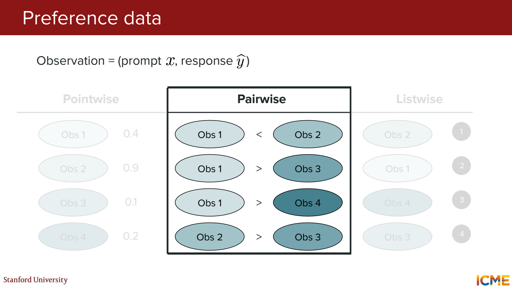
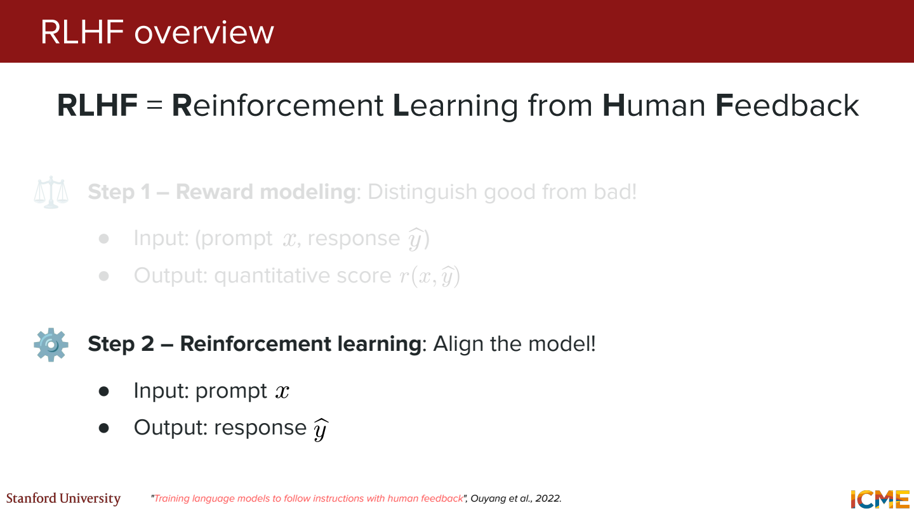
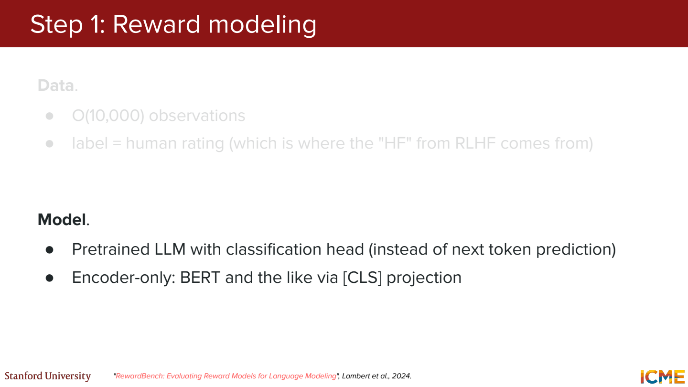
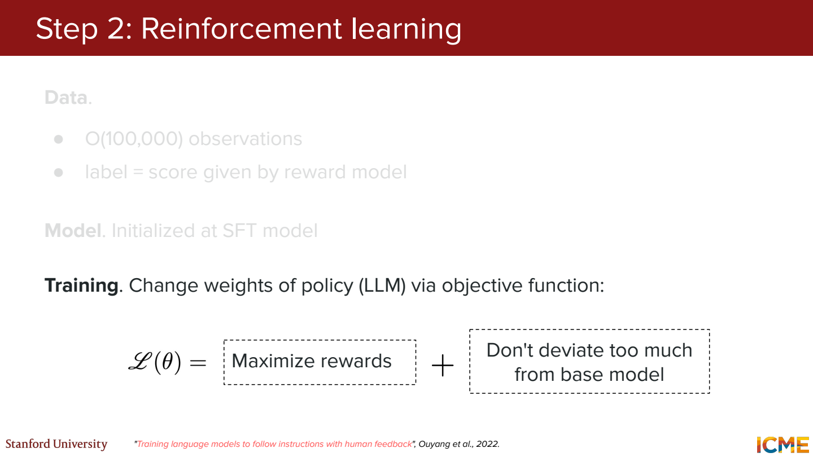
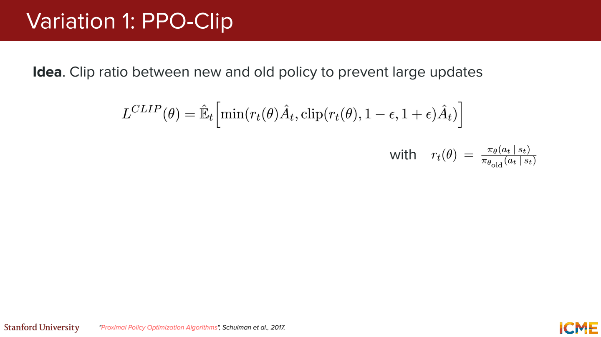
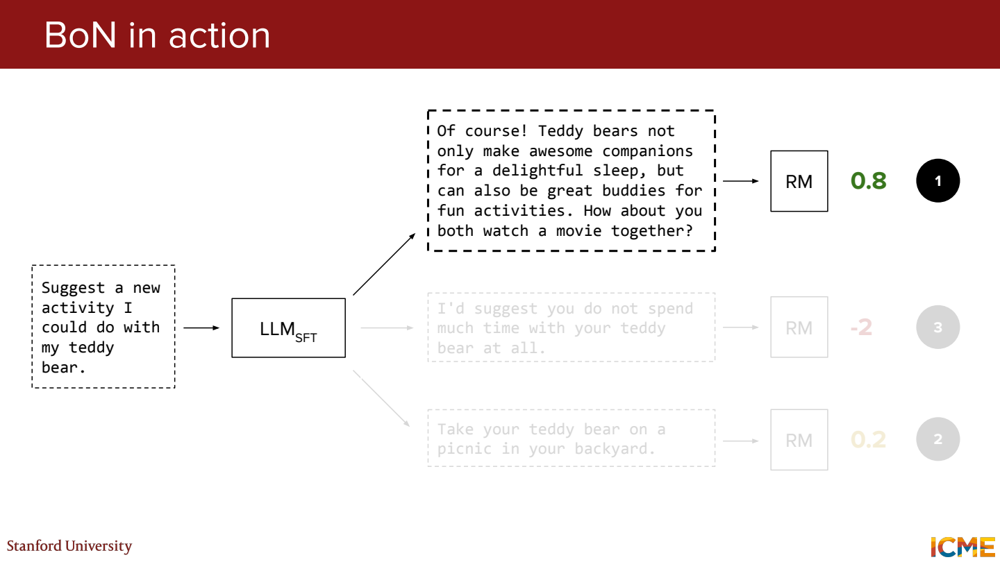
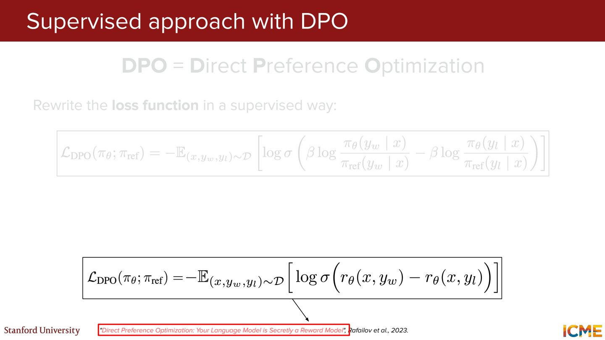

# 5단원 더 나은 답변을 고르는 기준 학습하기

SFT는 좋은 답변을 따라 쓰게 하는 단계.
Preference tuning에서는 같은 질문에 대한 여러 답변 중 무엇을 더 선호하는지도 사용.

## 선호도 데이터는 어떤 모양인지



질문이 `이 오류를 어떻게 고치지?`라고 가정.

- 답변 A: 오류 원인과 수정 위치를 짚어줌
- 답변 B: 관련은 있지만 원론적인 설명만 길게 함

둘 다 문장은 자연스러워도 A가 더 유용할 수 있음.
Pairwise 데이터는 이런 비교에서 A를 chosen, B를 rejected로 표시.
Pointwise는 답변별 점수, listwise는 여러 답변의 순위를 사용하는 방식.

그럼 선택된 답변은 완벽한 정답인가?

비교 대상보다 선호되었다는 뜻. 둘 다 틀린 답변일 수도 있음.
평가 기준과 annotator 간 일관성이 데이터 품질에 영향을 줌.

## Reward model로 선호를 점수화



Reward model은 `(질문, 답변)`을 받아 하나의 점수를 냄.
Chosen의 점수가 rejected보다 높아지도록 학습.

두 답변의 점수 차이를 sigmoid에 넣는 비교 모델을 생각하면,

```text
r(A)=2, r(B)=0
P(A가 선호됨) = sigmoid(2-0) ≈ 0.881
```

이 확률은 비교 모델의 출력. 사람이 실제로 88.1%의 빈도로 선택했다는 측정값은 아님.



그럼 reward 10이면 reward 5보다 두 배 좋은 답변인가?

그렇게 해석하기 어려움. 비교에서 어느 쪽 점수가 더 높은지와 그 차이가 학습의 핵심.
점수의 절대 크기에 사람이 읽을 수 있는 품질 단위가 붙는 건 아님.

## 점수를 높이는 방향으로 언어 모델 업데이트



현재 모델이 답변을 생성하고 reward model이 평가.
그 보상을 높이는 방향으로 답변을 생성하는 policy를 바꿈.
LLM에서는 지금까지 나온 토큰들이 상태, 다음 토큰 선택이 행동으로 볼 수 있음.

Reward만 무작정 높이면 점수 모델의 허점을 이용할 수 있음.
예를 들어 긴 답변에 높은 점수를 주는 경향이 있으면, 내용 없이 길이만 늘릴 수 있음.
그래서 기준 모델과 너무 멀어지지 않도록 KL penalty 등을 함께 둠.

그럼 KL이 작으면 답변 내용도 안전하게 보존되나?

분포의 변화를 제한하는 장치이지 내용의 정답이나 안전을 보증하는 장치는 아님.
보상 기준과 결과 평가도 따로 필요.

## PPO에서 한 번에 너무 크게 바꾸지 않기



PPO는 이전 policy와 새 policy가 같은 행동에 주는 확률 비율을 사용.
그 비율과 advantage를 이용해 업데이트.
Advantage는 단순 reward 자체보다 ‘기대보다 얼마나 나았는지’에 가까운 값.

이전 확률 0.2, 새 확률 0.3이면 비율은 1.5.
Clipping 범위가 `[0.8, 1.2]`이고 advantage가 양수라면, 이 방향으로 비율을 계속 키워 얻는 이득을 제한.

Clipping은 모든 확률을 강제로 그 구간 안에 묶는 명령은 아님.
목적함수에서 과한 변경에 대한 유인을 제한하는 방식.
RLHF에서 쓰는 reference model과 PPO의 이전 policy도 역할이 서로 다름.

## 학습 없이 여러 후보 중 고르는 방법



Best-of-N은 N개 답변을 생성하고 점수가 가장 높은 것을 고름.
이 단계 자체는 모델 가중치를 업데이트하지 않음.

후보 점수가 `[0.3, 0.8, 0.5]`면 두 번째 답변을 선택.
생성 비용이 늘지만 별도의 강화학습 없이 선호 기준을 적용할 수 있음.
점수 모델이 틀리면 후보를 많이 뽑아도 잘못된 선택을 더 적극적으로 할 수 있음.

## DPO는 비교 데이터를 바로 loss에 넣음



DPO는 chosen과 rejected의 log 확률 차이를 사용해 모델을 직접 학습.
기준 모델에 비해 chosen 쪽을 얼마나 더 선호하게 되었는지를 비교.

```text
차이 = [log π(chosen) - log π_ref(chosen)]
     - [log π(rejected) - log π_ref(rejected)]

loss = -log sigmoid(beta × 차이)
```

응답의 log 확률은 보통 토큰별 조건부 log 확률을 합쳐 계산.
위 비교에 쓸 별도 reward model을 먼저 학습하지 않아도 된다는 점이 편리.

그럼 DPO는 RLHF보다 항상 좋은가?

학습 구성이 단순해지는 장점은 있지만 데이터와 작업에 따라 결과가 달라짐.
주어진 preference pair로 학습하는 것과, 현재 policy가 만든 응답을 다시 평가하며 탐색하는 것도 다름.
편리함과 최종 성능을 같은 말로 묶지 않기.

## 참고자료

- [Stanford CME 295](https://cme295.stanford.edu/)
