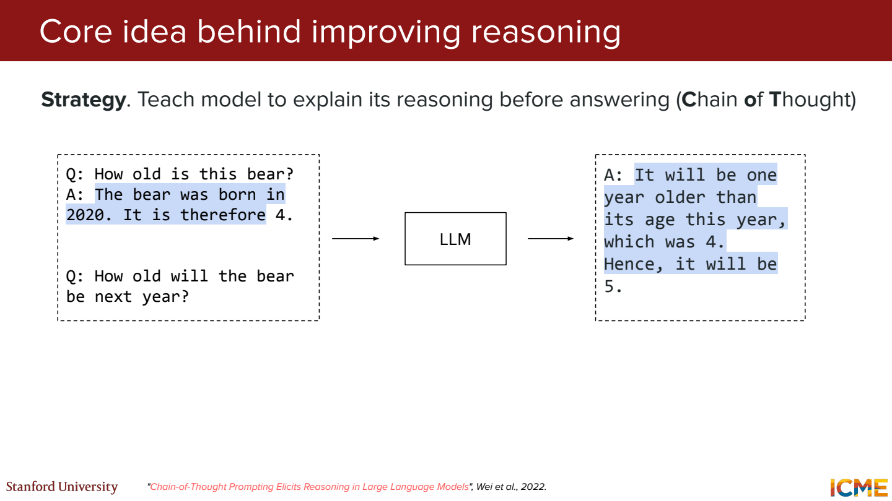
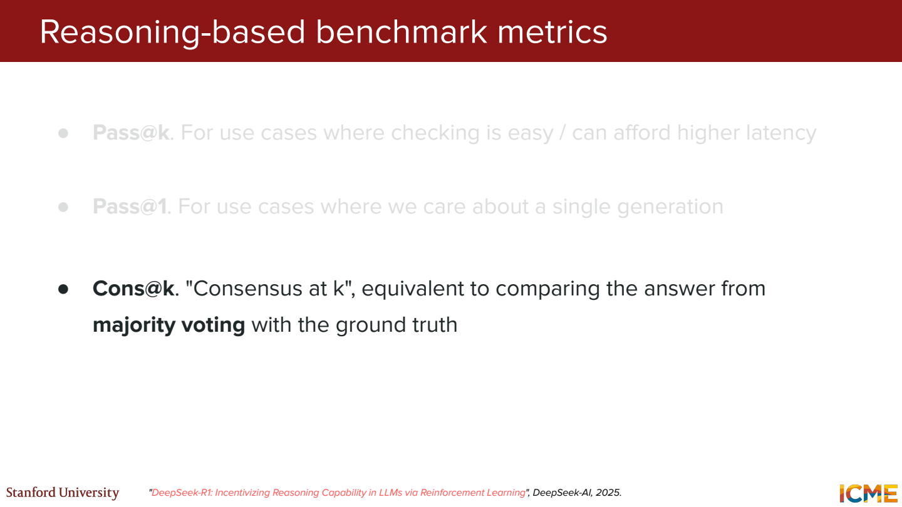
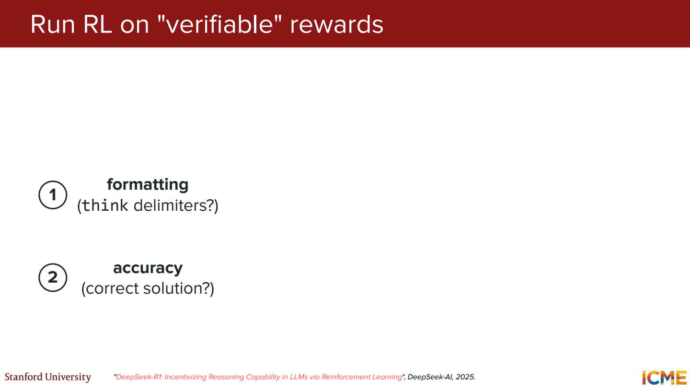
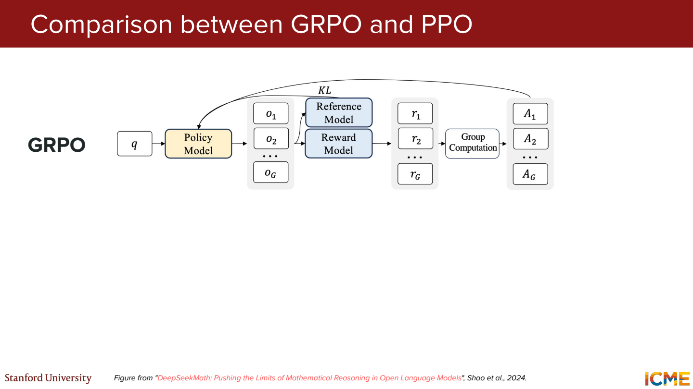
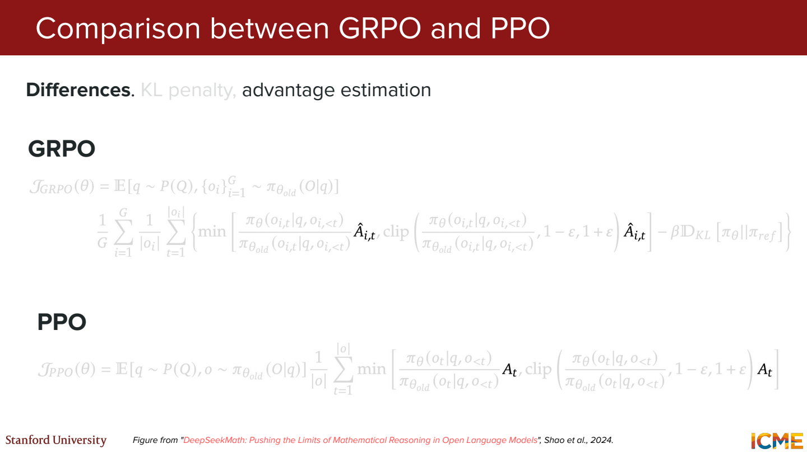
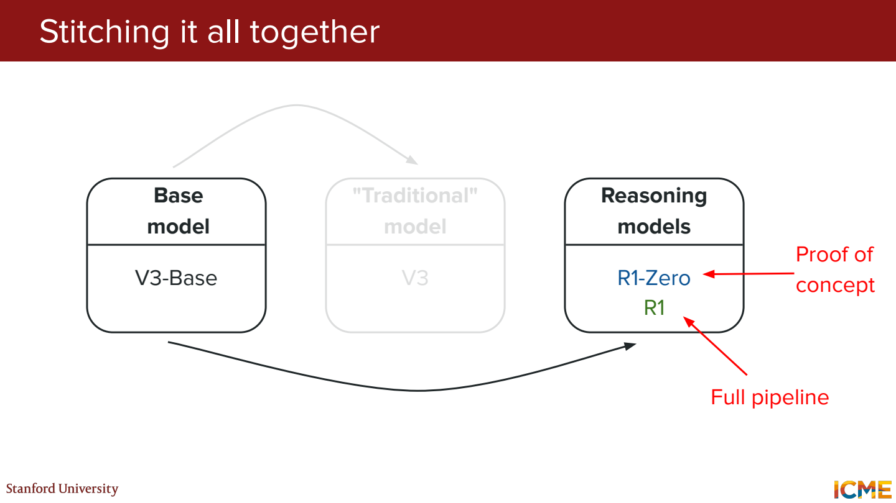
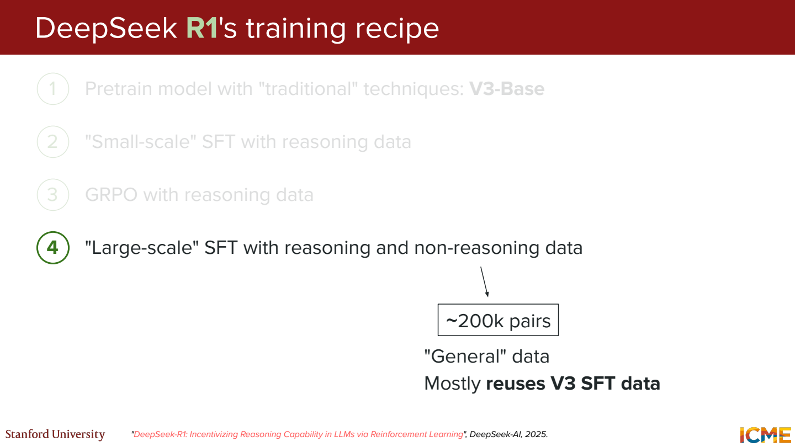
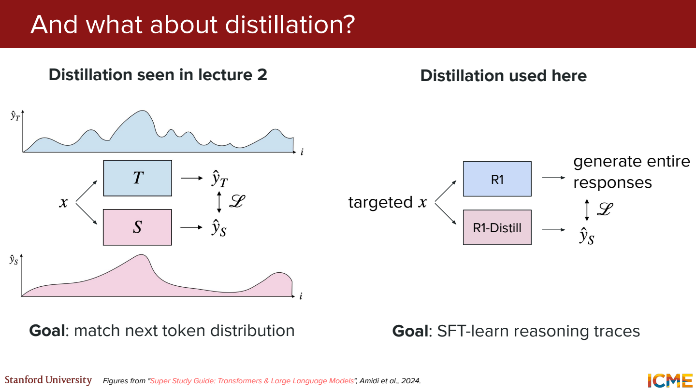

# 6단원 답을 내기 전에 계산을 더 쓰는 모델

모델 크기나 학습량만 늘리는 방법 외에, 답변을 만드는 동안 계산을 더 쓰는 방법도 있음.
한 번에 답하기 어려운 문제를 중간 계산, 여러 후보, 검증으로 나눠보기.

## Test-time compute



`사과 3개가 2,400원이면 7개는?`

```text
한 개 가격 = 2,400 / 3 = 800
7개 가격 = 800 × 7 = 5,600
```

바로 답 하나를 내는 대신 중간 계산을 생성.
다른 방법으로 여러 답을 뽑은 뒤 검증기로 고르거나 다수결을 할 수도 있음.
답변 길이를 늘리는 것과 정확하게 추론하는 것은 구분해야 함.
틀린 전제로 길게 계산하면 결과도 틀림.

## 여러 번 시도했을 때의 성능



가상의 네 번 시도 결과가 `[42, 17, 42, 8]`, 정답은 42라고 하면,

- Pass@4: 네 개 중 정답이 있으므로 이 문제는 성공
- 다수결: 42가 가장 많이 나와서 42를 선택
- 첫 번째 답 하나만 사용: 첫 번째 시도의 결과에 따라 결정

Pass@k가 높으면 사용자가 정답을 받는 비율도 높은가?

정답이 후보 안에 있다는 것과 그 정답을 골라내는 것은 별개.
실제 서비스에는 선택 기준이나 검증기가 필요.
오답을 같은 방식으로 반복하면 다수결도 틀릴 수 있음.

## 사람이 일일이 채점하지 않아도 되는 문제



수학의 최종 답, 코드의 테스트 통과 여부처럼 결과를 확인하기 쉬운 작업이 있음.
예를 들어 `add(2, 3)`이 5를 반환하는지 실행해서 확인.

```text
후보 A: 테스트 10개 중 10개 통과
후보 B: 테스트 10개 중 6개 통과
```

이런 결과를 reward로 사용할 수 있음.
출력 형식을 지켰는지에 대한 reward를 추가하는 경우도 있음.
다만 준비한 테스트 통과가 모든 입력에서의 정답을 뜻하지는 않음.

## GRPO는 같은 문제의 답변들을 비교



같은 질문에서 답변을 여러 개 생성하고 그룹 안에서 보상을 비교.
GRPO에서는 별도 value model 대신 그룹의 보상을 이용해 advantage를 구함.

계산용 예제로 reward가 `[0, 1, 1, 0]`이라고 가정.
그룹 평균은 0.5, 모집단 표준편차는 0.5.

```text
advantage = (reward - 그룹 평균) / 그룹 표준편차
          = [-1, 1, 1, -1]
```

잘된 답변의 확률은 올리고, 상대적으로 못한 답변은 낮추는 신호로 사용.
실제 식에서는 분모에 작은 수를 더하는 등 수치 처리가 들어감.

모두 정답이거나 모두 오답이면?

보상이 전부 같으면 그룹 안에서 우열을 가릴 신호가 없음.
그렇다고 전체 목적함수의 모든 항이 사라진다는 뜻은 아님. KL 같은 항은 따로 있음.



PPO와 비교할 때 critic이 없어지는 점과, 그룹 상대 보상을 쓰는 점을 연결해서 보기.
Clipping이나 기준 모델과의 KL 제약도 함께 고려.
‘보상 높은 답을 그냥 복사’하는 학습과는 다름.

## R1-Zero와 R1의 학습 흐름



R1-Zero는 먼저 reasoning용 SFT를 거치지 않고 base model에 RL을 적용한 실험.
학습하면서 검산하거나 다른 풀이를 시도하는 형태가 나타남.
다만 읽기 어려운 출력이나 언어가 섞이는 문제도 보고됨.

R1은 cold-start 데이터로 시작한 뒤 reasoning RL, 생성 데이터 선별과 SFT, 추가 RL 등을 조합.
학습 순서가 단순히 `base → RL 한 번`으로 끝나지는 않음.



수학 풀이만 잘하도록 학습하면 일반적인 질문에 답하는 능력은 어떻게 유지할까?

추론 데이터와 일반 답변 데이터를 함께 사용.
정답을 맞히는 능력 외에 읽기 쉬운 설명, 지시 준수 등도 학습 과정에서 다뤄야 함.

## 추론 과정을 작은 모델에 전달



큰 모델이 만든 풀이를 선별해서 작은 모델의 SFT 데이터로 사용.
여기서 distillation은 teacher의 전체 다음 토큰 확률을 맞추는 방식만 뜻하지 않음.
생성된 reasoning trace를 학습하는 형태도 있음.

`문제 → 중간 계산 → 최종 답`을 따라 학습해도 새로운 문제에서 같은 능력이 보장되는 건 아님.
학습에 없던 문제에서 정답률과 필요한 생성 길이를 함께 확인해야 함.

## 참고자료

- [Stanford CME 295](https://cme295.stanford.edu/)
