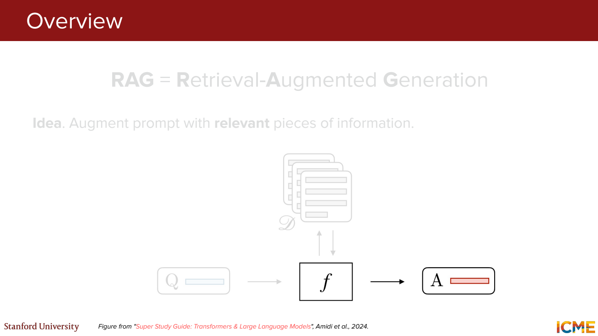
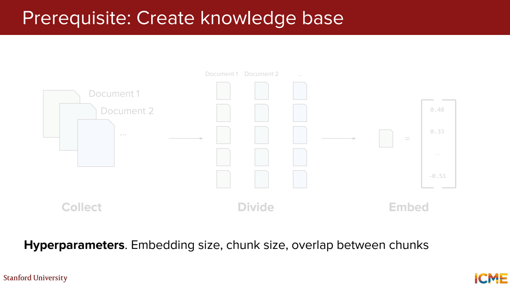
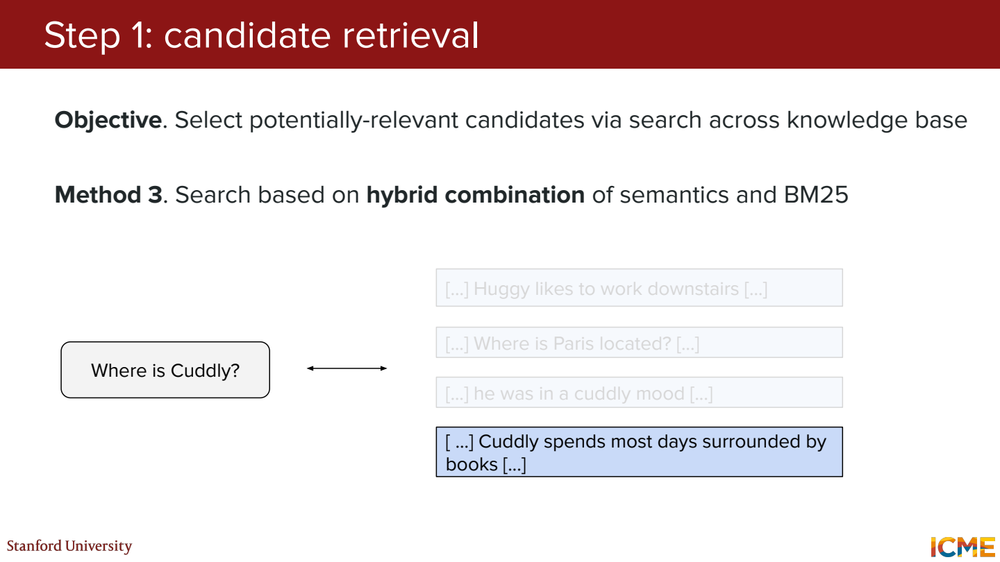
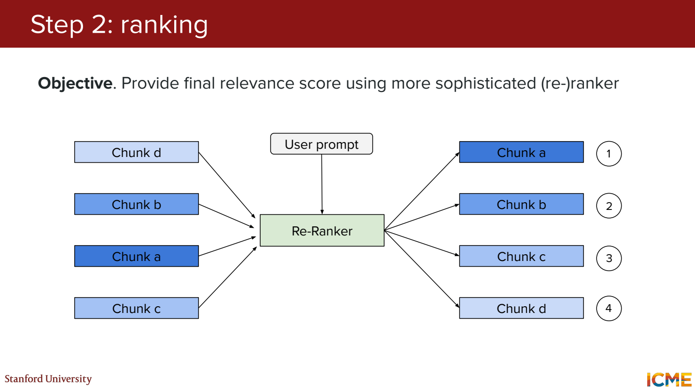
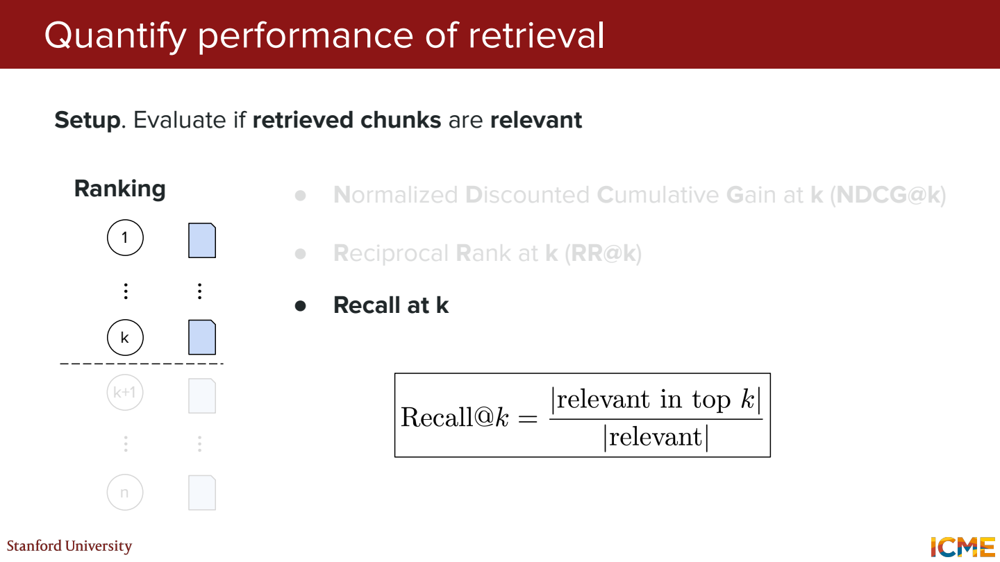
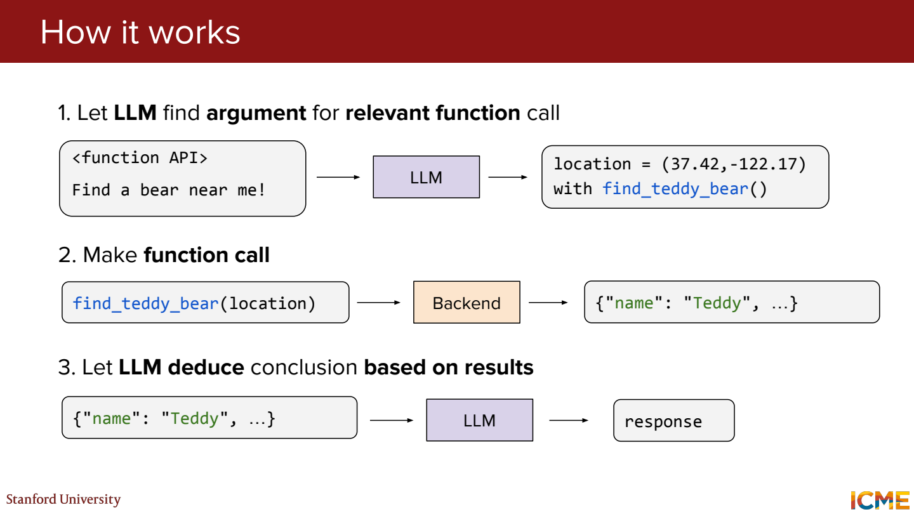
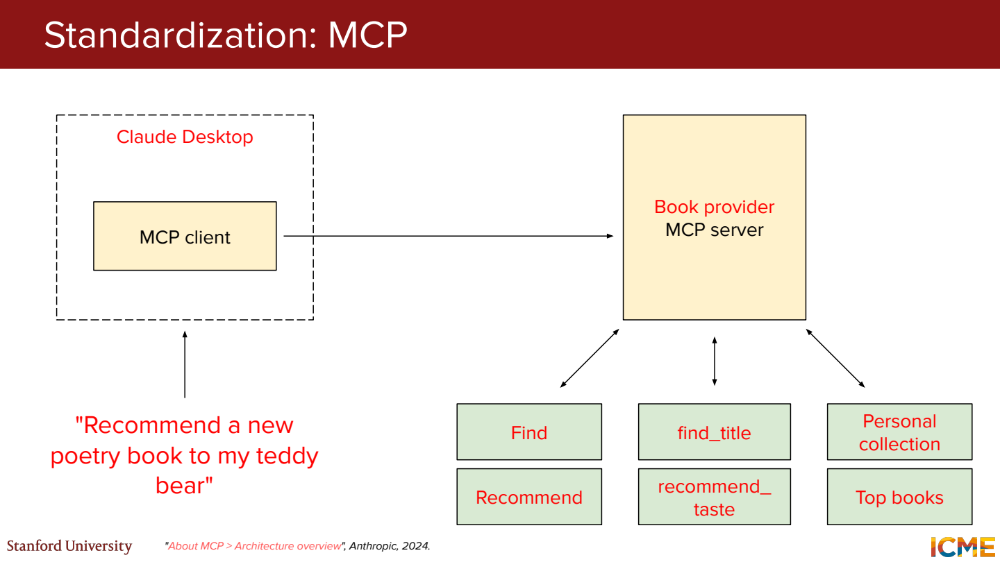
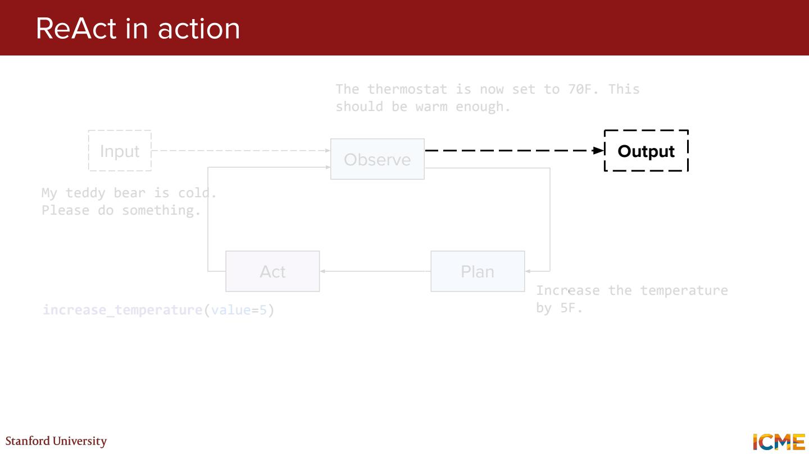

# 7단원 문서를 찾고 도구를 사용하는 LLM

모델이 모든 정보를 가중치 안에 기억할 필요는 없음.
질문과 관련된 문서를 찾거나, 계산·검색 도구를 호출해서 답변에 사용.

## RAG는 답변 전에 자료를 가져오는 것



예를 들어 가상의 학교 규정에 `졸업에는 130학점 필요`라고 적혀 있다고 가정.
사용자가 졸업 학점을 물으면 관련 규정을 찾아 질문과 함께 모델에 전달.

```text
질문 → 관련 규정 검색 → 찾은 내용 + 질문 → 답변
```

모델을 새로 학습하지 않고도 문서 내용을 답변에 반영할 수 있음.
문서가 수정되면 검색 대상도 갱신해야 함.

RAG를 붙이면 환각이 없어질까?

다른 학과 규정을 가져오거나, 오래된 문서를 검색하거나, 내용을 잘못 읽을 수 있음.
검색이 맞았는지와 답변이 자료를 따랐는지를 나눠서 봐야 함.

## 긴 문서를 chunk로 나누기



규정 전체를 하나의 벡터로 만들면 질문과 관계없는 내용도 섞임.
조항이나 문단 단위로 나누고 각 chunk의 임베딩을 저장.

```text
chunk A: 졸업 이수 학점과 전공 필수 조건
chunk B: 휴학 신청 절차
chunk C: 장학금 신청 조건
```

너무 작게 자르면 `단, 아래 조건을 만족할 경우 제외` 같은 예외가 떨어져 나갈 수 있음.
일부 구간을 겹치게 하거나 제목·조항 번호를 같이 보관하는 이유.
정답이 들어 있는 문장을 검색해도 예외 조건이 빠지면 답이 틀릴 수 있음.

## 단어 검색과 의미 검색



BM25 같은 lexical 검색은 실제 단어의 일치를 활용.
Dense retrieval은 임베딩으로 의미가 가까운 내용을 찾음.

`학위 받으려면 몇 학점?`과 `졸업 이수 학점`은 표현이 달라도 의미가 가까움.
반대로 `CS101` 같은 정확한 과목 코드는 문자 일치가 유용할 수 있음.
Hybrid retrieval은 두 검색 결과를 결합.
서로 다른 점수 척도를 그대로 더해도 되는지는 따로 정해야 함.

## 후보를 모은 뒤 순서 다시 매기기



먼저 넓게 후보 20개를 검색하고, reranker가 질문과 각 후보를 함께 읽어 다시 점수화.
그중 상위 몇 개를 답변 모델에 전달하는 식.

처음부터 모든 문서를 정밀하게 비교하면 비용이 큼.
빠른 후보 검색과 더 비싼 재평가를 나누는 구조.
처음 검색에서 빠진 문서는 reranker가 되살릴 수 없음.



정답 관련 문서가 총 4개이고 상위 5개 안에 2개가 들어 있다면,

```text
Recall@5 = 2 / 4 = 0.5
Precision@5 = 2 / 5 = 0.4
```

첫 관련 문서가 3위라면 reciprocal rank는 `1/3`.
관련 문서의 정도와 순서를 같이 보려면 NDCG 같은 지표도 사용.
검색 점수가 좋아졌는지와 최종 답변이 좋아졌는지는 별도로 측정.

## Tool calling에서 실제 실행은 누가 하나



`123 × 456`을 계산하는 도구가 있다고 가정.

```text
모델: multiply(a=123, b=456) 호출 요청
실행 프로그램: 계산 후 56088 반환
모델: 반환된 결과로 답변 작성
```

함수 이름과 인자를 생성하는 것까지가 모델의 출력.
실제 도구 실행, 인자 검사, 권한 확인은 연결된 프로그램이 담당.
모델이 ‘실행했다’고 문장으로 말하는 것과 도구 실행 기록은 다름.

## MCP는 연결 방식을 맞추는 규약



여러 도구마다 연결 방식을 새로 만들면 관리하기 어려움.
MCP는 host, client, server 사이에서 도구나 리소스를 주고받는 방식을 표준화.

계산기를 연결하는 규격이 같아지는 것에 가까움.
연결했다고 모델이 언제 어떤 도구를 써야 하는지까지 자동으로 잘 판단하는 건 아님.

## Agent는 결과를 보고 다음 행동을 결정



가상의 일정 확인 작업이라면,

```text
일정 검색 → 날짜가 빠져 있음 확인
상세 페이지 조회 → 날짜 확인
관련 조건 확인 → 답변 작성 후 종료
```

한 번의 도구 호출로 끝나지 않고 관찰한 결과로 다음 행동을 선택.
ReAct는 reasoning과 action을 번갈아 진행하는 형태.

다음 행동을 계속 만들면 언젠가 해결될까?

같은 검색을 반복할 수 있어서 종료 조건과 호출 예산이 필요.
검색 문서 안의 명령문도 작업 지시로 받아들이면 안 됨.
도구 결과는 판단에 쓰는 자료이고, 그 안의 문장이 사용자 권한을 대신하지는 않음.

## 참고자료

- [Stanford CME 295](https://cme295.stanford.edu/)
