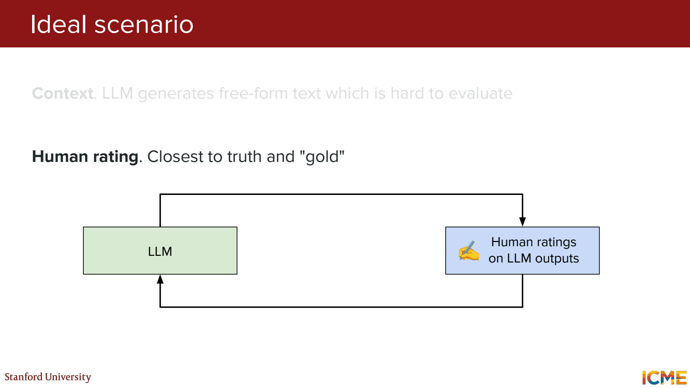
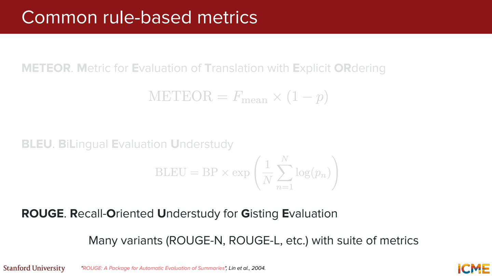
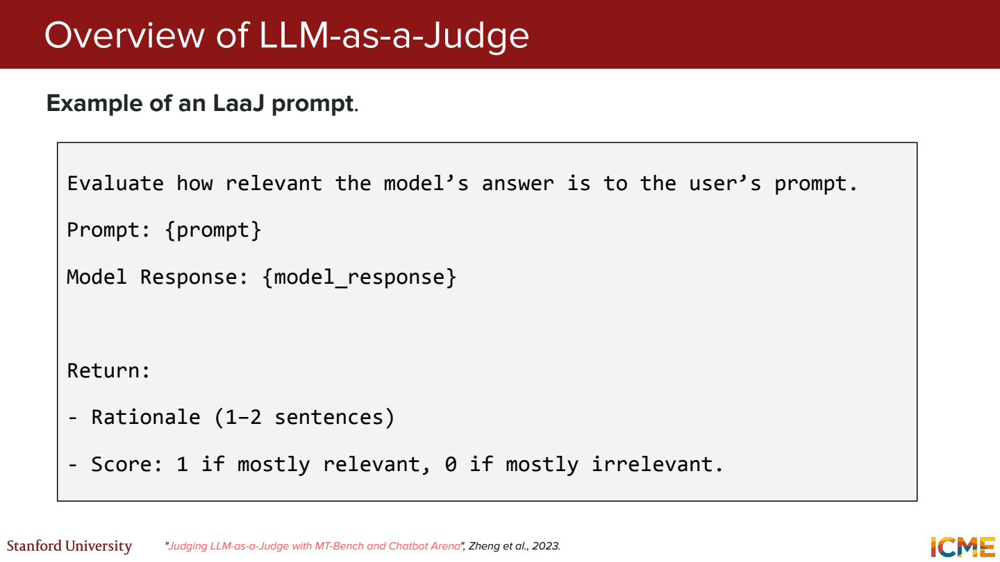
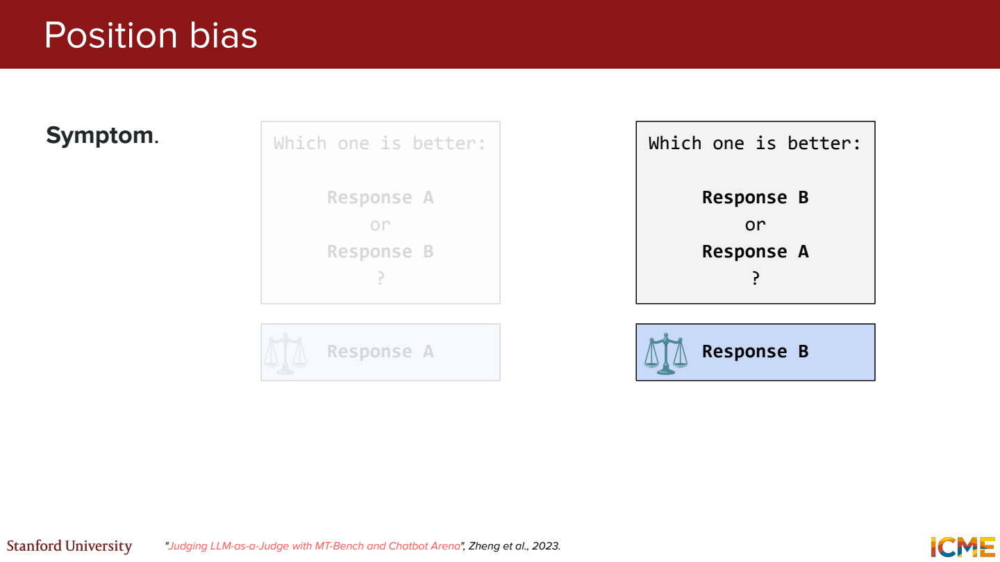
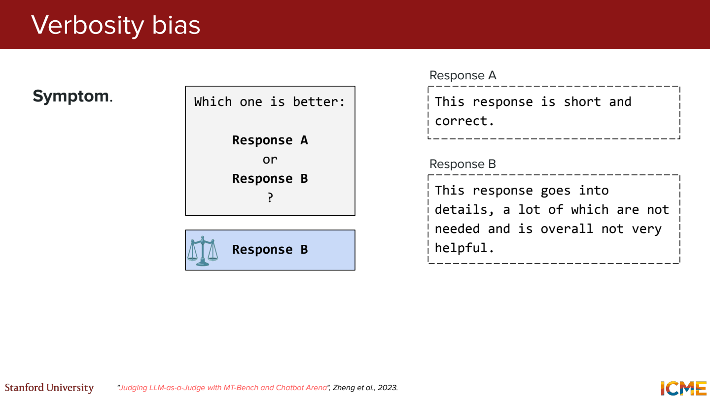
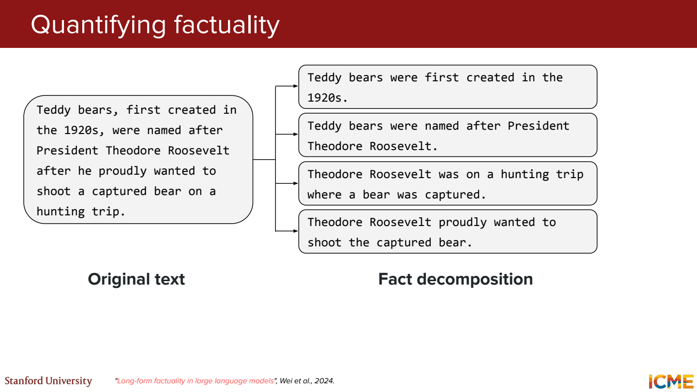
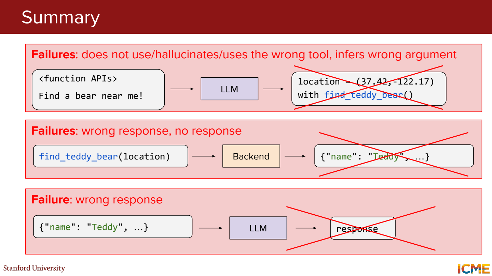
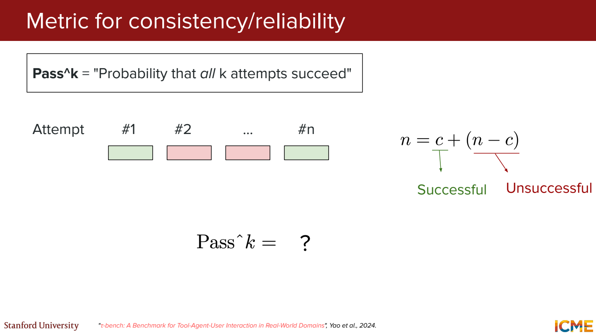
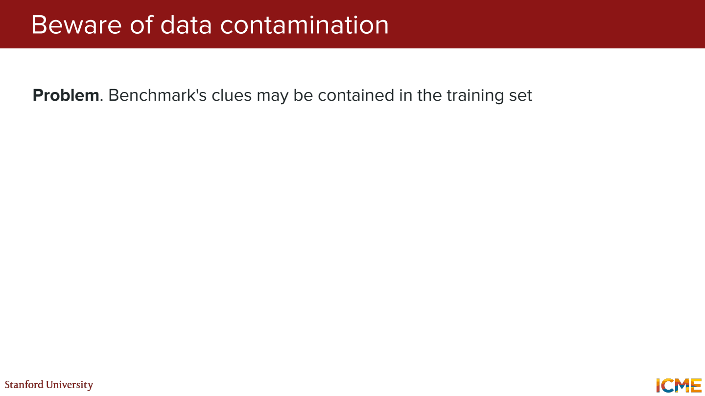

# 8단원 모델이 좋아졌다는 걸 어떻게 확인할까

답변 하나가 그럴듯한 것과, 같은 조건에서 꾸준히 잘하는 것은 다름.
무엇을 잘해야 하는지부터 정하고 평가 방법을 고르기.

## 사람이 답변을 비교



예를 들어 오류 해결 답변이면 정확성, 수정 방법의 실행 가능성, 설명의 이해도를 나눠볼 수 있음.
긴 답변이라는 이유로 높은 점수를 주지 않도록 기준을 먼저 정함.

같은 답변에 평가자마다 점수가 다르면?

기준이 모호한지, 정답 자체가 여러 개인지 확인.
여러 명의 평가와 일치도를 함께 보면 단일 점수에 가려진 차이가 보임.

## 단어가 얼마나 겹치는지 보는 지표



```text
기준 답: 오늘 비가 와서 경기가 취소됐다.
생성 답: 우천으로 오늘 경기는 열리지 않았다.
```

의미는 비슷하지만 겹치는 단어 수는 적음.
BLEU는 주로 n-gram precision, ROUGE는 주로 recall을 활용하는 계열의 지표.
METEOR는 단어 정렬과 변형·동의어 등을 고려.
정확한 계산은 지표 종류와 설정에 따라 달라짐.

반대로 `경기가 취소됐다`를 `경기가 취소되지 않았다`로 바꾸면 글자는 비슷해도 뜻은 반대.
문자열 일치를 사실 정확성으로 바로 읽으면 안 됨.

## LLM에게 채점시키기



Judge에게 질문, 후보 답변, 평가 기준을 전달.
정답 자료가 있으면 같이 제공하고 판단 근거도 확인.
대량 평가에 편하지만 judge도 모델이라 오류와 편향이 있음.



A와 B의 순서를 뒤집었는데 계속 첫 번째 답변을 고르면 position bias를 의심.
후보 순서를 바꿔 재평가하거나 순서를 무작위화하는 이유.



짧고 정확한 답보다 길고 틀린 답을 선호할 수도 있음.
모델 이름을 숨기고, 길이·표현보다 내용에 관한 기준을 구체화.
자동 채점 결과 일부를 사람이 확인해서 어떤 오류를 놓치는지도 봐야 함.

## 문장 하나를 작은 사실들로 나누기



가상의 가게 안내문이 `9시에 열고, 월요일은 쉬며, 주차는 무료`라고 답했다고 가정.

```text
claim 1: 9시에 연다.
claim 2: 월요일은 쉰다.
claim 3: 주차가 무료다.
```

이 중 1, 2만 자료로 확인되고 3은 근거가 없다면 따로 표시.
근거 없음과 거짓으로 확인됨도 구분.
문장 전체에 점수 하나만 매기는 것보다 어느 부분이 문제인지 찾기 쉬움.

## Agent는 중간 과정도 평가



답이 틀렸을 때 원인이 다를 수 있음.

- 필요한 검색 대신 계산기를 선택
- 올바른 도구에 잘못된 날짜 인자를 전달
- 도구가 timeout을 반환
- 도구 결과는 맞는데 최종 답변에서 숫자를 바꿈

이걸 모두 ‘모델 정답률 하락’으로만 묶으면 고칠 곳이 안 보임.
도구 선택, 인자, 실행 결과, 최종 답변을 연결해서 확인.

## 한 번이라도 성공과 매번 성공



Pass@k는 k번 중 한 번 이상 성공.
Pass^k는 k번을 모두 성공하는 신뢰성 쪽 지표.

계산용으로 각 시도가 서로 독립이고 성공 확률이 항상 0.8이라고 가정하면,

```text
pass@3 = 1 - (1-0.8)^3 = 0.992
pass^3 = 0.8^3 = 0.512
```

같은 모델인데 숫자가 크게 다름.
실제 평가에서는 같은 유형의 실패가 반복될 수 있으므로 독립 가정을 그대로 적용하면 안 됨.
여러 시도 중 하나를 고를 수 있는 작업인지, 매번 안정적으로 성공해야 하는 작업인지부터 구분.

## 평가 문제가 학습 데이터에 들어갔다면



이미 본 문제를 잘 푸는 것과 새로운 문제에 일반화하는 것은 다름.
평가 데이터와 학습 데이터의 중복, 비슷한 변형 문제의 유입도 확인.

모델 비교에서는 prompt, 도구, 생성 예산 같은 조건도 맞춰야 함.
정답률이 같아도 비용과 응답 시간이 다를 수 있어서 함께 기록.
벤치마크 점수 하나를 모든 작업의 성능으로 확대하지 않기.

## 참고자료

- [Stanford CME 295](https://cme295.stanford.edu/)
