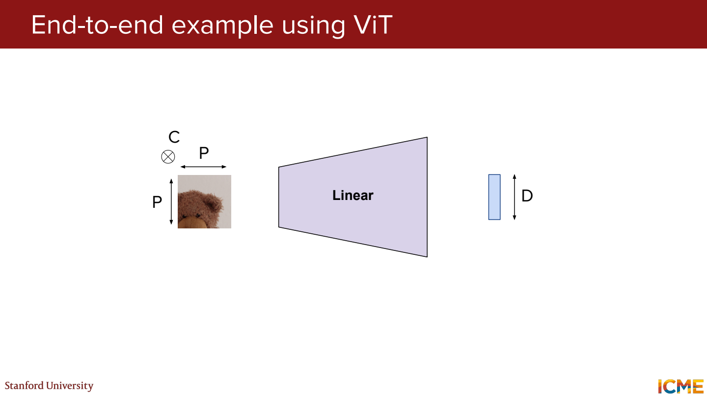
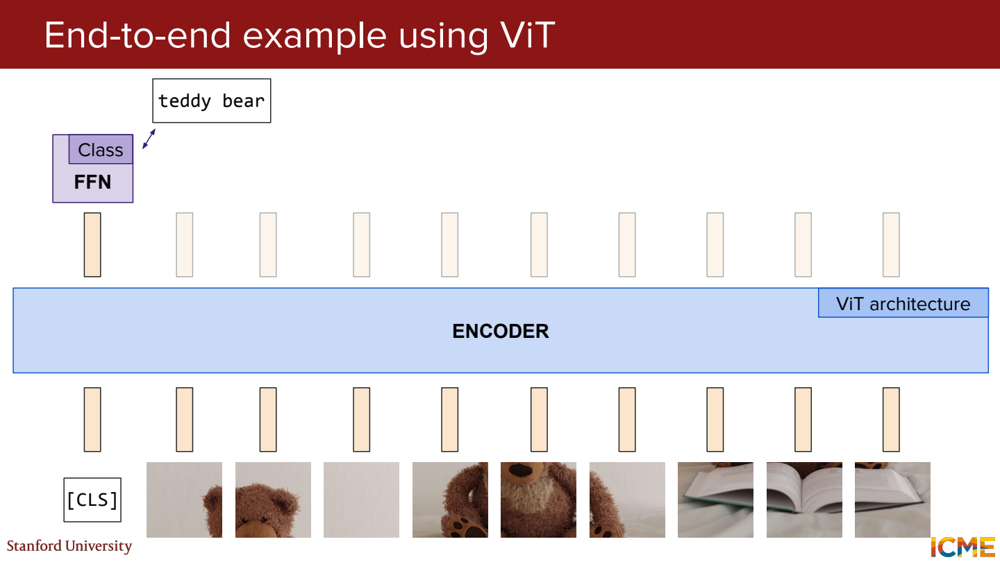
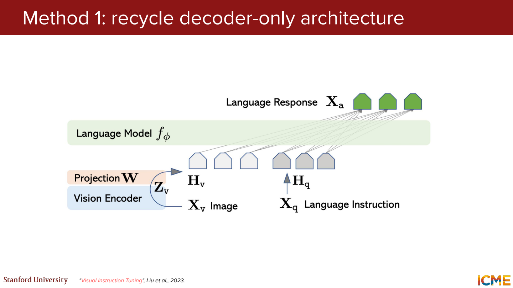
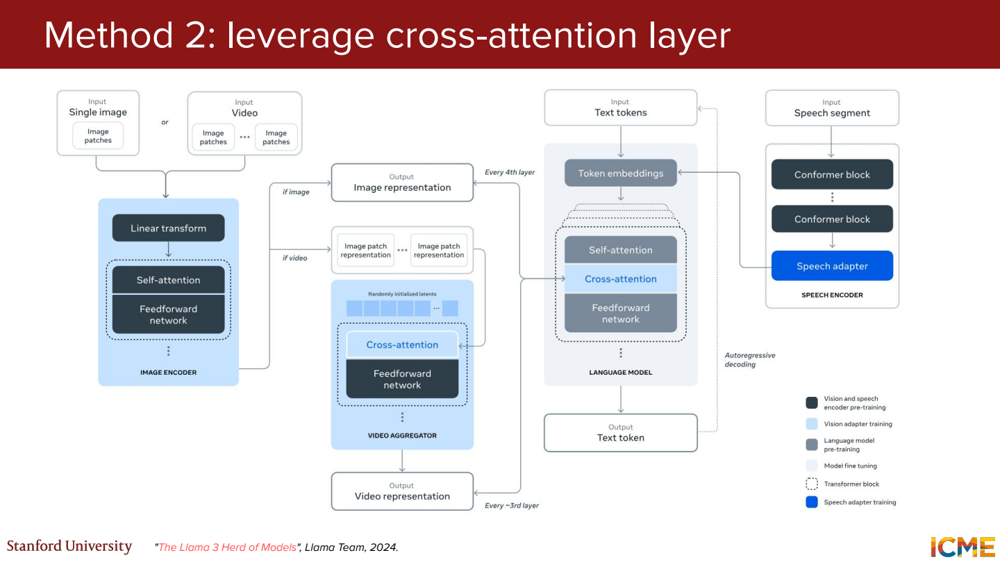
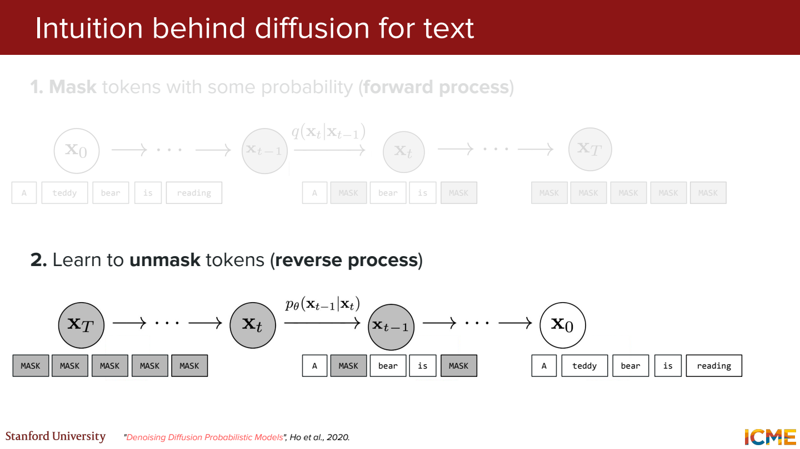
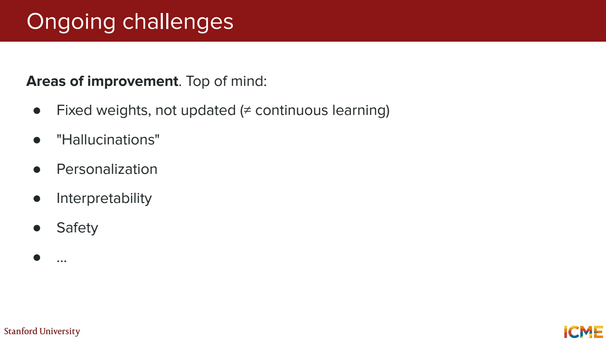

# 9단원 텍스트 밖으로 확장되는 Transformer

Transformer에 들어가는 토큰이 꼭 단어일 필요는 없음.
이미지 조각도 벡터로 바꾸면 attention의 입력으로 사용할 수 있음.

## 이미지를 patch로 나누기



224×224 RGB 이미지를 16×16 patch로 나누는 예제.

```text
가로 14개 × 세로 14개 = 196개 patch
patch 하나 = 16 × 16 × 3 = 768개 숫자
```

각 patch를 펼친 뒤 선형 변환해서 모델 차원의 벡터로 만듦.
768은 이 예제의 입력 숫자 개수. 모델의 hidden dimension이 항상 768인 건 아님.
위치 정보도 더해서 patch가 원래 어디 있었는지 구분.



분류용 ViT에서는 `[CLS]`를 추가하고 그 출력으로 이미지 클래스를 예측하는 구성이 있음.
위 예제라면 patch 196개 + CLS 1개로 197개 토큰.
모든 vision model이 CLS를 쓰는 것은 아님.

## 이미지 표현을 언어 모델에 전달



이미지 encoder가 시각 특징을 뽑고 projector가 언어 모델에 맞는 차원으로 변환.
이미지 토큰과 `이 사진에 뭐가 있어?`라는 텍스트 토큰을 함께 처리하는 방식.

```text
사진 → vision encoder → projector → 이미지 토큰
질문 → tokenizer → 텍스트 토큰
이미지 토큰 + 텍스트 토큰 → 답변
```

Projector가 차원만 맞추면 바로 사진을 이해할까?

차원이 같다는 것만으로 의미가 연결되지는 않음.
이미지와 텍스트가 어떻게 대응하는지 학습 데이터와 학습 과정이 필요.



다른 구성에서는 텍스트 쪽을 Q로, 이미지 특징을 K와 V로 하는 cross-attention 사용.
답변을 만들 때 필요한 시각 정보를 조회하는 형태.
이미지 토큰을 입력 앞에 붙이는 방식과 연결 위치가 다름.

## 자연스러운 설명과 정확한 시각 판단

사진을 보고 `컵이 세 개 있다`고 자연스럽게 말해도 실제로는 두 개일 수 있음.
작은 글씨, 물체 수, 좌우 관계 등은 각각 확인해야 함.

`빨간 컵 오른쪽의 파란 접시`라는 설명에서는,

- 컵과 접시가 있는지
- 색이 맞는지
- 좌우 관계가 맞는지

세 가지가 따로 틀릴 수 있음.
유창함만으로 이미지 이해를 평가하기 어려운 이유.

## 텍스트를 한 칸씩 생성하는 것 외의 방법



Autoregressive 생성은 이전 토큰 뒤에 다음 토큰을 붙임.
Masked diffusion 계열은 일부 또는 전체가 가려진 토큰 배열에서 점차 내용을 채움.

```text
[MASK] [MASK] [MASK] [MASK]
오늘 [MASK] 정말 [MASK]
오늘 날씨가 정말 좋다
```

위는 흐름을 보기 위한 예시. 실제로 어느 위치를 채우고 다시 가릴지는 모델과 sampler에 따라 다름.
여러 위치를 함께 예측할 수 있지만 여러 번의 모델 호출이 필요할 수 있음.
병렬 예측이 곧 한 번의 계산으로 완성된다는 뜻은 아님.

## 남는 문제들



이미지 입력이나 도구를 추가해도 잘못된 정보를 만드는 문제는 남음.
가중치에 저장된 정보의 갱신, 개인화, 모델 내부의 해석도 별도의 문제.

다음 과정에서는 생성 쪽을 더 자세히 보기.
이미지에 노이즈를 넣고 복원하는 diffusion에서 시작해서, latent 공간과 vision Transformer로 연결.

## 참고자료

- [Stanford CME 295](https://cme295.stanford.edu/)
