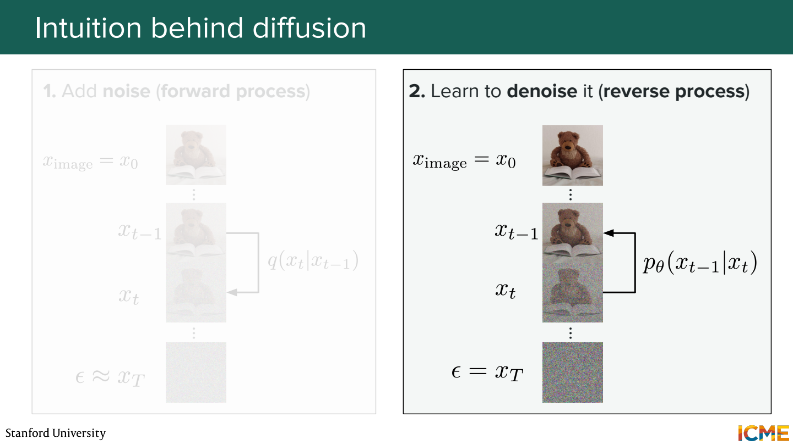
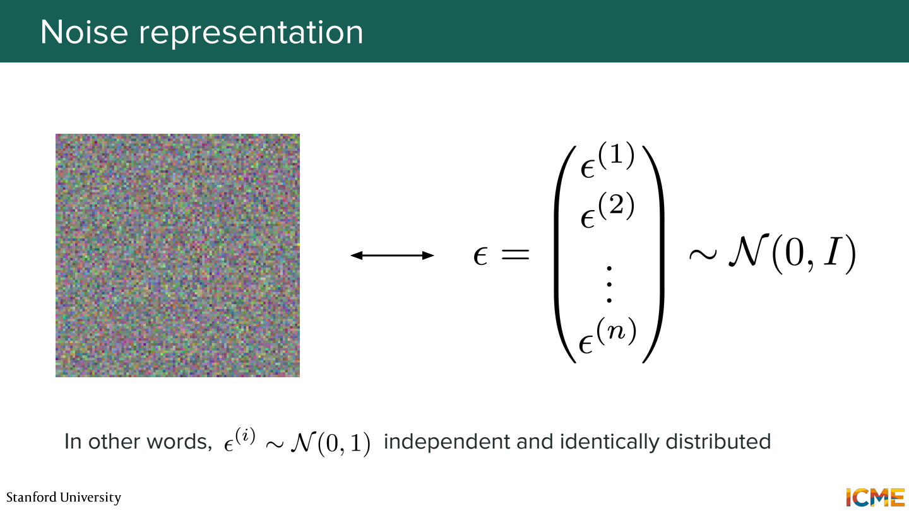
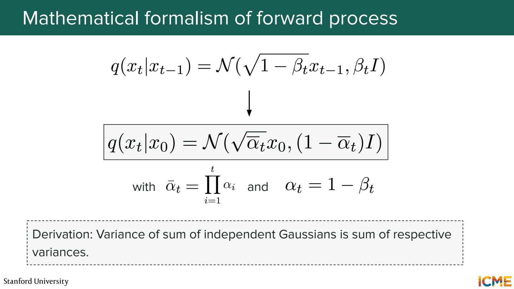
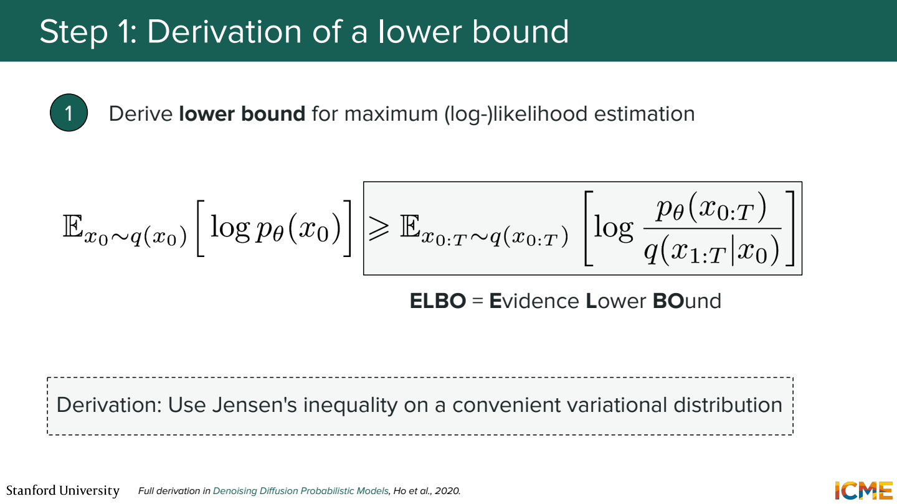
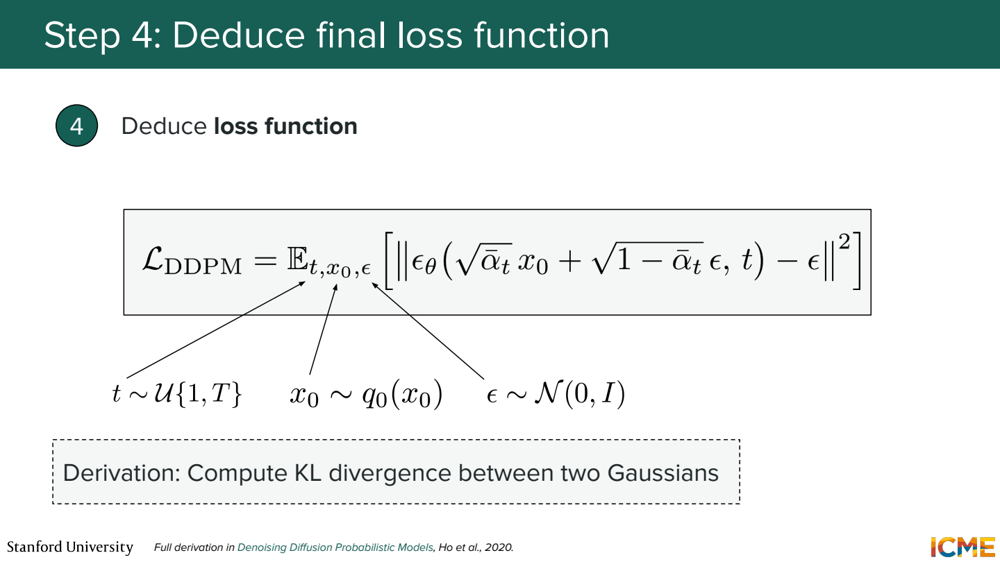
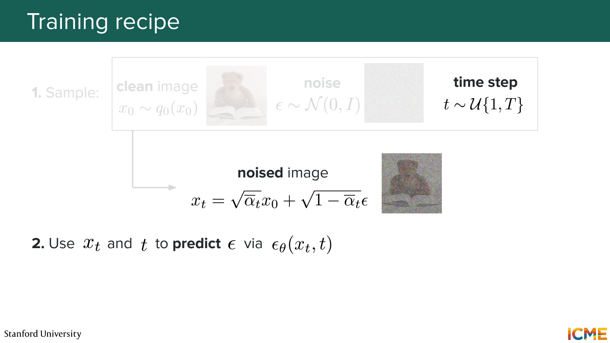
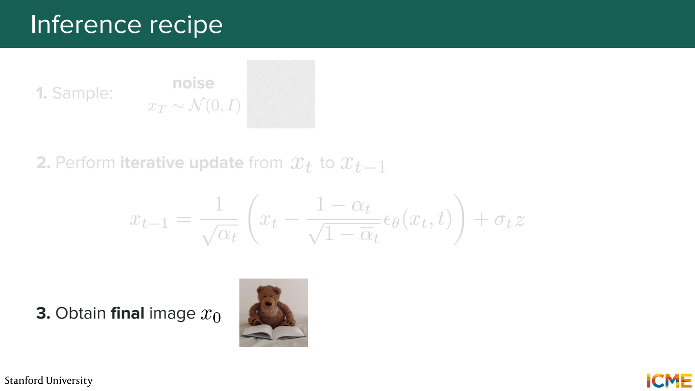
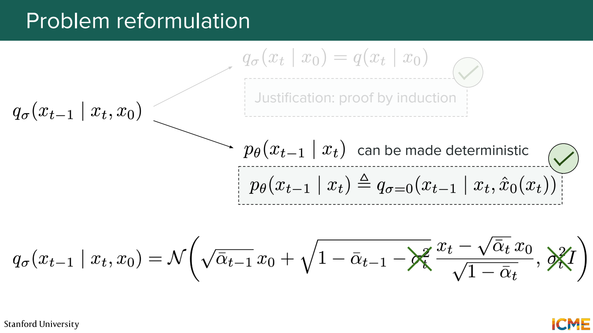
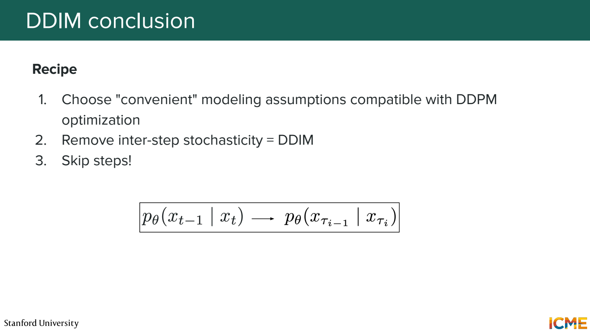

# 1단원 노이즈에서 이미지를 만드는 과정

Diffusion은 깨끗한 이미지에 노이즈를 넣는 과정부터 시작.
그 반대 방향을 모델이 배우면, 노이즈에서 출발해 이미지를 생성할 수 있음.

## 이미지를 조금씩 흐트러뜨리기



Forward에서는 원본 x₀에 작은 노이즈를 반복해서 추가.
충분히 진행하면 원본의 모양이 거의 사라지고 Gaussian noise에 가까워짐.
Reverse에서는 노이즈가 많은 상태에서 적은 상태로 가는 변환을 학습.



이미지는 숫자의 배열. RGB 32×32 이미지라면 숫자 `32×32×3 = 3,072`개.
Gaussian noise도 같은 모양의 배열이고 각 위치의 값을 정규분포에서 뽑음.
화면에서 지저분하게 보이는 것과 수식에서 확률변수인 것이 같은 대상.

## 중간 상태를 한 번에 만들 수 있음



```text
α_t = 1 - β_t
ᾱ_t = α₁ × α₂ × ... × α_t
x_t = √ᾱ_t × x₀ + √(1-ᾱ_t) × ε
ε ~ N(0, I)
```

β_t는 각 단계에서 추가하는 노이즈의 양.
ᾱ_t는 그 단계까지 원본 신호가 얼마나 남는지와 관련된 누적 값.

숫자 하나만 놓고 계산해보기.
`x₀=0.8`, `ᾱ_t=0.64`, 뽑힌 노이즈 `ε=-0.5`라고 가정.

```text
x_t = 0.8 × 0.8 + 0.6 × (-0.5)
    = 0.34
```

그럼 t=500의 학습 입력을 만들려면 500번 노이즈를 더해야 하나?

위 식으로 바로 만들 수 있음.
학습할 때 원본 이미지, t, ε를 뽑아서 해당 시점의 입력을 한 번에 구성.

## 왜 원본 대신 노이즈를 맞히나



생성 모델의 목표는 실제 데이터에 높은 확률을 주는 것.
그런데 모든 중간 상태를 고려한 log likelihood를 직접 계산하기 어려움.
계산 가능한 하한인 ELBO를 이용해서 학습 목표를 유도.

하한이므로 높이는 방향은 유용하지만, 하한과 원래 값이 항상 같지는 않음.
이 유도에서 Gaussian 분포 사이의 KL 항들을 정리하면 denoising과 연결됨.



DDPM에서 많이 쓰는 단순화된 목표는 다음과 같음.

```text
loss = E[ ||ε - ε_θ(x_t, t)||² ]
```

ε는 내가 입력을 만들 때 넣은 노이즈라 정답을 알고 있음.
모델은 x_t와 시간 t를 보고 그 ε를 예측.
같은 x_t처럼 보여도 노이즈 수준이 다르면 복원 방향이 달라질 수 있어 t도 전달.

## 학습 한 번의 흐름



```text
이미지 하나 선택
→ 시간 t 선택
→ 노이즈 ε 선택
→ x_t 계산
→ 모델이 ε 예측
→ 실제 ε와 차이로 업데이트
```

앞의 예제에서 실제 ε=-0.5인데 모델이 -0.4로 예측했다면 제곱 오차는 0.01.
이런 학습을 여러 이미지와 노이즈 수준에서 반복.

노이즈를 정확히 알면 원본도 알 수 있나?

이 예제에서는 식을 정리하면 됨.

```text
x₀ = (x_t - √(1-ᾱ_t) × ε) / √ᾱ_t
   = (0.34 - 0.6 × (-0.5)) / 0.8
   = 0.8
```

실제 모델은 ε를 추정하므로 오차가 있음.
정보가 거의 사라진 입력에서 특정 원본을 항상 정확히 되찾는 문제는 아님.

## 생성할 때는 노이즈에서 시작



학습 데이터의 원본을 넣는 대신 새로운 Gaussian noise x_T를 뽑음.
모델의 예측으로 x_T → x_{T-1} → ... → x₀ 순서로 이동.
DDPM sampler에서는 중간 단계에 추가 무작위성도 들어감.
마지막 단계의 노이즈 처리는 따로 두는 구성이 일반적.

학습은 임의의 t 하나를 골라 진행할 수 있지만, 생성은 여러 시점을 따라 이동.
둘의 계산 흐름을 구분해두기.

## DDIM은 생성 경로를 다르게 잡음



DDIM은 DDPM의 학습 목표와 연결되는 다른 sampling 경로를 구성.
η=0인 설정에서는 단계 사이에 새 노이즈를 추가하지 않아, 초기 노이즈가 같으면 경로가 결정됨.

그럼 매번 같은 이미지만 생성하나?

초기 노이즈를 다르게 뽑으면 다른 결과가 나올 수 있음.
Deterministic은 초기 상태를 고정했을 때의 이야기.



일부 시점만 선택해서 이동할 수도 있음.
기존 DDPM 반복문에서 임의로 몇 줄을 건너뛰는 것과는 다름.
선택한 시점 간격에 맞는 update 식을 사용해야 함.
단계를 줄이면 속도는 좋아지지만 품질도 함께 확인.

## 참고자료

- [Stanford CME 296](https://cme296.stanford.edu/)
