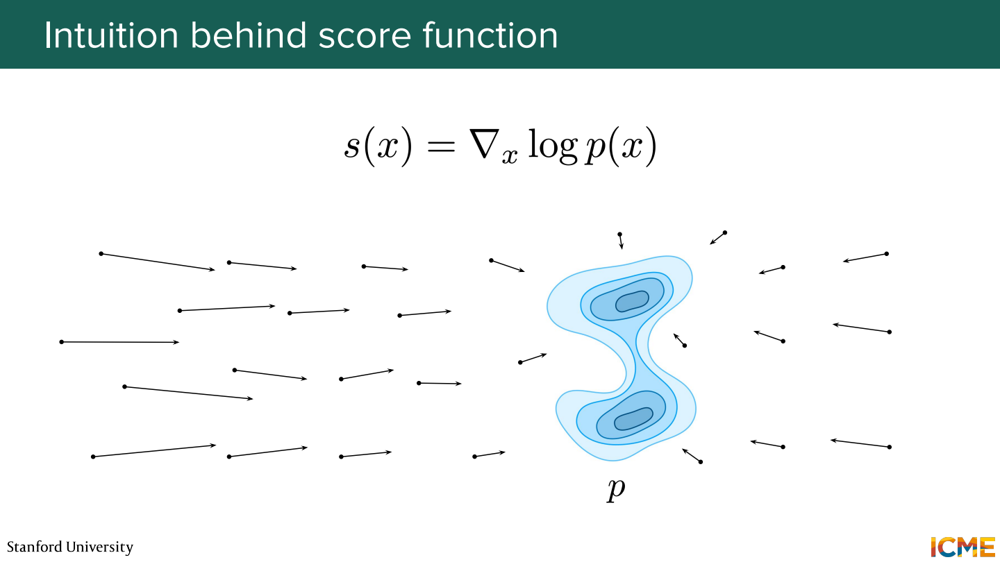
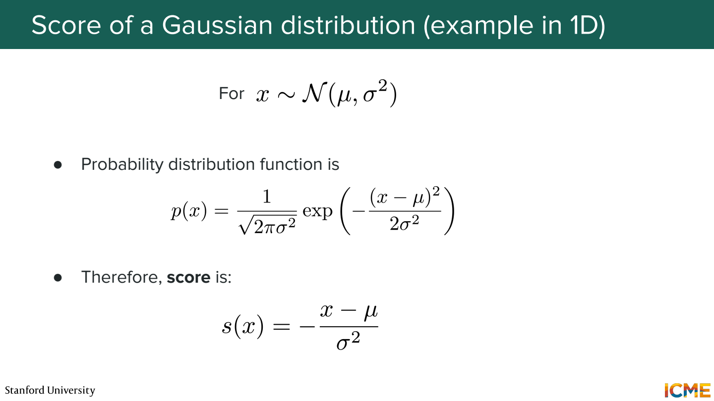
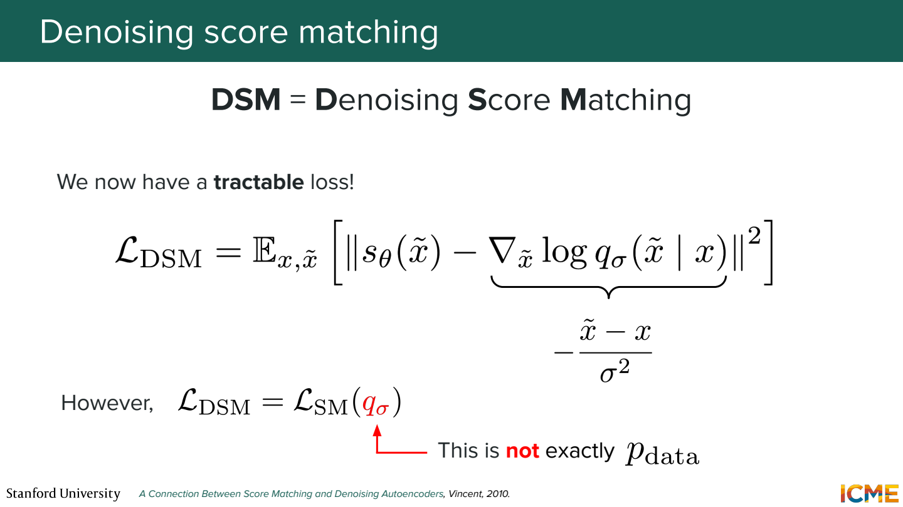
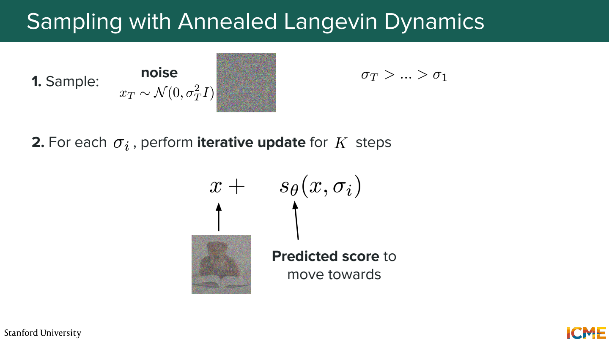
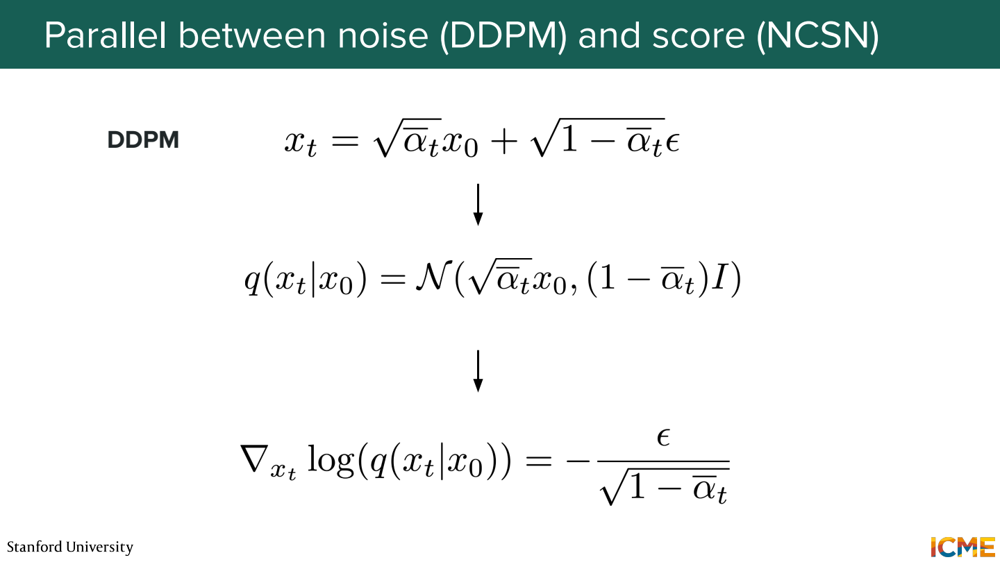
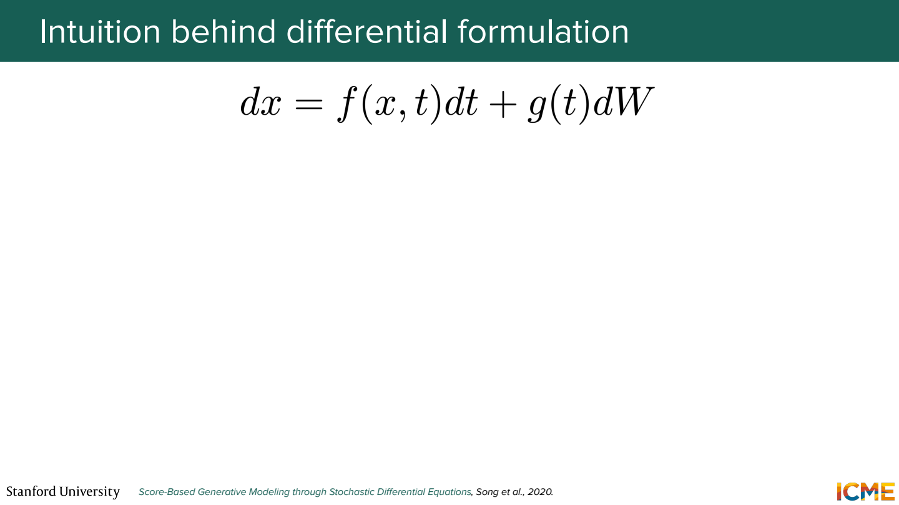
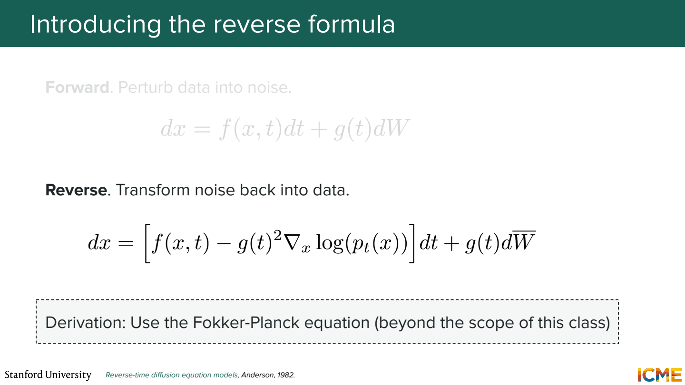
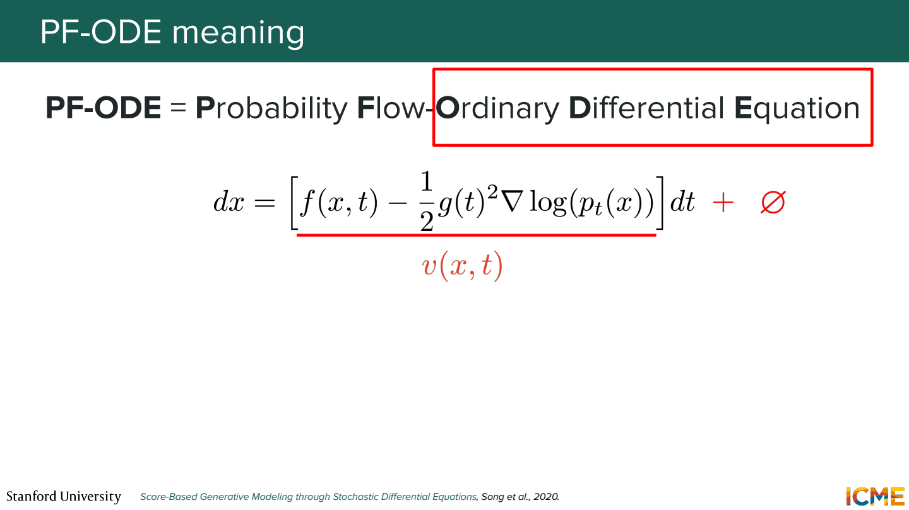
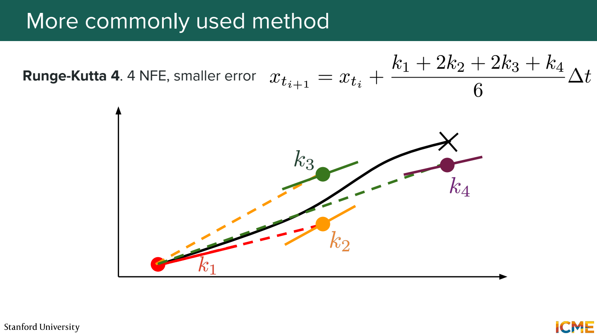
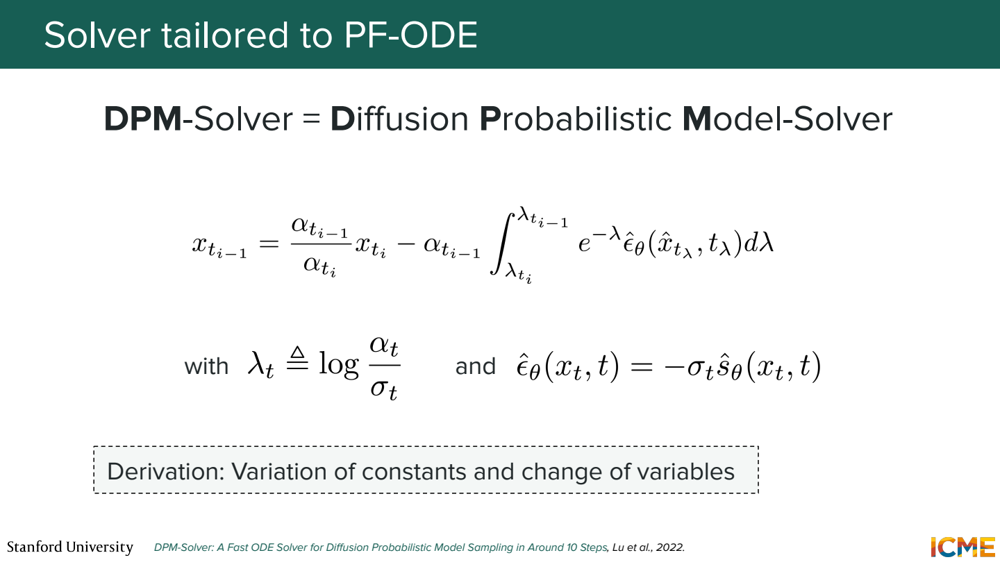

# 2단원 score로 복원 방향 찾기

1단원에서는 모델이 넣었던 노이즈 ε를 맞혔음.
이번에는 확률밀도가 높아지는 방향을 알려주는 score로 같은 과정을 보기.

## Score는 확률 자체가 아님



```text
s(x) = ∇_x log p(x)
```

여기서 미분하는 대상은 모델 파라미터가 아니라 입력 x.
현재 위치에서 log density가 어느 방향으로 얼마나 증가하는지 나타냄.
시험 점수처럼 ‘좋은 이미지에 높은 숫자 하나’가 붙는 의미는 아님.
이미지에서는 픽셀 또는 latent의 각 차원에 대응하는 벡터.



1차원 `N(μ=2, σ²=4)`라면,

```text
s(x) = -(x-2) / 4
s(0) = +0.5
s(6) = -1
s(2) = 0
```

0에서는 오른쪽으로, 6에서는 왼쪽으로 밀도를 높이는 방향.
분포 중심인 2에서는 확률밀도가 높지만 score는 0.
Score의 크기와 확률밀도의 크기가 다른 이유.

## 정답 score를 모르는데 어떻게 학습하나



실제 이미지 분포 p_data의 식은 모름.
대신 이미지에 Gaussian noise를 넣으면, 그 이미지에 조건부인 노이즈 분포는 알고 있음.

```text
x̃ = x₀ + σ ε
조건부 score = -(x̃-x₀) / σ² = -ε / σ
```

예를 들어 `x₀=1`, `σ=0.5`, `ε=2`면 x̃=2이고 target score는 -4.
이렇게 만든 target과 모델의 출력 사이 제곱 오차로 학습.

조건부 score와 전체 데이터 분포의 score는 같은가?

샘플 하나의 target과 전체 분포의 score가 항상 같은 값은 아님.
많은 원본·노이즈 쌍을 평균해 학습하면, 노이즈가 섞인 주변 분포의 score를 배우는 구조.
이때의 분포도 깨끗한 p_data 자체와는 다름.

## Score 방향으로만 계속 이동하면



단순히 밀도가 높은 곳으로만 이동하면 몇몇 mode에 모일 수 있음.
Langevin dynamics는 score 방향의 이동에 무작위 노이즈를 섞어 sampling.

대표적인 표기 하나를 쓰면,

```text
x_next = x + (η/2) × s(x) + √η × z
z ~ N(0, I)
```

Annealed 방식에서는 큰 노이즈 수준에서 시작해 더 작은 수준으로 내려감.
서로 다른 노이즈 수준의 score를 학습해두는 이유.

## Noise prediction과 score의 연결



DDPM의 `x_t = √ᾱ_t x₀ + √(1-ᾱ_t) ε`에서,

```text
σ_t = √(1-ᾱ_t)
s_θ(x_t, t) = -ε_θ(x_t, t) / σ_t
```

학습된 예측을 이런 식으로 바꿔 읽을 수 있음.
σ_t=0.6일 때 ε 예측이 -0.3이면 score 예측은 +0.5.
모델 출력의 의미는 달라도 서로 연결된 parameterization.

## 단계를 연속 시간으로 표현



```text
dx = f(x,t) dt + g(t) dW
```

f는 일정한 방향으로 움직이는 drift, g는 무작위 흔들림의 크기.
dW는 Brownian motion의 작은 변화량.
분산이 시간 간격 dt에 비례하므로 일반적인 고정 벡터에 dt를 곱한 것과 다름.



시간을 큰 t에서 작은 t로 진행하는 표기에서는,

```text
dx = [f(x,t) - g(t)² s_θ(x,t)] dt + g(t) dW̄
```

여기서는 dt가 음수 방향이라는 점을 같이 보기.
수식에 마이너스가 있다고 그대로 ‘score 반대 방향으로 생성’이라고 읽으면 헷갈림.

## 무작위 항이 없는 ODE도 가능



```text
dx = [f(x,t) - 0.5 × g(t)² s_θ(x,t)] dt
```

정확한 score와 연속 시간 해를 가정하면 SDE와 같은 시간별 주변 분포를 갖는 ODE.
같은 초기 샘플이 매 순간 똑같은 경로를 간다는 뜻은 아님.
실제로는 score 오차와 수치 적분 오차도 있음.

## Step 수와 모델 호출 수



Euler는 한 시점의 기울기를 사용해 한 걸음 이동.
RK4는 한 step에서 기울기를 네 번 평가해 더 정교하게 이동.

```text
Euler 20 steps → 보통 20 NFE
RK4 20 steps → 보통 80 NFE
```

NFE는 Number of Function Evaluations.
같은 step 수라고 계산 비용까지 같은 건 아님.
위 수치는 vector field 호출 기준이고, CFG 등은 실제 모델 계산량을 더 늘릴 수 있음.



DPM-Solver 계열은 diffusion ODE의 구조를 활용해서 적분을 근사.
단계를 무조건 크게 잡는 것보다, 같은 호출 예산에서 오차를 줄이는 방식으로 생각.

## 참고자료

- [Stanford CME 296](https://cme296.stanford.edu/)
