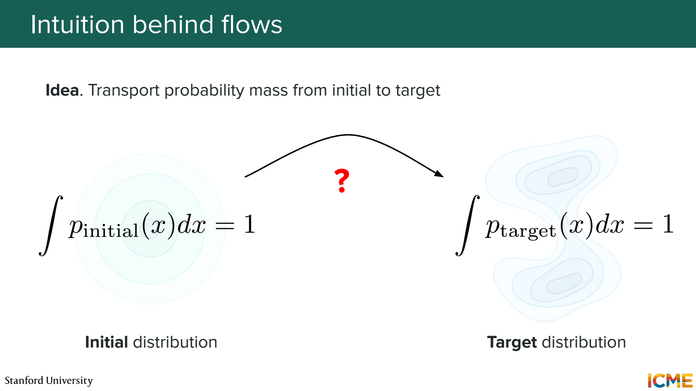
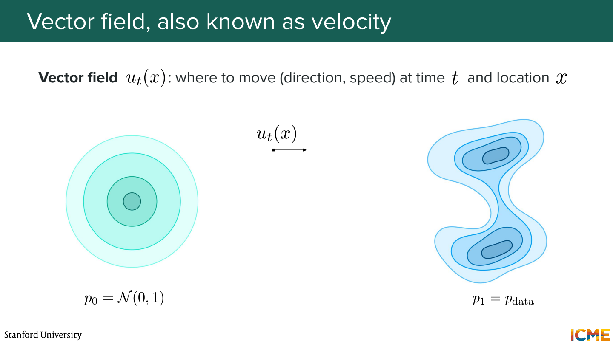
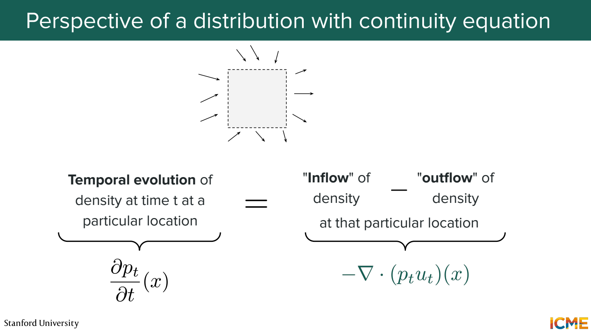
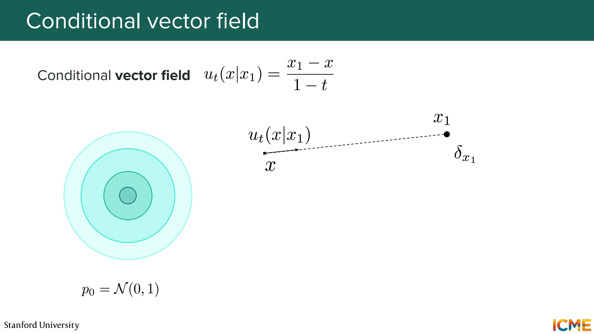
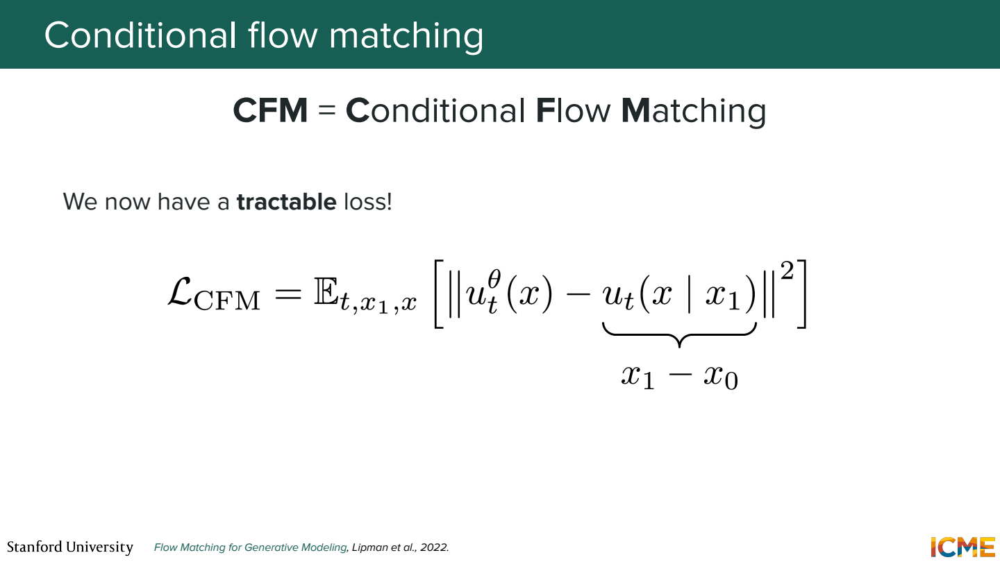
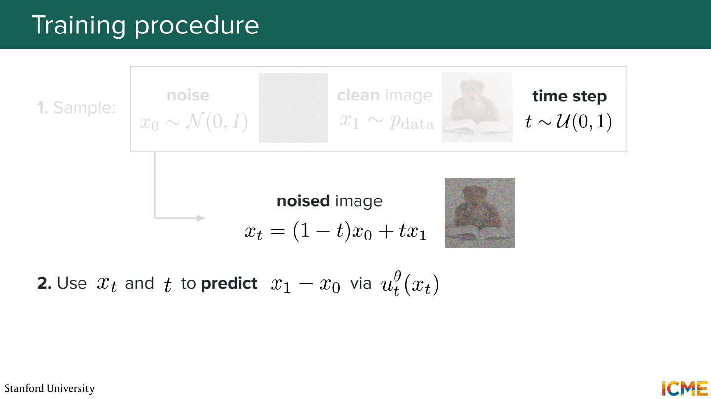
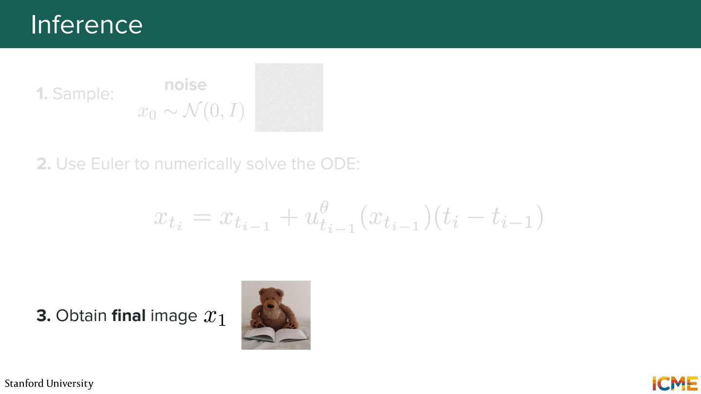
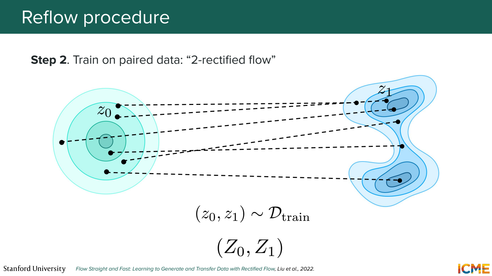
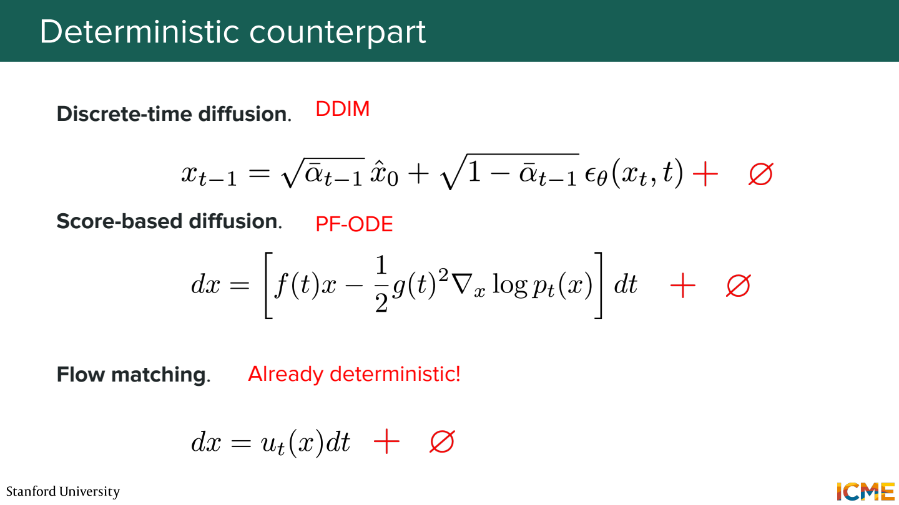

# 3단원 노이즈를 데이터로 옮기는 속도 학습하기

이번에는 score 대신 velocity를 예측.
현재 위치와 시간에서 어느 방향으로 얼마나 움직일지 학습하는 방식.

## 분포를 다른 분포로 이동



처음에는 Gaussian noise에서 점을 뽑고, 마지막에는 이미지 데이터처럼 분포하게 만들기.
샘플 하나가 움직이는 경로를 많이 모으면 분포 전체의 변화가 됨.

여기서는 강의의 flow matching 표기에 맞춰 `t=0은 노이즈`, `t=1은 데이터`로 둠.
DDPM에서 x₀를 깨끗한 이미지라고 썼던 것과 방향이 바뀜.



```text
dx_t / dt = v_θ(x_t, t)
```

v는 위치 x_t와 시간 t에서의 속도 벡터.
예를 들어 현재 x=1, 예측 속도 2, 작은 시간 간격 0.1이면 Euler 한 걸음은 `1+0.1×2 = 1.2`.
실제로는 이동한 위치에서 속도를 다시 계산.

## 점들의 이동과 밀도의 변화



같은 구간 안으로 들어오는 점이 나가는 점보다 많으면 그 구간의 밀도가 높아짐.
반대면 밀도가 낮아짐.

```text
∂p_t / ∂t = -∇·(p_t v_t)
```

p_t v_t는 밀도가 속도를 따라 흐르는 양.
발산은 한 지점 주변에서 밖으로 퍼져 나가는 정도로 생각.
샘플을 옮기는 식과 분포가 변하는 식을 연결하는 관계.

## 정답 속도를 어떻게 만드나



노이즈 x₀와 데이터 x₁을 하나씩 뽑아서 직선 경로를 만들면 간단해짐.

```text
x_t = (1-t) x₀ + t x₁
이 경로의 속도 = x₁ - x₀
```

숫자 예제로 x₀=-1, x₁=3이면 속도는 4.
t=0.25에서 x_t=0, t=0.5에서 x_t=1.

직선 한 개 위에서는 속도가 일정하므로 target을 바로 계산할 수 있음.
가우시안 시작점을 하나의 데이터로 모으는 조건부 표현은 `(x₁-x)/(1-t)`로도 나타남.



```text
loss = E[ ||v_θ(x_t, t) - (x₁-x₀)||² ]
```

같은 위치와 시간에 서로 다른 학습 경로가 지나갈 수도 있음.
모델은 그 위치에서 가능한 조건부 속도들을 평균하는 방향을 배우게 됨.
특정 원본으로 가는 직선 하나를 외우는 것과 다름.

## 학습 때는 경로 전체를 적분하지 않음



```text
noise x₀, data x₁, 시간 t 선택
→ x_t를 식으로 계산
→ v_θ(x_t,t) 예측
→ x₁-x₀와 비교
```

각 업데이트를 위해 ODE solver를 끝까지 돌릴 필요는 없음.
중간 위치와 정답 속도를 직접 만들 수 있기 때문.



반면 생성할 때는 정답 x₁을 모름.
새 노이즈에서 시작해 모델이 예측하는 속도를 따라 0에서 1까지 적분.

```text
x_{t+Δt} ≈ x_t + Δt × v_θ(x_t,t)
```

학습 경로가 직선이면 생성도 한 걸음이면 되나?

여러 조건부 경로를 평균한 vector field의 실제 궤적은 휘어질 수 있음.
한 위치에서 구한 속도를 끝까지 유지하면 오차가 커질 수 있음.

## Rectified flow와 reflow



학습된 flow로 노이즈를 실제로 이동시켜 도착점을 얻음.
그 시작점과 도착점을 새 쌍으로 묶고, 다시 더 곧은 이동을 학습하는 것이 reflow의 핵심.

```text
처음: 무작위로 연결한 noise와 data
reflow: 기존 모델이 연결한 시작점과 도착점
```

경로를 덜 휘게 만들어 적은 step으로도 이동하기 쉽게 하려는 것.
이 과정이 언제나 전역 최적의 수송 경로를 보장한다고 읽으면 안 됨.

## DDIM, ODE, flow의 공통점



모두 초기 노이즈에서 출발해 데이터 쪽으로 이동하는 생성 경로를 만들 수 있음.
다만 어떤 경로를 정하고 무엇을 예측하도록 학습하는지가 다름.

- DDPM parameterization: 넣었던 노이즈 ε를 예측
- Score matching: noisy distribution의 log density 기울기를 예측
- Flow matching: 선택한 확률 경로를 움직이는 속도를 예측

같은 Transformer를 사용하더라도 출력의 의미와 sampler가 달라질 수 있음.

## 참고자료

- [Stanford CME 296](https://cme296.stanford.edu/)
