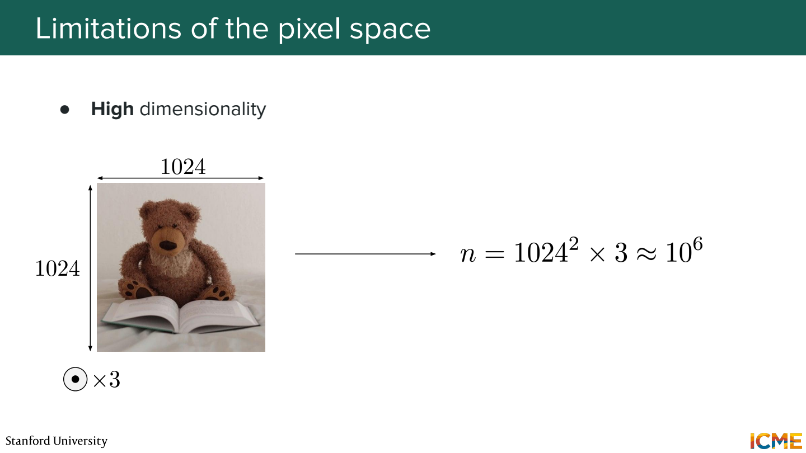
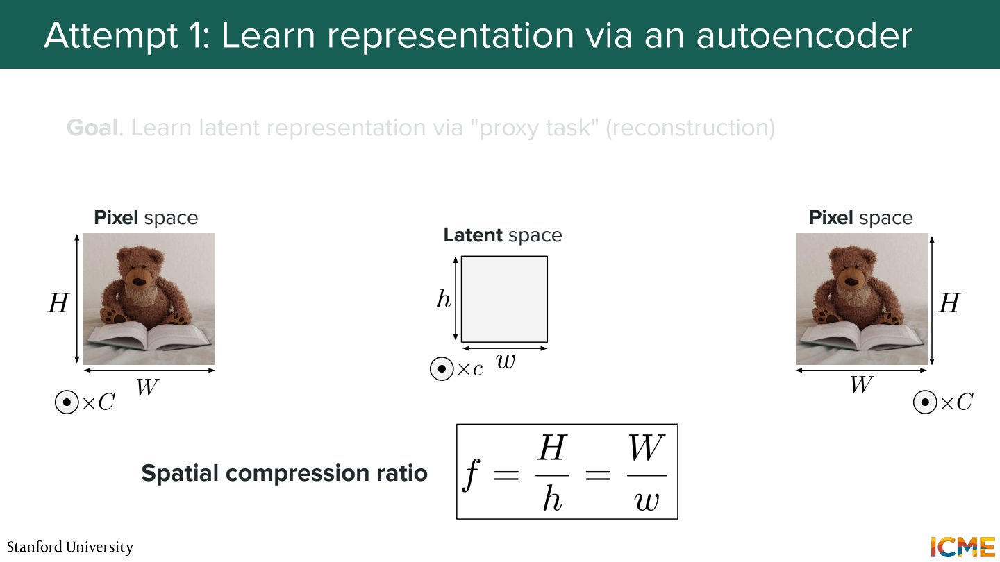
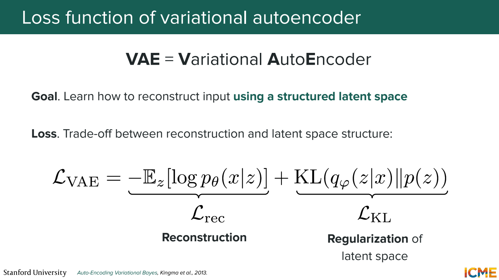
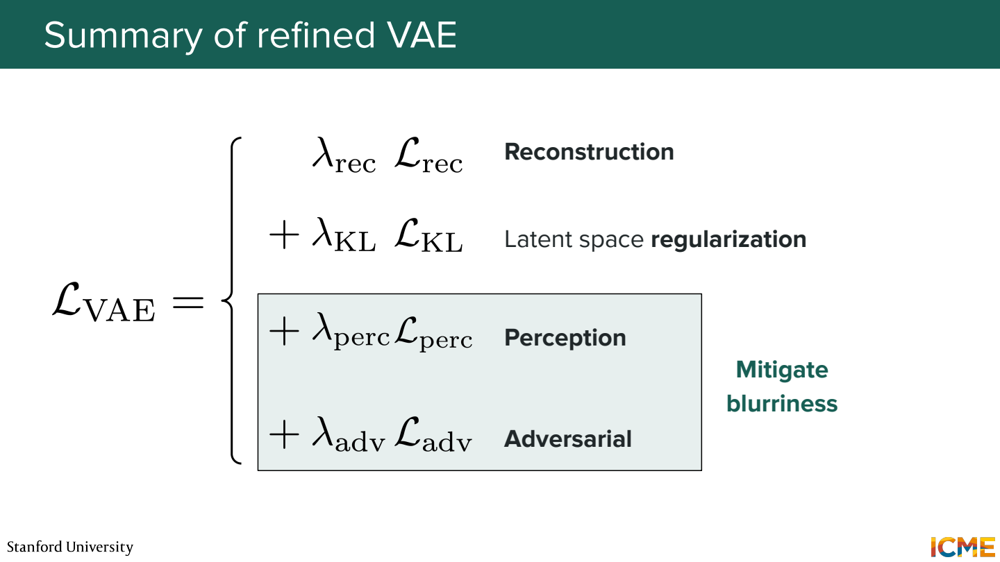
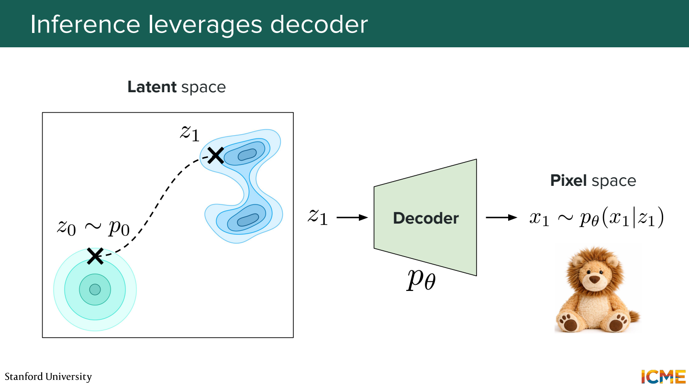
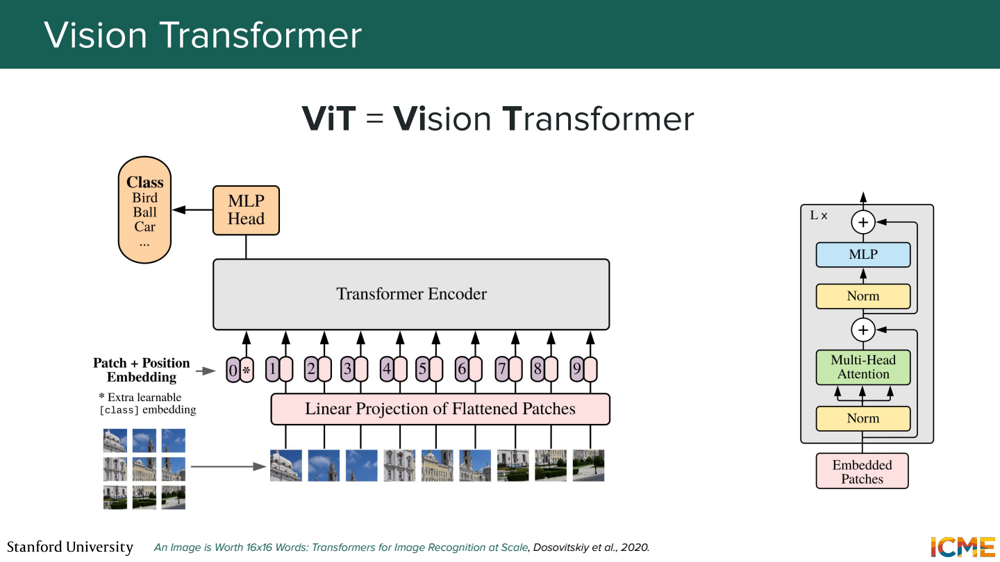
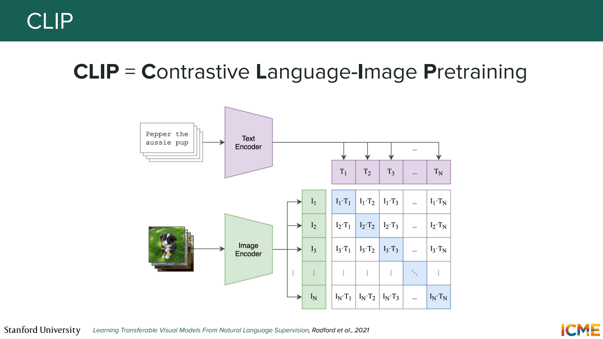
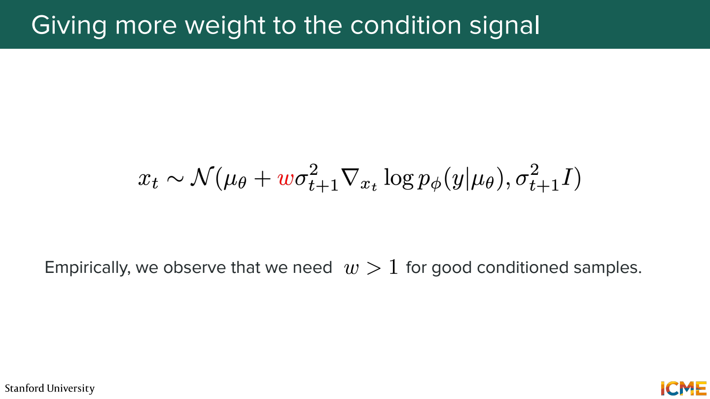
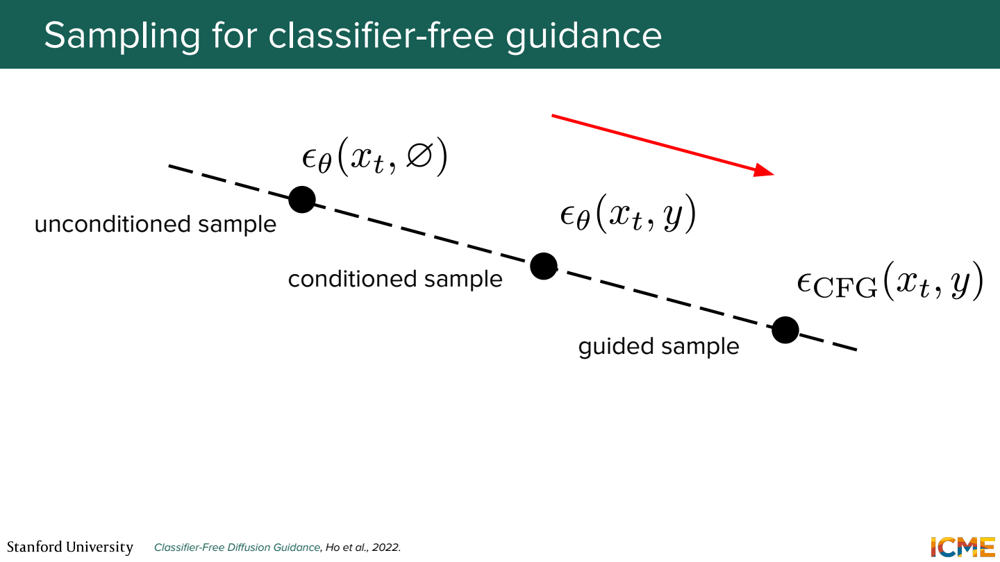

# 4단원 작은 공간에서 생성하고 텍스트로 방향 잡기

큰 이미지를 모든 step에서 직접 계산하면 비용이 큼.
먼저 이미지를 작은 latent로 압축하고 그 공간에서 생성할 수 있음.
원하는 이미지를 만들기 위해 텍스트 조건도 연결.

## Pixel 공간의 크기



1024×1024 RGB 이미지는 숫자 3,145,728개.
가로와 세로를 각각 절반으로 줄이면 픽셀 수는 1/4이 됨.
해상도가 높아질수록 매번 denoising하는 계산도 부담.

## Autoencoder로 압축과 복원



```text
이미지 x → encoder → latent z → decoder → 복원 이미지 x̂
```

크기 계산용 예제로 `512×512×3 → 64×64×4`라고 가정.
숫자 개수는 786,432개에서 16,384개로 줄어듦.
가로·세로 압축률은 각각 8이고, 전체 숫자 개수 비율은 48.
채널 수가 달라지므로 ‘8배 압축’과 ‘숫자가 8배 감소’를 혼동하지 않기.

작은 z에 넣으면 정보가 완전히 보존되나?

보통 손실이 있음. 글씨나 세부 무늬가 복원 과정에서 달라질 수 있음.
생성 모델이 잘해도 decoder가 표현하지 못하는 세부는 제한이 됨.

## VAE는 latent의 분포도 다룸



일반적인 VAE encoder는 z 하나만 내는 대신 μ와 σ를 출력.
`z = μ + σ ⊙ ε`, `ε ~ N(0,I)`로 샘플을 만듦.

```text
loss = reconstruction 항 + KL(q(z|x) || p(z))
```

복원만 잘하면 서로 가까워야 할 이미지들의 latent가 제각각 흩어질 수 있음.
KL 항은 encoder가 만드는 분포를 정해둔 prior 쪽으로 정리하는 역할.

1차원 Gaussian posterior와 표준정규 prior라면,

```text
KL = 0.5 × (μ² + σ² - log σ² - 1)
μ=0, σ=1이면 0
μ=2, σ=1이면 2
```

KL만 줄이면 복원에 필요한 정보도 사라질 수 있으므로 균형이 필요.



실제 이미지용 autoencoder는 pixel 복원 외에 perceptual·adversarial loss 등을 조합하기도 함.
픽셀 오차가 작아지는 것과 시각적으로 선명해지는 것이 항상 같지는 않아서.

## Diffusion은 latent에서 수행



학습에서는 encoder로 이미지의 latent를 만들고 그 latent에 노이즈를 넣음.
생성에서는 latent 모양의 노이즈에서 시작해 denoising한 뒤 decoder로 이미지 복원.

```text
학습: 이미지 → encoder → latent → 노이즈 추가 → 복원 학습
생성: latent noise → 반복 생성 과정 → 깨끗한 latent → decoder
```

매 step마다 원본 해상도의 이미지를 만들 필요가 없다는 점이 핵심.

## 이미지와 텍스트를 비교할 수 있는 표현



ViT는 이미지를 patch로 나누고 Transformer로 처리.
텍스트 encoder와 이미지 encoder가 각각 표현을 만들면 두 modality를 비교하는 학습이 가능.



CLIP은 같은 쌍의 이미지와 문장 표현은 가깝게, 다른 쌍은 구분되게 학습.
예를 들어 batch에 `(고양이 사진, 고양이 문장)`, `(자동차 사진, 자동차 문장)`이 있다면,

```text
                고양이 문장   자동차 문장
고양이 사진       높게          낮게
자동차 사진       낮게          높게
```

행과 열 양쪽으로 올바른 짝을 찾는 contrastive objective.
Batch 안의 다른 짝들을 negative로 사용하지만, 실제로 내용이 비슷한 쌍도 있을 수 있음.
CLIP 유사도가 높다고 물체 수나 모든 공간 관계까지 정확한 것은 아님.

## Classifier guidance



별도 classifier가 noisy image를 보고 조건 c일 가능성을 평가.
`∇_x log p(c|x_t)`를 이용해서 조건에 더 맞는 방향으로 생성 경로를 조정.

예를 들어 ‘고양이’ 조건이면 고양이로 분류될 가능성을 높이는 쪽을 추가.
노이즈가 섞인 입력에서도 작동하는 classifier가 필요.

## Classifier-free guidance



CFG는 별도 classifier 없이 조건이 있는 예측과 없는 예측을 조합.
학습 중 조건을 일부 확률로 빼서 두 상황을 모두 다루게 함.

여기서는 다음 scale 표기를 사용.

```text
ε_guided = ε_uncond + s × (ε_cond - ε_uncond)
```

한 성분의 값이 ε_uncond=0.2, ε_cond=0.5라면,

```text
s=0 → 0.2
s=1 → 0.5
s=3 → 1.1
```

s=1은 조건부 예측, s>1은 그 차이를 더 밀어주는 형태.
자료마다 `조건부 + w×차이`로 쓰기도 해서 scale 정의를 확인해야 함.

Scale을 계속 올리면 prompt를 더 정확히 따를까?

너무 강하면 다양성이 줄거나 색·형태가 부자연스러워질 수 있음.
텍스트를 따르는 정도와 이미지 품질을 같이 확인해야 함.

## 참고자료

- [Stanford CME 296](https://cme296.stanford.edu/)
