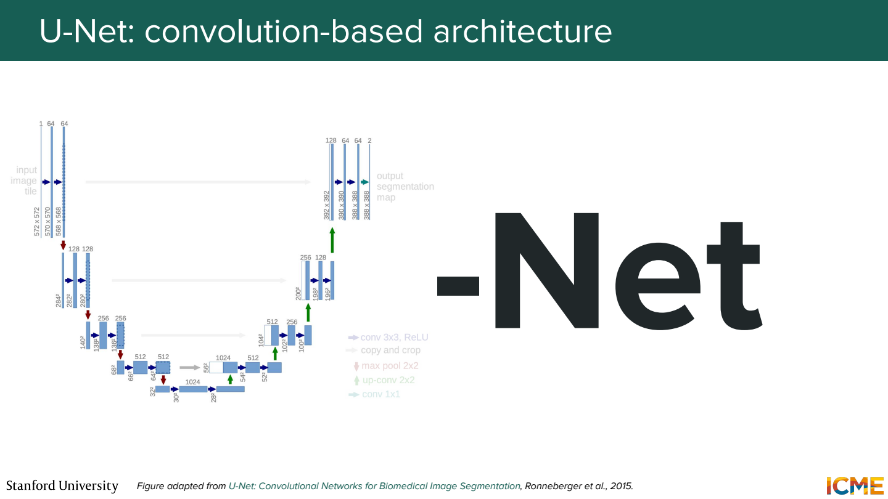
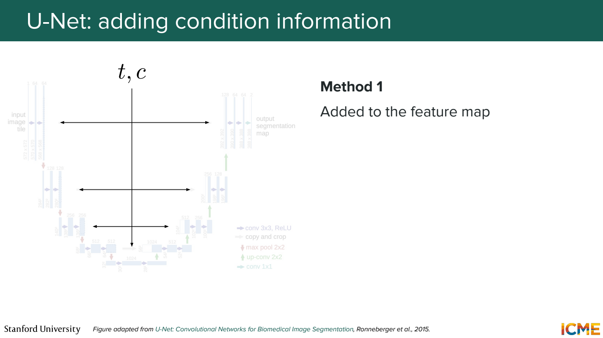
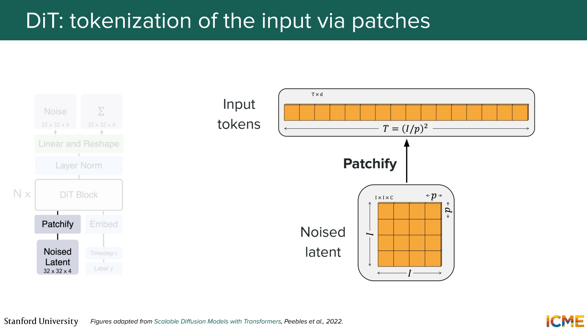
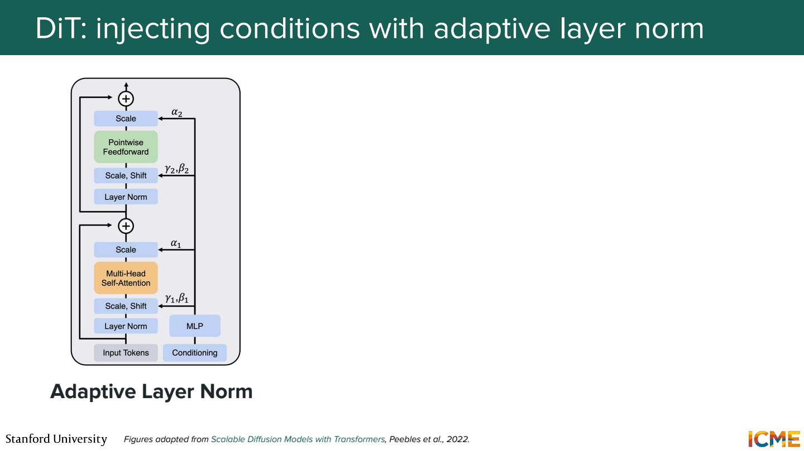
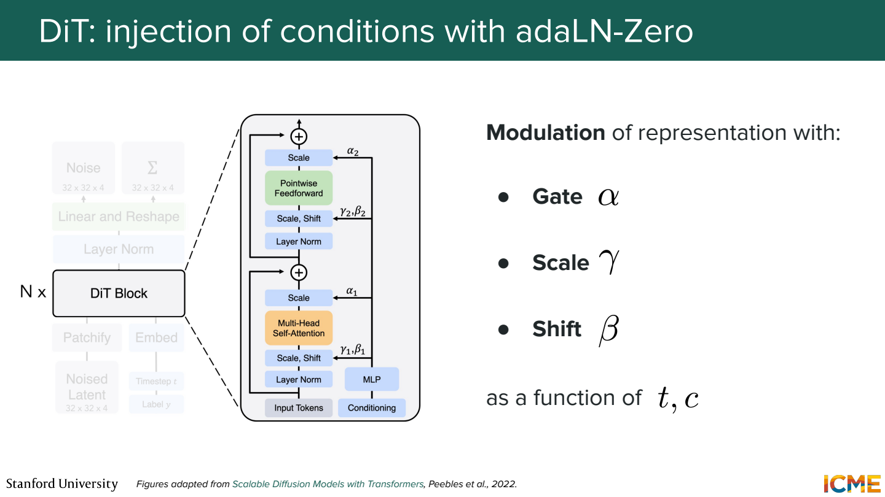
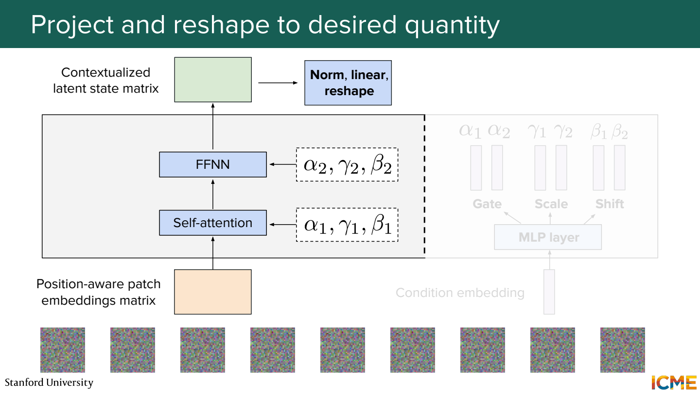
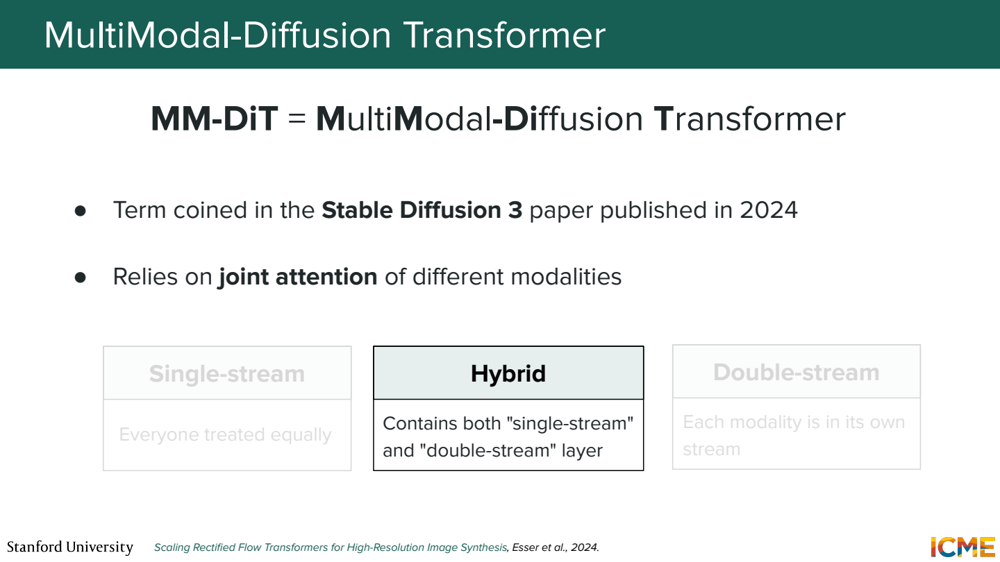
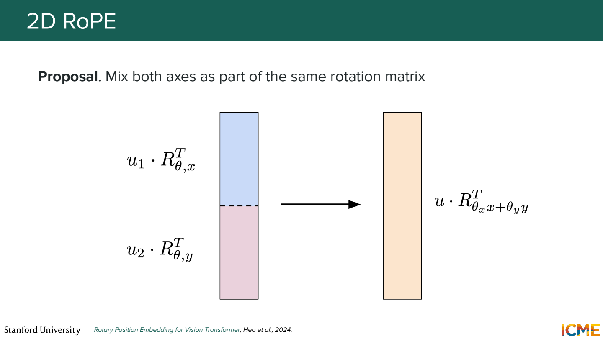

# 5단원 노이즈를 예측하는 모델 안쪽

Diffusion은 학습과 생성의 방식이고, U-Net이나 Transformer는 그 안에서 쓰는 모델 구조.
어떤 구조를 쓰든 noisy input과 시간·조건을 받아 필요한 값을 예측해야 함.

## U-Net은 줄였다가 다시 키움



Downsampling으로 공간 크기를 줄이면서 넓은 영역의 정보를 모음.
Upsampling으로 다시 크기를 키워 위치별 출력을 만듦.
같은 해상도의 앞쪽 feature를 뒤쪽으로 전달하는 skip connection도 사용.

```text
64×64 → 32×32 → 16×16
                   ↓
64×64 ← 32×32 ← 16×16
```

작은 feature map은 큰 구조를 보기 쉽지만 세부 위치 정보가 줄어들 수 있음.
앞쪽의 세부 정보를 연결해서 복원에 활용하는 이유.
여기서 skip은 feature를 이어 붙이는 등 구현이 다양해서 residual의 덧셈과 항상 같지는 않음.

## 시간과 조건을 전달



같은 형태의 입력이라도 생성 초반인지 마지막인지에 따라 필요한 예측이 달라짐.
t를 embedding으로 바꿔 각 block의 feature에 반영.
Class embedding이나 텍스트 조건도 더하거나 cross-attention 등으로 연결할 수 있음.

`강아지`라는 조건을 입력 맨 앞에 한 번 넣는 것만이 방법은 아님.
여러 층에서 조건을 다시 사용하게 만드는 구성이 가능.

## DiT는 latent를 patch token으로 처리



DiT는 Diffusion Transformer.
Noisy latent를 작은 patch로 나눠 Transformer 입력으로 사용.

계산용으로 `16×16×4` latent를 `2×2` patch로 나눈다고 가정.

```text
patch 수: 8×8 = 64개
patch 하나의 숫자: 2×2×4 = 16개
16개 숫자 → 선형 변환 → 예를 들어 128차원 token
```

모델 안에서는 `[64, 128]` 모양의 token 배열로 처리 가능.
128은 예제에서 정한 hidden dimension. Patch의 숫자 개수와 같을 필요는 없음.

## adaLN은 조건에 따라 정규화 뒤 값을 조절



LayerNorm 뒤에 적용하는 scale과 shift를 조건 embedding에서 계산.

```text
조건 c와 시간 t → 작은 네트워크 → γ, β
출력 = γ ⊙ LayerNorm(x) + β
```

구현에서는 scale을 `1+γ`로 쓰기도 함.
고정된 γ, β 대신 현재 시간과 조건에 맞는 값을 쓰는 점이 핵심.

정규화가 조건을 이해하는 건가?

정규화 계산 자체가 텍스트를 읽는 건 아님.
조건을 읽은 작은 네트워크가 feature를 얼마나 키우고 이동할지 정해주는 구조.



adaLN-Zero에서는 residual branch의 결과에 곱할 gate도 사용.
초기에 gate가 0이면 `x + 0×F(x)`이므로 block이 입력을 거의 그대로 통과시킴.
학습하면서 필요한 변화를 열어가는 형태.

## Transformer 출력은 다시 공간 배열로



앞의 예제에서 token 64개를 처리했다면 각 token을 patch 모양의 출력으로 변환.
이들을 원래 위치로 합쳐 `16×16×4` 같은 예측 배열을 얻음.

```text
noisy latent → patch tokens → Transformer
→ patch별 예측 → 공간 배열 → sampler update
```

출력이 바로 완성된 RGB 이미지인 것은 아님.
Noise나 velocity 등 학습 목표에 맞는 값을 내고, sampler가 다음 latent를 계산.
여러 step 이후 decoder가 최종 이미지를 만듦.

## 텍스트와 이미지를 함께 처리



MM-DiT 계열은 이미지와 텍스트의 표현이 joint attention으로 정보를 주고받게 함.

예를 들어 `빨간 컵`의 텍스트 token과 컵이 있을 법한 이미지 patch가 서로 참조.
텍스트를 단순한 class 번호 하나로 압축하는 것보다 풍부한 조건을 다룰 수 있음.

Single-stream은 두 modality를 한 stream에서 처리.
Double-stream은 modality별 변환을 두면서 attention으로 연결하는 형태.
두 종류의 block을 섞는 hybrid 구성도 있음.
이름만 보고 모든 층의 가중치 공유 방식이 같다고 가정하지 않기.

## 이미지 위치는 가로와 세로가 있음



텍스트는 주로 1차원 순서지만 이미지 patch에는 `(행, 열)` 좌표가 있음.
2D RoPE는 두 축의 위치를 Q와 K의 회전에 반영.
축별로 차원을 나누는 방법이나, 회전에 두 좌표를 함께 반영하는 방법 등이 있음.

`(2,3)`과 `(2,4)`는 가로 이웃, `(2,3)`과 `(3,3)`은 세로 이웃.
단순히 펼친 배열의 index 차이만으로는 이 구분이 직접 드러나지 않음.
Patch 위치 관계를 attention에서 활용하도록 넣는 장치.

## 참고자료

- [Stanford CME 296](https://cme296.stanford.edu/)
