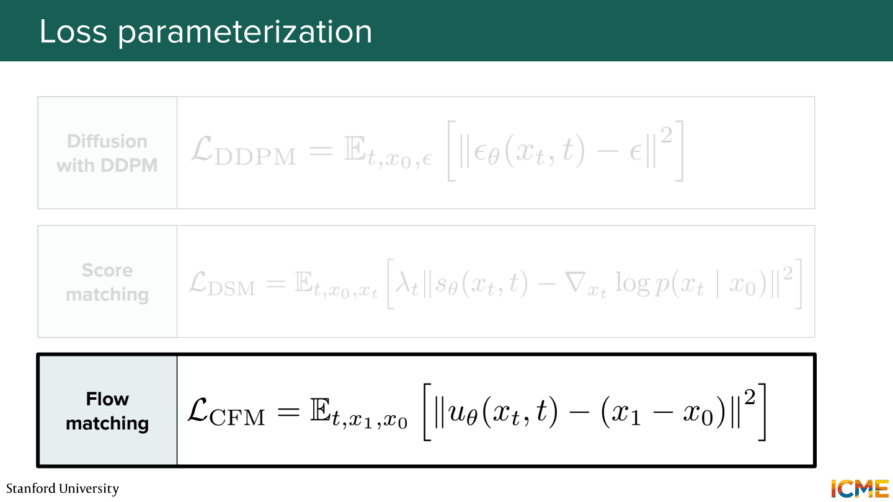
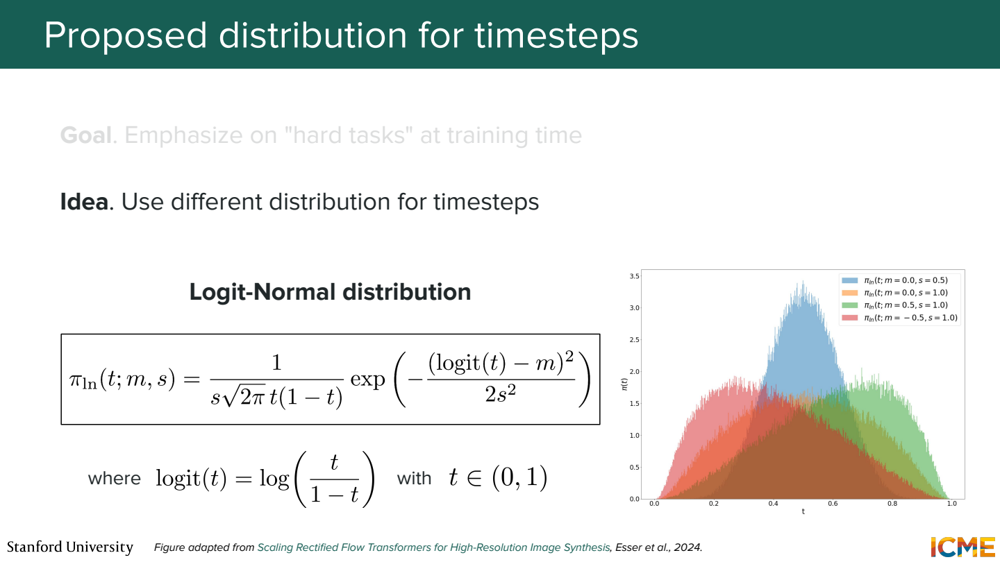
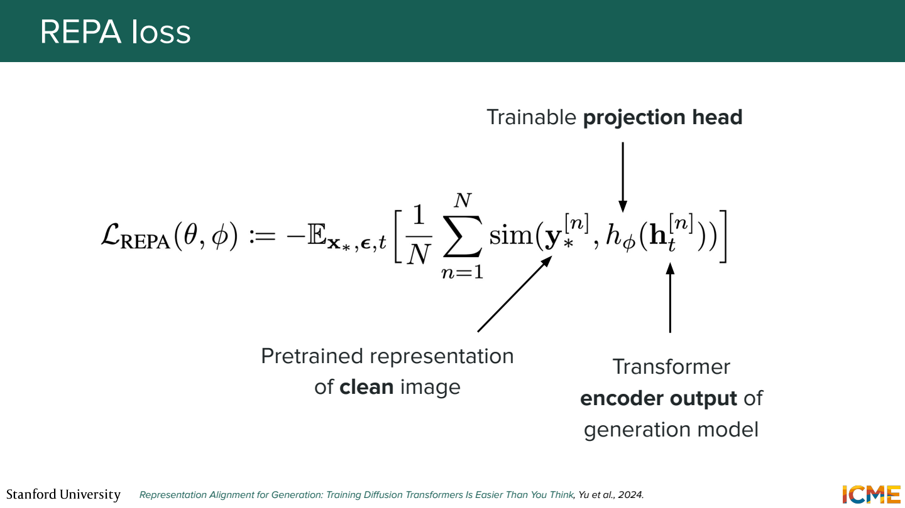
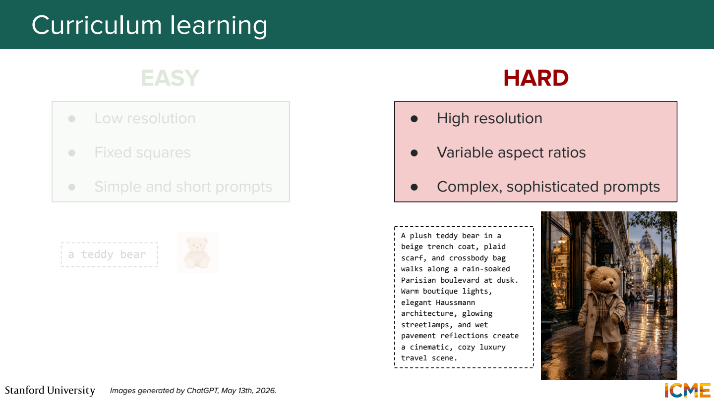
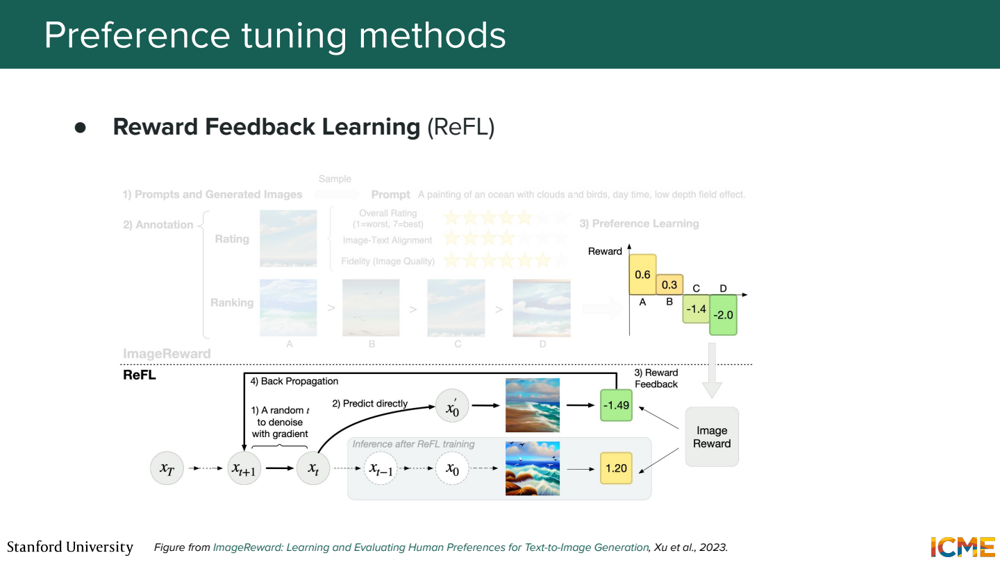
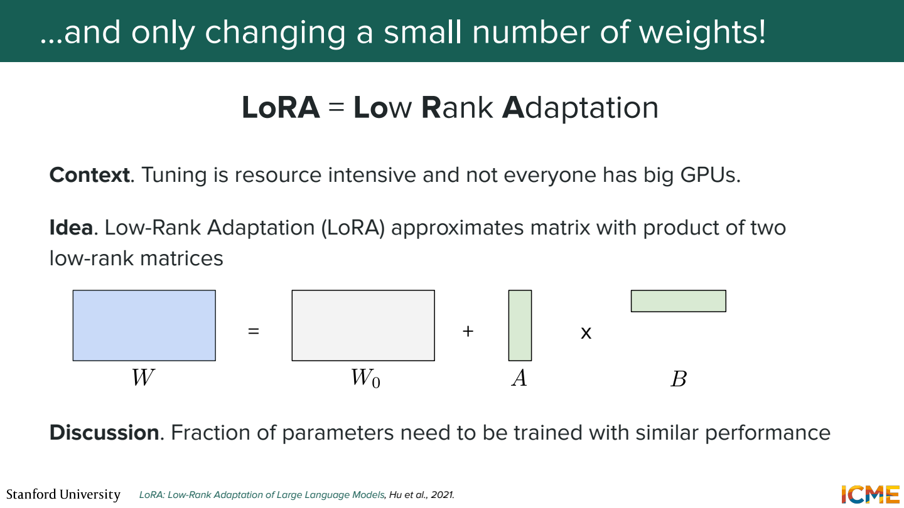
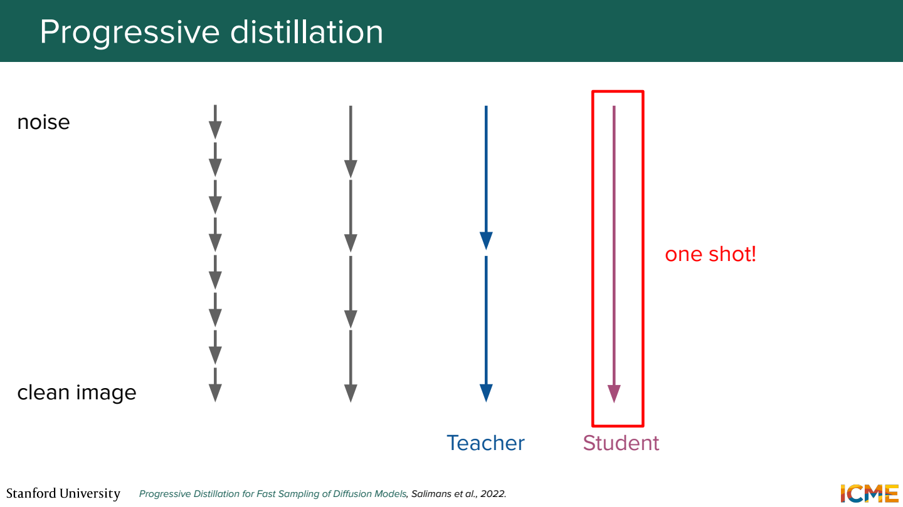
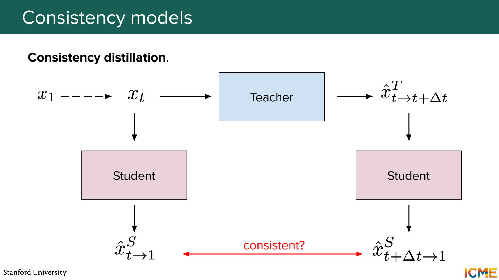
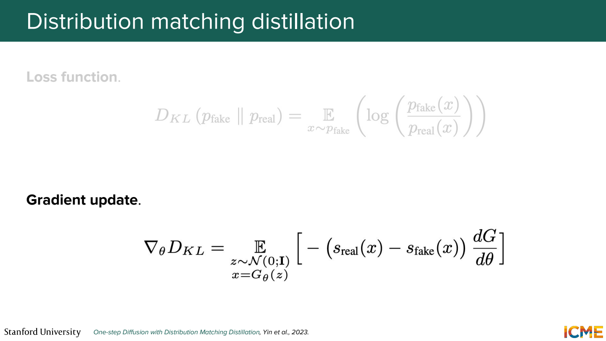

# 6단원 생성 품질을 높이고 step 줄이기

같은 DiT 구조여도 무엇을 예측하고 어떤 데이터를 얼마나 보여주는지에 따라 학습이 달라짐.
학습 이후에는 선호도·개인화·증류로 목적에 맞게 조정할 수도 있음.

## 출력의 의미부터 확인



Noisy input을 보고 노이즈 ε를 예측할 수도 있고, score나 flow velocity를 예측할 수도 있음.
연결식이 있다고 loss까지 아무 조건 없이 같은 것은 아님.

예를 들어 `x_t = a_t x₀ + σ_t ε`에서,

```text
x̂₀ = (x_t - σ_t ε̂) / a_t
x̂₀ - x₀ = -(σ_t/a_t) × (ε̂-ε)
```

같은 noise 예측 오차라도 σ_t/a_t가 크면 원본 추정 오차가 커짐.
출력 변환과 시간별 loss 가중치를 함께 봐야 하는 이유.
Flow matching의 시간 방향도 자료마다 다를 수 있어서 0과 1이 무엇인지 먼저 확인.

## 어떤 노이즈 수준을 더 자주 보여줄까



t를 uniform하게 뽑는 것이 유일한 방법은 아님.
특정 구간을 더 자주 학습하게 만드는 분포를 사용할 수 있음.

노이즈가 거의 없을 때는 작은 세부를 고치는 문제.
노이즈가 아주 많을 때는 큰 구조를 잡는 문제에 가까움.
그 사이 어려운 구간에 학습을 더 배분하려는 접근도 있음.

모든 해상도에서 같은 t가 같은 난이도일까?

해상도가 달라지면 같은 noise schedule의 체감 효과도 달라질 수 있음.
해상도에 맞춰 timestep을 조정하는 방법이 나오는 이유.
‘중간 t만 중요’처럼 고정된 규칙으로 외우기보다는 모델과 schedule을 같이 보기.

## 이미 배운 시각 표현을 빌리기



REPA는 생성 모델의 중간 표현을 pretrained vision encoder의 표현과 맞추는 추가 학습 신호.
Noisy input을 처리하는 중간 feature를 projection한 뒤, clean image의 시각 특징과 비교.

```text
clean image → 고정된 vision encoder → target feature
noisy image → 생성 모델 중간 층 → projection → 비교
```

최종 이미지의 픽셀을 그대로 복사하라는 뜻은 아님.
이미지의 의미 있는 구조를 표현하는 데 도움을 주는 보조 목표.

## 쉬운 데이터에서 복잡한 데이터로



낮은 해상도와 짧은 prompt에서 시작한 뒤 높은 해상도와 복잡한 조건으로 이어갈 수 있음.

```text
초기 예: 곰 인형
복잡한 예: 파란 모자를 쓴 곰 인형이 빨간 책을 읽는 장면
```

해상도뿐 아니라 물체 수, 속성, 관계도 어려워짐.
가로·세로 비율이 다른 이미지를 모두 정사각형으로 자르면 중요한 부분이 사라질 수 있어서,
비슷한 크기·비율끼리 묶는 방식도 고려.

## 사람이 더 좋아하는 이미지로 조정



같은 prompt에서 A와 B를 생성하고 어느 쪽을 선호하는지 비교.
미적 품질뿐 아니라 prompt 준수나 형태 오류도 기준이 될 수 있음.

Reward model의 점수를 이용하거나 선호 쌍을 이용하는 학습 등 여러 접근이 있음.
언어 모델에서의 DPO 식을 이미지의 토큰 log 확률에 그대로 붙이는 식으로 생각하면 곤란.
Diffusion에서는 경로와 denoising 목표에 맞는 정식화가 필요.

예쁜 이미지에만 높은 reward를 주면?

‘세 개의 컵’에서 컵을 두 개만 그려도 높은 점수를 받을 수 있음.
원하는 작업과 reward가 맞는지 따로 확인해야 함.

## LoRA로 일부 변화만 학습



큰 가중치를 모두 바꾸는 대신 작은 low-rank 행렬의 곱으로 변화를 학습.
특정 인물·물체·스타일을 소수 이미지로 맞추는 작업 등에 활용.

한 물체를 같은 배경에서만 학습하면 배경까지 그 물체의 특징으로 묶일 수 있음.
대상을 잘 재현하는지와 다른 배경·구도에서도 prompt를 따르는지를 같이 확인.
적은 parameter를 학습한다는 것이 과적합이 없다는 뜻은 아님.

## 여러 step을 한 step으로 배우기



Teacher가 두 번 이동해서 만든 도착점을 student는 한 번에 맞히도록 학습.
이 student를 다시 teacher로 삼으면 step 수를 단계적으로 줄일 수 있음.

```text
16 steps → 8 steps → 4 steps → 2 steps
```

학습 없이 16 step sampler를 2 step으로 바꾸는 것과 다름.
큰 이동을 해도 결과를 유지하도록 모델 자체를 맞추는 과정이 추가됨.

## Consistency는 같은 궤적의 끝을 맞춤



같은 ODE trajectory 위의 서로 다른 시점을 넣어도 같은 깨끗한 끝점을 예측하게 함.

```text
같은 경로의 x_t     → 깨끗한 끝점
같은 경로의 x_{t+Δ} → 같은 끝점
```

서로 다른 이미지에서 뽑은 noisy input까지 모두 같은 결과로 보내라는 의미는 아님.
같은 경로라는 조건이 빠지면 모든 입력을 같은 이미지로 만드는 잘못된 해석이 됨.

## Distribution matching은 결과의 분포를 비교



Teacher와 student가 만드는 분포를 가깝게 맞추는 접근.
Noise 하나마다 teacher의 특정 이미지와 pixel MSE만 줄이는 문제와는 목표가 다름.
Score 추정 등을 이용해 student의 출력 분포를 좋은 방향으로 옮김.

호출 수를 줄여도 다양성이나 prompt 준수가 떨어지면 목적에 맞지 않을 수 있음.
같은 prompt 묶음에서 품질·조건 준수·속도를 함께 비교해야 함.

## 참고자료

- [Stanford CME 296](https://cme296.stanford.edu/)
