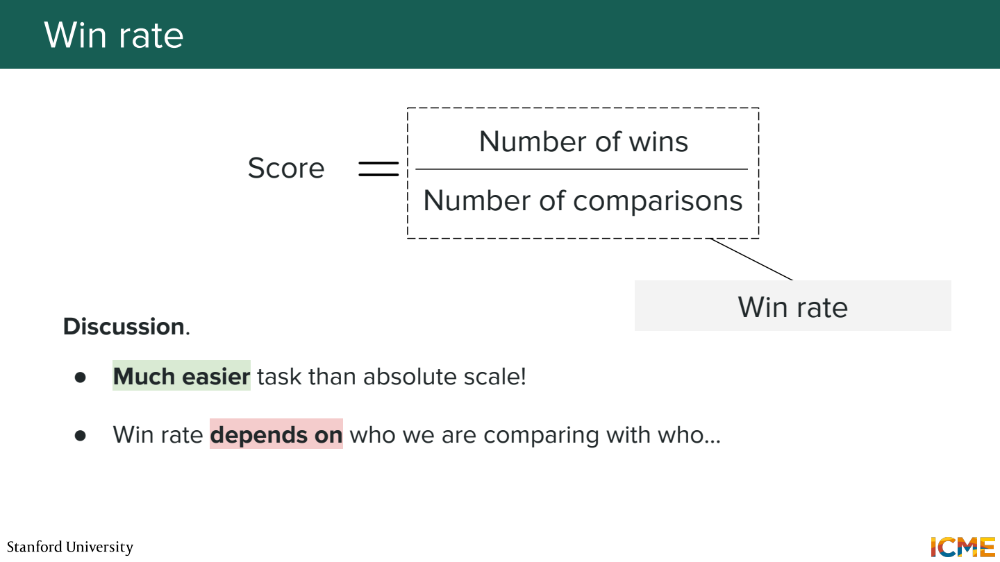
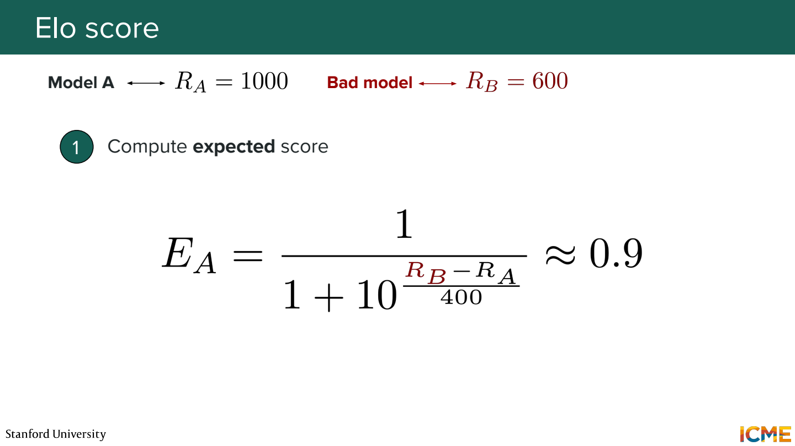
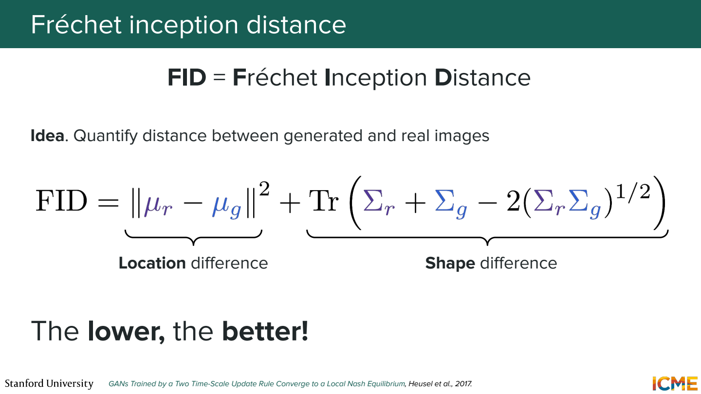
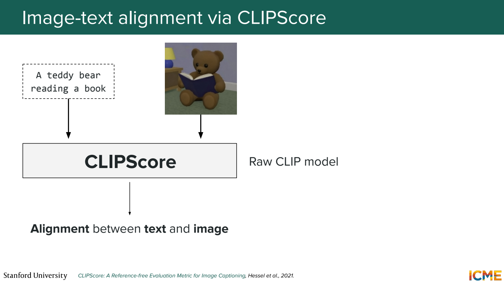
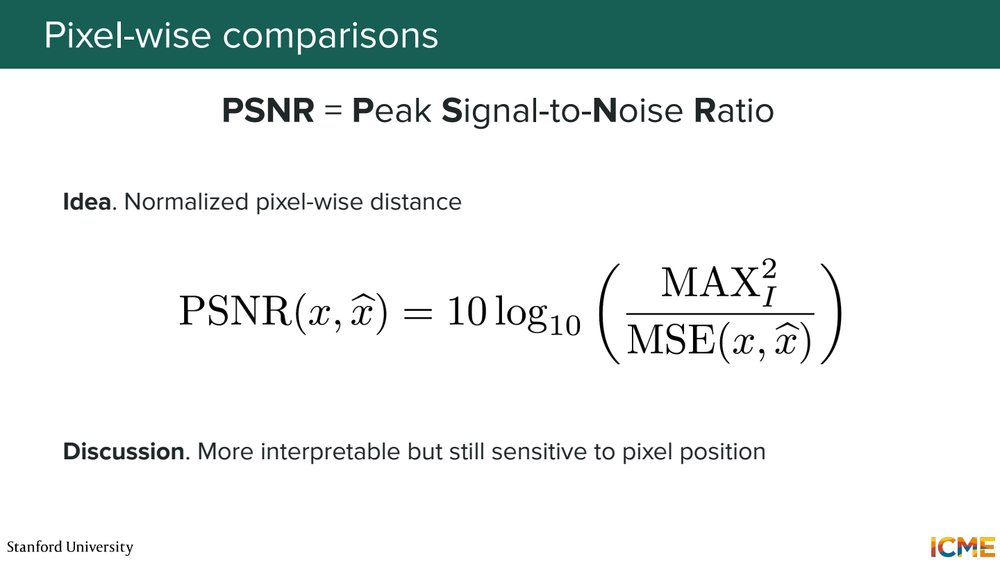
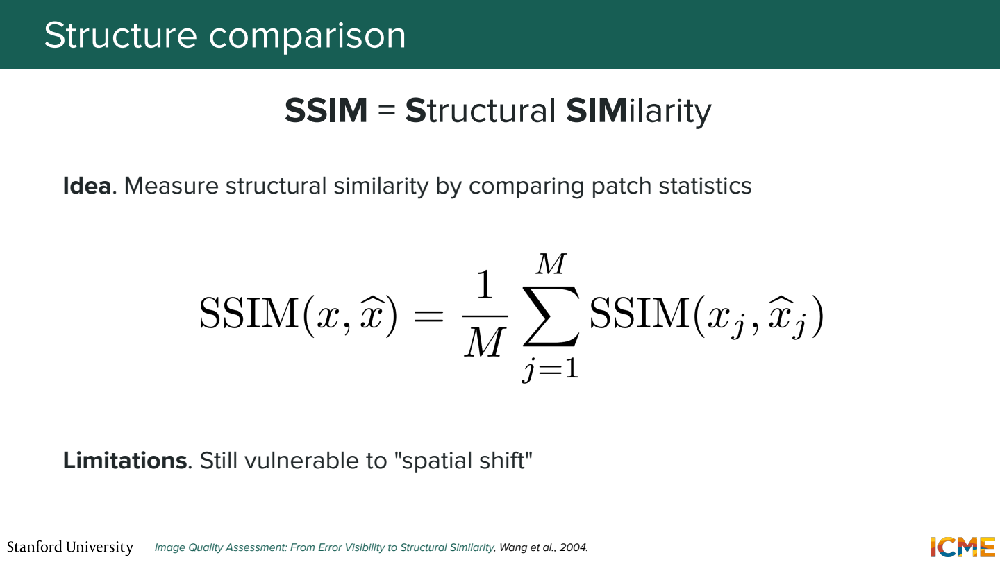
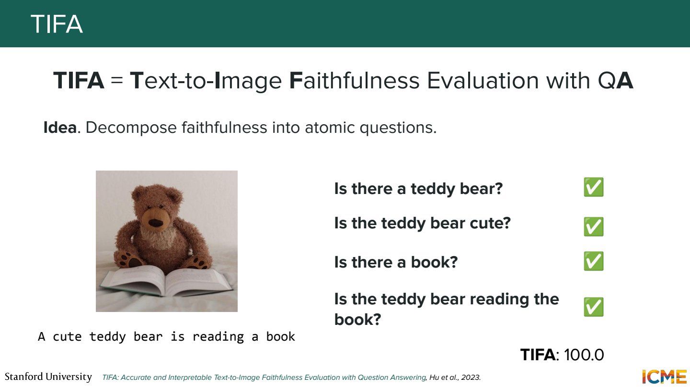
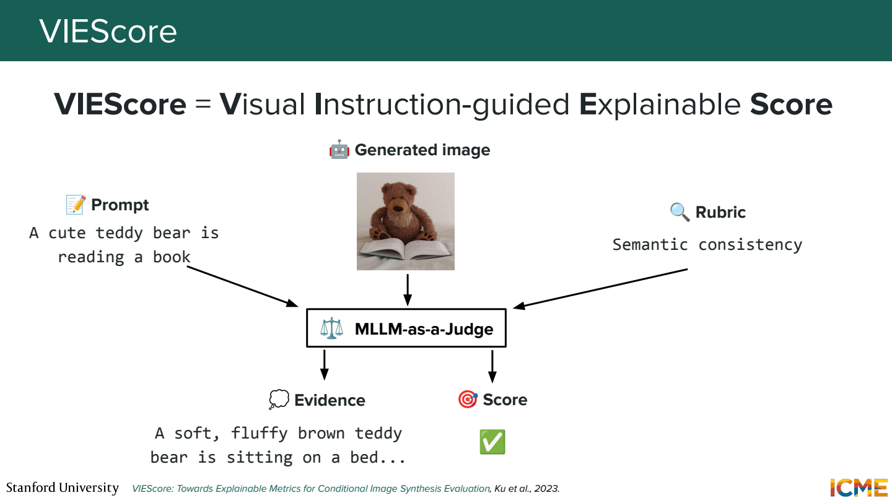
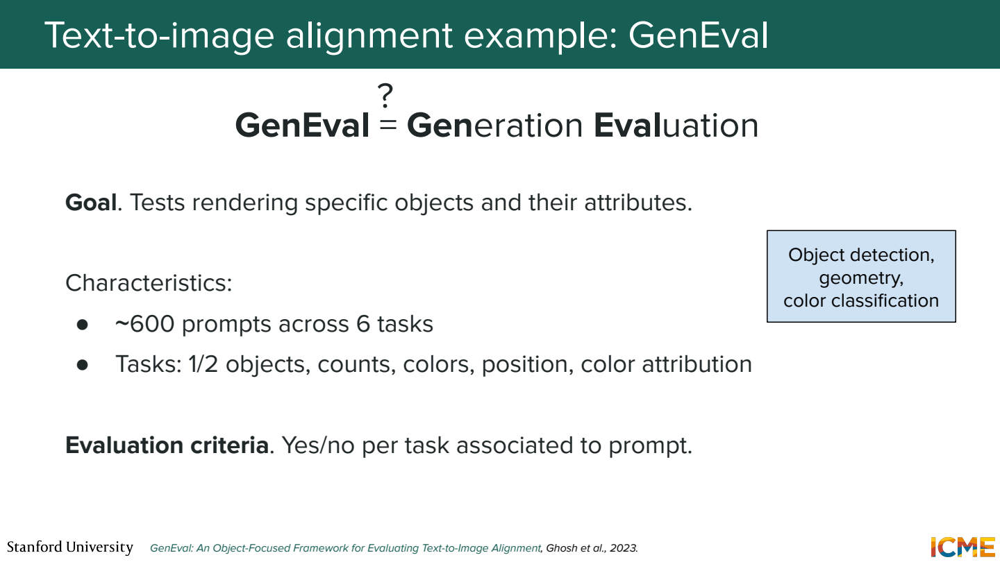

# 7단원 잘 생성된 이미지인지 평가하기

‘보기 좋다’, ‘prompt를 잘 따른다’, ‘원본과 같다’는 서로 다른 기준.
한 지표로 세 가지를 모두 판단하기 어려움.

## 두 이미지 중 무엇을 고를까



같은 prompt로 만든 A와 B를 비교하면 절대 점수를 매기는 것보다 쉬울 수 있음.
동률이 없는 예제에서 100번 중 A가 60번 선택되면 win rate는 60%.
동률이 있다면 분모와 동률 처리 규칙을 함께 정해야 함.



Elo는 상대의 rating을 고려해서 비교 결과를 누적.
같은 10승이어도 강한 상대에게 이긴 것과 약한 상대에게 이긴 것을 다르게 반영.

```text
새 rating = 기존 rating + K × (실제 점수 - 기대 점수)
```

실제 점수는 보통 승리 1, 무승부 0.5, 패배 0.
비교 상대와 prompt 구성에 영향을 받으므로 절대적인 이미지 품질 단위는 아님.

## FID는 이미지 묶음의 분포를 비교



실제 이미지들과 생성 이미지들을 feature 공간으로 변환.
각 묶음의 평균과 공분산을 구해 두 Gaussian 근사 분포의 거리를 계산.
낮을수록 두 묶음이 그 feature 통계에서 비슷하다는 뜻.

직관을 위한 1차원 예제.
실제 feature 평균 0, 생성 feature 평균 2이고 분산이 둘 다 1이면,

```text
평균 차이 항 = (0-2)² = 4
공분산 차이 항 = 0
FID = 4
```

실제 FID는 고차원 feature로 계산하므로 이 예제의 숫자를 실제 점수 수준과 비교하면 안 됨.

이미지 한 장의 FID가 좋다고 말할 수 있나?

FID는 이미지 묶음의 통계를 비교하는 지표.
개별 이미지의 prompt 준수 점수로 쓰는 것은 맞지 않음.
표본 수, 전처리, feature extractor 조건도 맞춰야 비교 가능.

## CLIPScore는 이미지와 문장의 정렬



이미지 embedding과 텍스트 embedding의 유사도를 활용.
정답 이미지 없이도 prompt와 생성 이미지의 관련성을 평가할 수 있음.

`빨간 컵 왼쪽에 파란 접시`에서 두 물체와 색이 모두 보이면 높은 관련성이 나올 수 있음.
그렇다고 왼쪽·오른쪽 관계까지 정확하다는 보장은 없음.
텍스트 전체와 비슷한지와 세부 조건을 모두 만족하는지는 구분.

## 정답 이미지가 있으면 pixel 비교



복원·압축처럼 비교 대상 이미지가 정해진 작업에서는 MSE나 PSNR 사용.

```text
PSNR = 10 log₁₀(MAX² / MSE)
```

Pixel 범위가 0~1이면 MAX=1.

```text
MSE=0.01  → PSNR=20 dB
MSE=0.001 → PSNR=30 dB
```

MSE가 작을수록 PSNR은 높아짐.
이미지가 한 pixel 옆으로 밀리면 내용이 거의 같아도 오차가 커질 수 있음.
자유로운 이미지 생성에서 임의의 정답 사진 한 장과 PSNR을 비교하는 건 목적에 안 맞을 수 있음.

## 구조와 지각적 차이



SSIM은 작은 영역의 밝기·대비·구조 통계를 비교.
LPIPS는 학습된 신경망의 feature 차이를 활용하는 지각적 거리.
둘 다 보통 비교할 reference 이미지가 필요.

Pixel 오차보다 사람이 느끼는 차이에 가까운 정보를 얻으려는 접근.
그래도 물체가 약간 이동하거나 작업의 평가 기준이 달라지면 해석에 주의가 필요.

## Prompt를 작은 질문들로 쪼개기



예시 prompt: `빨간 모자를 쓴 곰 인형이 책을 읽고 있다`.

```text
곰 인형이 있나?
모자가 있나?
모자가 빨간색인가?
책을 읽고 있나?
```

TIFA는 이런 질문에 대한 시각적 답변을 이용해 조건 충족을 평가.
4개 중 3개가 맞았다는 가상의 결과라면, 어느 조건에서 실패했는지도 알 수 있음.
질문을 만드는 모델과 답하는 모델이 틀릴 가능성은 별도로 남음.



VIEScore처럼 multimodal 모델에 prompt·이미지·rubric을 전달하는 방식도 있음.
점수뿐 아니라 근거를 받을 수 있지만 그 근거가 실제 이미지와 맞는지 확인 필요.
Judge의 취향이나 물체 인식 오류가 점수에 섞일 수 있음.

## 한 점수보다 조건별 실패 보기



GenEval은 물체의 존재, 개수, 색, 위치, 색의 귀속 등을 나눠 평가.
`파란 컵 두 개와 빨간 접시 한 개`에서는,

- 컵과 접시가 있는지
- 각각의 개수가 맞는지
- 파란색이 컵에, 빨간색이 접시에 붙었는지

다른 능력이 필요.
물체 하나는 잘 그리지만 관계에서 실패하는 모델을 평균 점수만으로는 놓칠 수 있음.

## 참고자료

- [Stanford CME 296](https://cme296.stanford.edu/)
