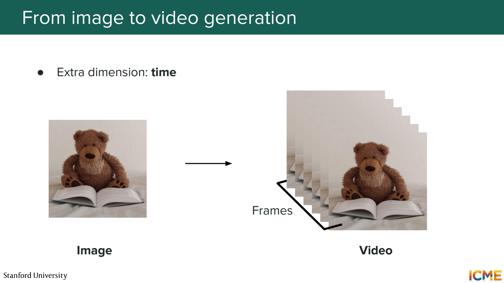
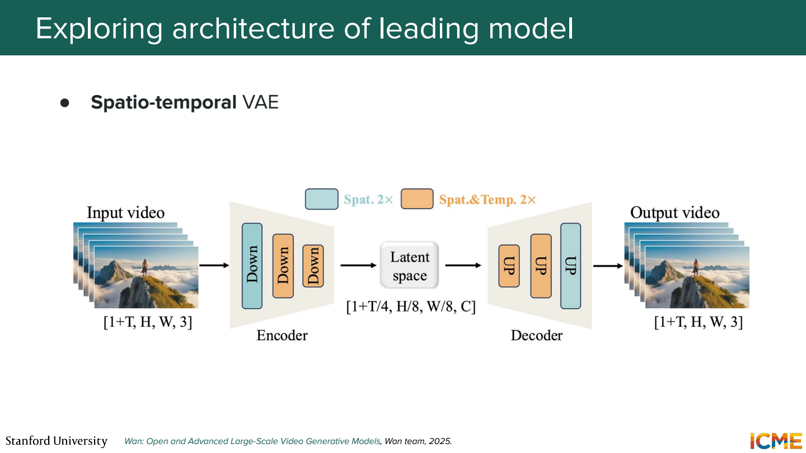
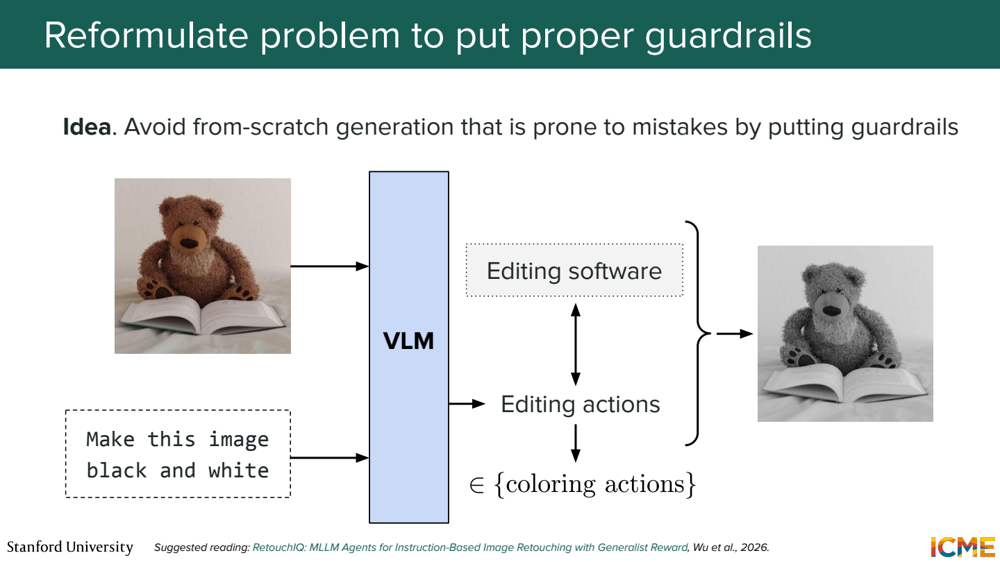
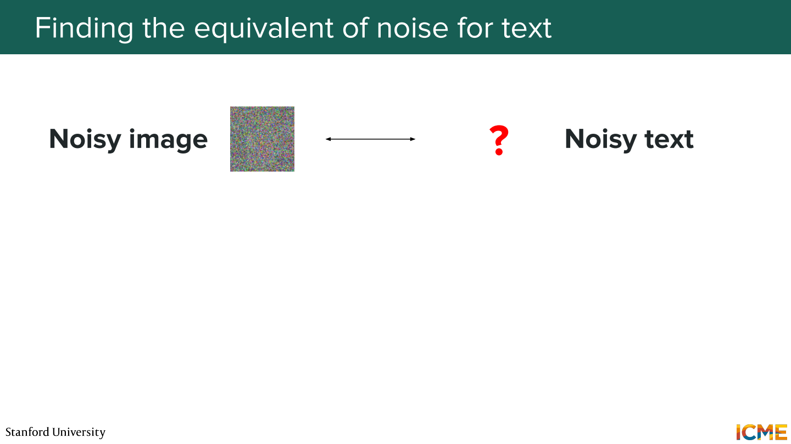
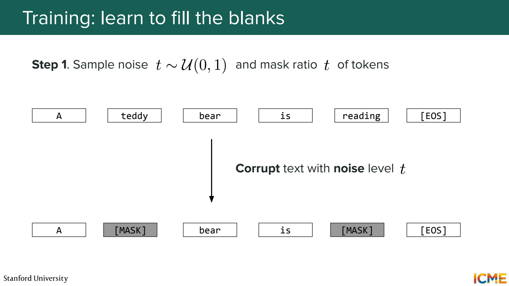
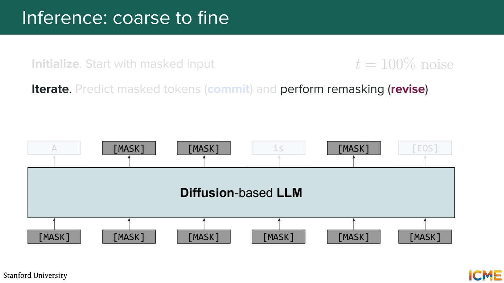
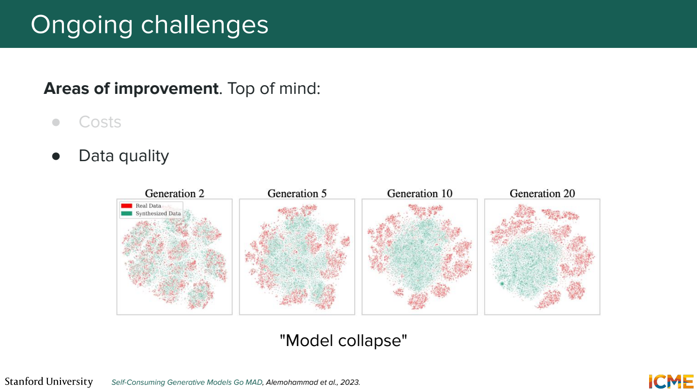

# 8단원 영상·편집·텍스트로 넓혀보기

이미지 한 장을 생성하는 방법을 배웠다면, 시간이나 기존 입력을 추가했을 때 무엇이 달라지는지 보기.
노이즈에서 복원한다는 아이디어도 데이터 종류에 맞게 바꿔야 함.

## 영상에는 시간 축이 추가



이미지는 H×W×C, 영상은 여기에 frame 축 T가 추가됨.
Frame마다 따로 좋은 이미지를 만들기만 하면 영상이 자연스러워지는 것은 아님.

```text
1 frame: 빨간 컵이 책상 위에 있음
2 frame: 컵이 파란색으로 바뀜
3 frame: 컵 손잡이가 반대편으로 이동
```

각 장면은 그럴듯해도 연속으로 보면 어색함.
물체의 정체성, 위치, 움직임을 시간에 걸쳐 유지해야 함.

## 공간과 시간을 함께 압축



영상용 VAE는 가로·세로뿐 아니라 시간 방향도 압축할 수 있음.
압축된 video latent를 시간·공간 patch로 나눠 Transformer에서 처리.

단순한 크기 예제로 frame별 latent가 16×16이고 2×2 patch를 쓴다고 가정.
시간 압축 없이 frame 8개를 처리하면,

```text
frame 하나당 8×8 = 64 tokens
8 frames → 512 tokens
```

Dense attention의 score 배열 크기는 token 수의 제곱에 비례.
나머지 조건이 같을 때 frame 수를 두 배로 늘리면 그 배열은 네 배가 됨.
시간 압축이나 attention 구성이 중요한 이유.

영상도 다음 frame만 순서대로 예측하나?

반드시 그런 것은 아님.
전체 clip의 noisy latent를 함께 갱신하는 방식도 있고, 시간 방향 제약이나 생성 구간을 나누는 방식도 있음.
구조마다 어떤 frame을 참조할 수 있는지 확인해야 함.

## 편집은 바꿀 부분과 보존할 부분이 있음

기존 사진에 `컵 색만 빨간색으로`라고 요청했다면 컵의 형태나 배경까지 바꾸면 곤란.
Text-to-image와 달리 원본을 얼마나 유지하는지도 목표에 포함.
입력 이미지, mask, 편집 지시 등을 조건으로 줄 수 있음.



모든 편집을 새 이미지 생성으로 처리할 필요는 없음.
`흑백으로 바꿔줘`는 VLM이 요청을 이해하고 편집 프로그램의 색상 변환 기능을 호출하는 방식도 가능.

```text
이미지 + 편집 지시 → 수행할 편집 동작 → 편집 프로그램 → 결과
```

어떤 변화가 필요한지 판단하는 부분과, 정확한 변환을 실행하는 부분을 나눌 수 있음.
선택한 기능으로 가능한 편집인지도 함께 확인.

## 텍스트에 Gaussian noise를 더하면



이미지 값에는 연속적인 작은 변화를 줄 수 있지만 token ID는 범주를 가리키는 번호.
ID 100이 ‘고양이’라고 해서 100.3이 조금 흐릿한 고양이를 뜻하지 않음.

그래서 discrete diffusion에서는 token을 가리거나 다른 token으로 바꾸는 corruption 등을 사용.
여기서는 mask 방식으로 보기.

## 일부를 가리고 복원하는 학습



설명을 위해 어절을 한 칸씩 놓은 예제. 실제 token 경계는 tokenizer에 따라 다름.

```text
원본: 오늘 날씨가 정말 좋다
입력: 오늘 [MASK] 정말 [MASK]
target: 날씨가, 좋다
```

Noise level에 따라 얼마나 많이 가릴지 정함.
앞 문맥뿐 아니라 보이는 뒤 문맥도 활용해서 빈칸을 예측할 수 있음.
학습 loss의 위치와 가중치는 구체적인 모델의 목적함수에 따라 달라짐.

## 여러 위치를 채우고 다시 수정



```text
[MASK] [MASK] [MASK] [MASK]
오늘 [MASK] 정말 [MASK]
오늘 날씨가 정말 좋다
```

확신이 높은 위치를 먼저 확정하거나, 일부를 다시 가리고 수정할 수 있음.
모든 모델이 같은 commit·remask 규칙을 쓰는 것은 아님.
위 예제는 네 칸을 고정했지만 길이 결정과 종료 처리도 별도의 설계 요소.

한 번에 여러 위치를 예측하면 무조건 autoregressive보다 빠를까?

모델을 몇 번 호출하는지, 매번 몇 개 token을 처리하는지에 따라 다름.
반복 횟수, 길이, 하드웨어와 구현 조건을 맞춰서 비교해야 함.
병렬로 채울 수 있다는 성질과 실제 응답 속도를 나눠서 보기.

## 생성 데이터를 다시 학습할 때



생성 결과를 무분별하게 다음 학습 데이터로 반복 사용하면 오류나 편향이 누적될 수 있음.
드문 패턴이 사라지고 일부 결과만 반복되는 문제도 가능.

그럼 synthetic data는 쓰면 안 되나?

데이터 선별, 검증, 실제 데이터와의 혼합 방식 등에 따라 유용할 수 있음.
중요한 것은 ‘모델이 만들었다’는 이유만으로 품질이 보장되지 않는다는 점.
생성 비용을 줄이는 작업과 학습 데이터의 품질을 유지하는 작업을 같이 봐야 함.

## 참고자료

- [Stanford CME 296](https://cme296.stanford.edu/)
